# 1967 Ford Mustang Fastback (`e-Mustang`) — 1:20 Printable & RC-Ready Model

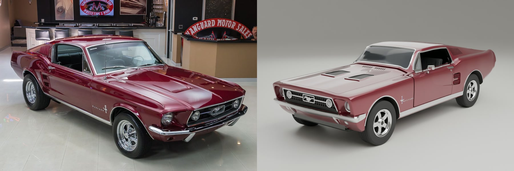

> **100% Code-Generated in Blender Python · 5-Colour Multi-Plate 3D Print · Hidden N25 V8 Drivetrain & Ackermann Steering · Zero-Overlap Verified (`0.0 mm³`)**

Meet **`e-Mustang`** — a **1:20 scale (`226 × 91 × 66 mm`)** 1967 Ford Mustang Fastback engineered entirely from Python code in [`mustang/`](mustang/). Zero polygons were sculpted by hand. Every curve of the fastback roof, V-prow nose, deep-recessed `7"` sealed-beam headlights, 11-slot C-pillar louvers, crowned 5-spoke American Racing Torq-Thrust wheels, opening hood, doors, and trunk lid is generated mathematically and camera-matched against 83 dealer photos and 2 walkaround videos of Vanguard Motor Sales `Stock #2229`.

Beneath the classic burgundy skin sits a hidden **Architecture #1 RC Dynamic Control System**: the blue 289 V8 engine block doubles as a removable scale shroud over a **`21 × 11 mm` flat-can DC / `N25` motor**, driving a **modular `7T:9T` flat-printed bevel-geared live rear axle** (`MotorCoupler` → toothless horizontal `Driveshaft` → `7T` `PinionGear` → `9T` `AxleGear` on `Axle_R`), while a **`1.7g` micro servo** behind the radiator drives **`±15°` front kingpin steering** and a partitioned under-floor conduit routes wiring invisibly to the trunk electronics bay.

---

## 🎬 Watch It Assemble, Steer & Drive

[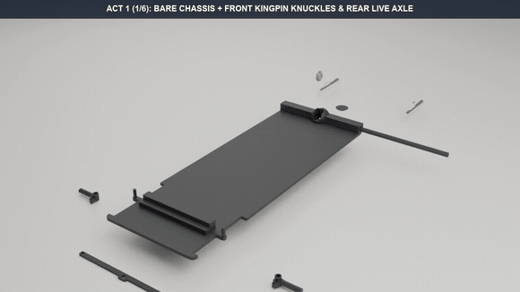](docs/images/rc_simulation.mp4)

*▶️ **Click the animation above** to open the full HD [**4-Act 3D Assembly & Dynamic RC Simulation (`rc_simulation.mp4`, 192 frames @ 24 fps)**](docs/images/rc_simulation.mp4), or watch the [**360° Inside-Out Studio Showcase (`showcase_360.mp4`, 144 frames @ 24 fps)**](docs/images/showcase_360.mp4).*

| Act 1 (`f001–f060`) | Act 2 (`f061–f108`) | Act 3 (`f109–f144`) | Act 4 (`f145–f192`) |
| :--- | :--- | :--- | :--- |
| **6-Wave Fly-In Assembly**: All 67 printed car parts + 6 colour-coded RC modules drop into place. | **360° Orbit & Hinges**: Full turntable sweep as `Hood` (`+42°`), `Doors` (`+55°`), and `TrunkLid` (`-40°`) open & close. | **Steering Sweep**: `1.7g` servo shifts `SteeringLink` (`±0.83 mm`) to pivot `Knuckle_L/R` (`+15°` Left / `-15°` Right). | **Dynamic Drive**: Forward S-turn acceleration (`156.7 mm`) with live bevel-axle spin, then reverse back-up (`89.1 mm`). |

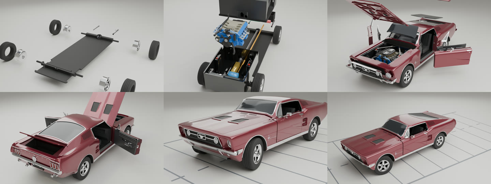

---

## ✨ Why You'll Love Building It

| Engineering Highlight | How It Works |
| :--- | :--- |
| **100% Procedural CAD-Grade Mesh** | Lofted from real-car station tables (`SCALE = 1/20`), ray-cast trim strips, and live `MANIFOLD` booleans. Exports to **53 print-ready STLs (`73` pieces)**, a **9-plate Bambu `.3mf`**, and **67 named STEP solids** (`mustang_67_fastback.step`) for Shapr3D. |
| **Hidden 289 V8 Motor Shroud & `21 × 11 mm` Multi-Height Cradle** | The blue 289 V8 block (`engine_block.stl`) features an enlarged underside cavity (`Engine_N25Cavity`), 6 structural mounts (with `45°`-bevelled `Engine_BellhousingMount` giving `0.45 mm` straight-vertical `-Z` clearance past `BayTub_Booster`), and continuous flat rails (`324.45 mm²` bed contact) dropping straight down over `BayTub_N25Bed` (`21.25 × 11.25 mm` internal slip fit aligned to `Z = 19.75 mm`, with `2 × 0.48 mm` bed-flat Z-shims covering `10 mm`, `9 mm`, and `8 mm` flat motor heights). |
| **Modular Multi-Fit Coupler & `7T:9T` Flat-Printed Bevel Live Axle** | Upright multi-fit `MotorCoupler` (`Ø 1.0 mm` & `Ø 1.5 mm` 3-lobe crush bores, silicone-sleeve collet, and `Ø 3.0 mm` N25 D-bore + transverse `M2`/glue lock hole) $\rightarrow$ toothless horizontal `Driveshaft` (`97.15 mm` bed-flat octagon) $\rightarrow$ flat-printed `7T` `PinionGear` (`0.54 mm` heel crest) $\rightarrow$ `90°` mesh with flat-printed `9T` `AxleGear` (`1.29 : 1` reduction, `0.099 mm³` locked-crown interlock) keyed onto the heavy-duty **`3.24 mm` octagonal `Axle_R`** (`+90.1%` stiffness, `0.088 mm` close-running bearing clearance). |
| **Front Ackermann Kingpin Steering & `12`-Spline Bead-Lock Wheels** | Reinforced `Knuckle_L/R` (`+44.1%` volume, `Ø 3.60 mm` kingpin barrel, inboard wheel stop collar) pivot `±15°` on `Ø 1.90 mm` kingpins (`Chassis_Kingpin_L/R`), linked by `SteeringLink` to a front `1.7g` micro servo. `Rim_*` hubs lock onto the axles with a **`2.621 mm³` (`29.1×`) 8-corner press-fit** and internal `45°` axial stop shoulder, while `Tire_*` interlocks with `Rim_*` via a **mid-barrel bead-lock crown + 12 longitudinal anti-slip splines (`17.51 mm³` torque lock)**. |
| **Open-Bottom Driveshaft U-Channel & Partitioned Conduit (`Approach A`)** | Open-bottom `45°` gable-roofed U-channels (`BayTub_ShaftTunnel`, `Cut_DiffShaftWeb`, `Tub_ShaftTunnel`) allow drop-in bottom-up driveshaft and chassis mating while a solid `1.05 mm` partition wall isolates a dedicated enclosed driver-side 5-wire harness conduit (`4.00 × 5.05 mm` print cross-section) running from `BayTub` to `BootTub`. |
| **Snap-Lock Doors & Calibrated `1:20` Filament Hinges** | `Door_L/R` (`Ø 2.00 mm` running bore) swing `+55°` on `1.75 mm` PLA filament pins pressed/glued into `Ø 1.84 mm` `Body` sill bores; `DoorCard_L/R` lock into contoured `45°` mortise bays and upper mirror-tongue keyways (`149.7 mm³` engagement, `990.8 mm²` flat bed contact, `0` cantilevers) while capturing `DoorVent_L/R` inside a sill U-channel. `Hood` (`+42°`) and `TrunkLid` (`-40°`) pivot on printed hinge pegs. |
| **Authentic 1967 Twin-Cowl Cabin & Waterfall Console** | Continuous 33-station lofted twin-cowl dash visor (`Tub_DashBrow`), 5-pod deep-set instrument cluster (`Tub_Gauge0..4`), full-length brushed-aluminum waterfall radio/tambour console (`Tub_Console`), forward-swept chrome T-handle shifter (`Tub_ShifterKnob`), and 3-spoke perforated brushed-chrome steering wheel (`SteeringWheel`). |

| RC System Cutaway (`BayTub` $\rightarrow$ Conduit $\rightarrow$ `BootTub`) | Rear Bevel Gear Mesh (`PinionGear` $\rightarrow$ `AxleGear`) |
| :---: | :---: |
| 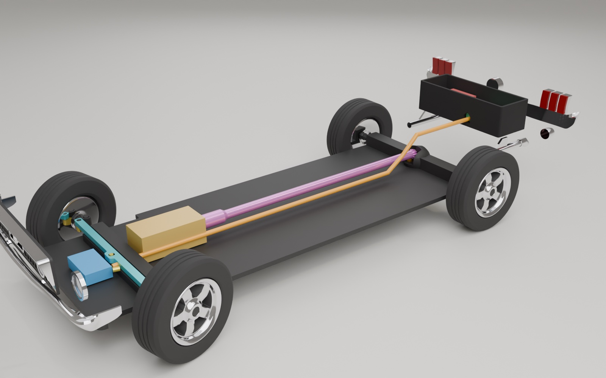 | 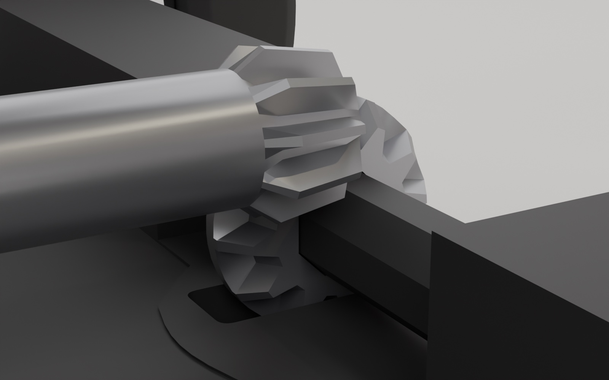 |

---

## 📸 Real Car vs. Procedural Model

Every camera (`Cam_P*`) in the studio scene is calibrated to Vanguard Motor Sales `Stock #2229` reference photography (real car on the left, procedural Blender render on the right):

| Front 3/4 — Passenger Side (`Cam_P1/P21`) | Hood Open — 289 V8 Engine Bay (`Cam_P11`) |
| :---: | :---: |
| 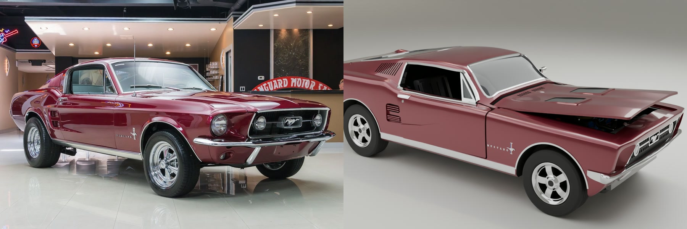 | 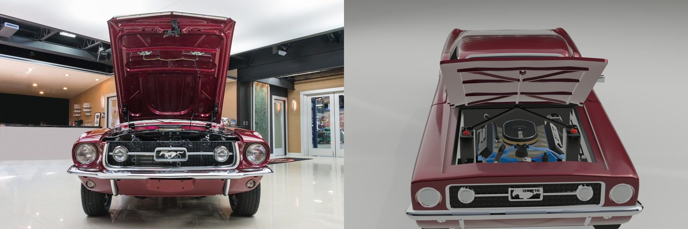 |
| **Top-Down 289 V8 & Cobra Air Cleaner (`Cam_P13`)** | **Passenger Door Open & Cabin Interior (`Cam_P8`)** |
| 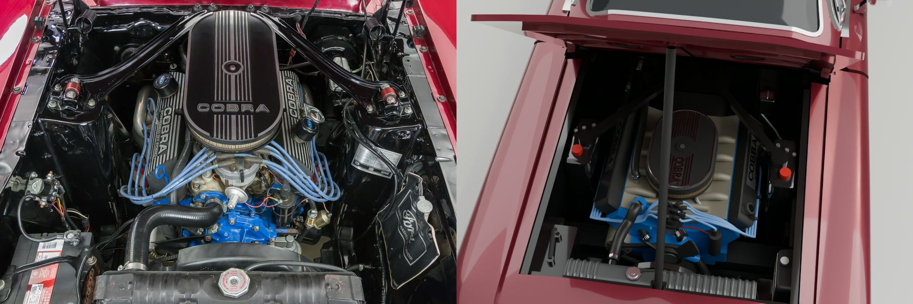 | 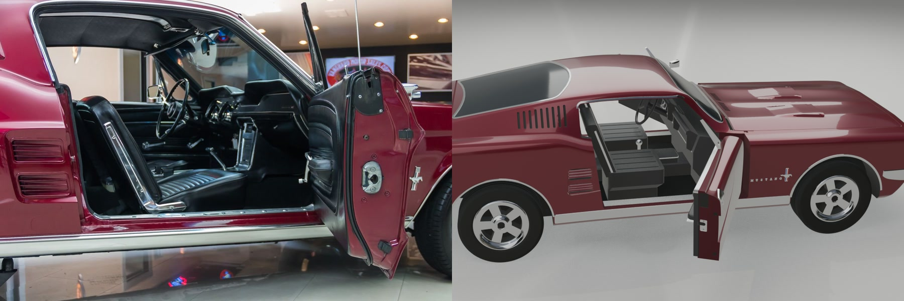 |
| **1967 Twin-Cowl Dash, Waterfall Console & T-Shifter (`Photo 7` vs. Model)** | **Cabin Interior Cutaway Close-Up (`InteriorTub` + `SteeringWheel`)** |
| 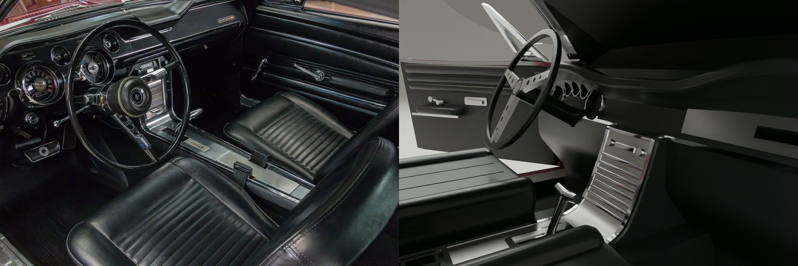 | 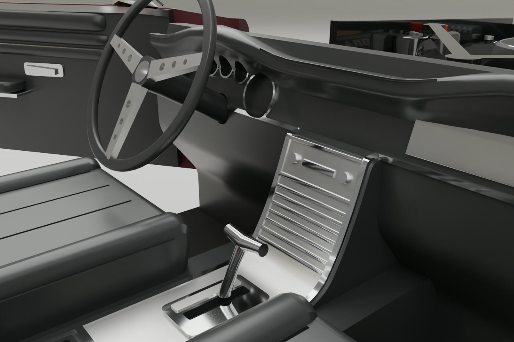 |

---

## 🖨️ Print & Operate in 4 Easy Steps

### 5-Colour Filament Breakdown (`53 STLs` $\rightarrow$ `73 Printed Pieces`)

`mustang/make_project.sh` packs all 73 pieces across **9 auto-arranged plate groups** (`3_silver` + isolated `3_silver_small` with automatic `outer_only` brims and gentle `20–25 mm/s` small-part wall speeds) for a **Bambu Lab X2D** (`0.4 mm` nozzle, `0.12mm High Quality`, Arachne walls, tree supports on `body`, `hood`, `trunk_lid`, `engine_block`, `bumper_rear`):

| Colour | Hex | Pieces | Key Parts |
| :--- | :--- | :---: | :--- |
| 🍷 **Burgundy** | `#6B0F1A` | `5` | `Body`, `Hood`, `TrunkLid`, `Door_L`, `Door_R` |
| ⚫ **Black** | `#1A1A1A` | `26` | `Chassis`, `InteriorTub`, `BayTub`, `BootTub`, `Tire` (`×4`), `Knuckle_L/R`, `SteeringLink`, `Axle_R`, `DoorCard_L/R`, `ValveCover_L/R`, `AirCleaner`, `Grille`, `Brace`, `HoodProp`, `DiffCover`, `SteeringWheel`, `MotorShim_0p5` (`×2`), `Windshield` & `RearGlass` inlays |
| 🥈 **Silver** | `#C8C8CC` | `35` | `Rim` (`×4`), `Driveshaft`, `PinionGear` (`7T`), `AxleGear` (`9T`), `MotorCoupler` (`×4` multi-fit kit: `1.0 mm`, `1.5 mm`, `tube`, `N25`), `Bumper_F/R`, `GrilleSurround`, `Corral`, `DoorVent_L/R`, `Headlight` (`×2`), `Fog` (`×2`), `ParkLight` (`×2`), `TaillightBezel` (`×6`), `BackupLight` (`×2`), `Exhaust_L/R`, `GasCap`, `Mirror_L` |
| 🔴 **Red** | `#B01010` | `6` | `TaillightLens` (`×6`) |
| 🔵 **Blue** | `#2B59C3` | `1` | Hollowed 289 V8 `EngineBlock` (`N25` / flat-can motor shroud) |

### 4-Step Assembly & RC Hookup

1. **Cabin & Engine Bay Liners into `Body` (`+Z`):** Plug `SteeringWheel` into `InteriorTub` and push `InteriorTub` and `BayTub` straight up from underneath into `Body`.
2. **Servo, Multi-Fit Motor Coupler, Open-Bottom `Driveshaft` & Wiring:** Seat a `1.7g` micro servo into `BayTub_ServoBed` from above and thread the 5-wire harness through the enclosed driver-side floor conduit (`Y = -156..-76`) to the trunk cavity. Pick the matching `MotorCoupler` from Plate 6 (`1` V-flute = `Ø 1.0 mm` pin, `2` flutes = `Ø 1.5 mm` pin, `3` flutes = silicone sleeve collet, `0` flutes = `Ø 3.0 mm` N25 D-shaft; optional `M2` screw or CA glue drop in the side lock port), press onto your `21 × 11 mm` motor shaft, seat the motor into `BayTub_N25Bed` over `0`, `1`, or `2` `MotorShim_0p5` (`0.48 mm`) shims (`10 / 9 / 8 mm` motor heights), and lift `Driveshaft` + `PinionGear` (`7T`) straight up from underneath into the open-bottom U-channel, sliding its front spline tenon into `MotorCoupler`.
   - **Proportional Hobby RC (Option A):** Connect the 5-wire floor bundle in `BootTub` to a micro 2.4GHz receiver + `5A` brushed ESC (left bay) and `1S/2S` LiPo battery (right bay).
   - **Simple Pocket Keyfob Drive (Option B):** Hook the motor + `1S 3.7V` LiPo directly to a **433MHz RF Mini H-Bridge Receiver** in `BootTub` for instant 2-button Forward/Reverse pocket-remote driving (zero programming required).
3. **Rolling `Chassis` Straight `+Z` Mating:** Drop `Knuckle_L/R` + `SteeringLink` onto `Chassis_Kingpin_L/R`, slide `Axle_R` through `Chassis_BossR` and `AxleGear` (`9T`), snap `DiffCover` underneath, press the 4 `Rim_*` + `Tire_*` wheels onto the hubs, and push the complete rolling `Chassis` straight up (`+Z`) onto `Body` (`PinionGear` `7T` meshes directly with `AxleGear` `9T`, and `SteeringLink` clears `BayTub_TieRodClear` onto the servo horn pin).
4. **289 V8 Shroud, `BootTub`, Doors (`Ø 1.84 / 2.00 mm` Filament Pins), Hood & Trunk:** Lower the blue `EngineBlock` (+ `ValveCover_L/R` + `AirCleaner`) straight down (`-Z`, `0°` pitch) over the motor onto `BayTub_EngineGuideL/R`, drop `BootTub` into the trunk cavity, install exterior chrome/lamps/bumpers, lock `DoorVent_L/R` + `DoorCard_L/R` into `Door_L/R`, hinge the doors on `1.75 mm` PLA filament pins (`Ø 1.84 mm` sill press/glue bore, `Ø 2.00 mm` door running bore), and drop `Hood`, `TrunkLid`, and `Brace` into place.

👉 **Full Bill of Materials, plate-by-plate STL table, and ASCII wiring diagrams:** [**`docs/printing-and-rc-guide.md`**](docs/printing-and-rc-guide.md)

---

## 🚀 Quick Build & CAD Commands

Prerequisites: **Blender 5.1+** (Apple Metal GPU supported), **Bambu Studio**, **ffmpeg**, **python3**, and **[uv](https://docs.astral.sh/uv/)**.

```bash
# 1. Rebuild all 67 car parts at 1:20 scale, run zero-overlap print checks, and export 53 STLs + assembled STLs
/Applications/Blender.app/Contents/MacOS/Blender -b --factory-startup --python-expr "
import sys; sys.path.insert(0, 'mustang')
import build, printcheck, export
build.main()
assert printcheck.run()['parts'] == 67
export.run()
export.run_assembled()
"

# 2. Generate the 9-group multi-plate Bambu Studio project (.3mf)
mustang/make_project.sh output/mustang_67_fastback_1-24.3mf

# 3. Export 67 named, colour-coded STEP solids + whole-car assembly for Shapr3D / CAD
uv run mustang/make_step.py
```

---

## 📚 Deep-Dive Documentation (`docs/`)

To keep this README fast and approachable, detailed engineering reports, wiring schematics, and camera calibration tables live in [`docs/`](docs/):

| Guide | What You'll Find Inside |
| :--- | :--- |
| 🧠 [**Design Thinking & Build Verification**](docs/design-thinking-and-verification.md) | How the 1:20 scale upgrade (`K = 1.2`), `Approach A` partitioned wire conduit, contoured `45°` zero-cantilever door interlocks, modular multi-fit `7T:9T` flat-printed bevel drivetrain, and 4-Act kinematics were engineered and proven (`0.0 mm³` overlap across all 67 parts and `0` Bambu Studio warnings across all 9 plates). |
| 🛠️ [**Printing, Assembly & RC Wiring Guide**](docs/printing-and-rc-guide.md) | Complete 53-STL / 73-piece manifest across 9 plates, multi-fit motor coupler & Z-shim guide, Bambu X2D outer-only brim & speed settings, **Option A (2.4GHz Hobby RC)** & **Option B (433MHz RF Keyfob)** wiring diagrams, and how to import named STEP solids into **Shapr3D**. |
| 🎥 [**Vanguard Stock #2229 Reference Media Index**](docs/reference-media.md) | Complete index of all 83 dealer reference photos, 2 walkaround videos in [`origin_images/`](origin_images/), and `Cam_P*` camera-matching calibration. |
| 📜 [**Changelog (`v1.0.0` $\rightarrow$ `v2.9.1`)**](CHANGELOG.md) | Chronological release history from the initial 1:24 static model to the 1:20 RC dynamic control system, authentic 1967 twin-cowl cabin, heavy-duty `3.24 mm` axle / `12`-spline wheel assembly, 9-plate small-part reliability overhaul, `v2.9.0` multi-fit coupler + flat-printed `7T:9T` bevel gear upgrade, and `v2.9.1` open-bottom U-channel + straight-line `3D` physical assembly clearance upgrade. |
| 🤖 [**Architecture & Developer Rules (`AGENTS.md`)**](AGENTS.md) | Coordinate conventions (`+X` rear, `+Y` right), boolean modifier pipeline, `export.HINGED` axes, verification gates, and lockstep documentation rules. |

---

## 🗂️ Repository Layout

| Path | Contents |
| :--- | :--- |
| [`mustang/`](mustang/) | Procedural Blender Python modules (`build`, `body`, `features`, `details`, `bumpers`, `doors`, `engine_bay`, `interior`, `wheels`, `materials`, `printcheck`, `export`, `studio`, `animate`), Bambu CLI scripts (`make_project.sh`, `merge_3mf.py`), STEP exporter (`make_step.py`), `readme_images.sh` |
| [`docs/`](docs/) | Deep-dive engineering guides (`design-thinking-and-verification.md`, `printing-and-rc-guide.md`, `reference-media.md`) and tracked showcase media (`docs/images/`) |
| [`origin_images/`](origin_images/) | 83 reference photos, 2 walkaround videos, and `vanguard_2229_manifest.json` (`Stock #2229`) |
| `output/` | Generated deliverables (git-ignored): `mustang_67_fastback.blend`, `mustang_67_fastback_1-24.3mf`, `mustang_67_fastback.mp4`, `stl/` (`53` STLs), `stl_assembled/`, `step/` (`67` part STEPs), and `mustang_67_fastback.step` |
| `tmp/` | Scratch renders, animation/simulation frame sequences, and JSON verification reports |
