# 1967 Ford Mustang Fastback (`e-Mustang`) — 1:20 Printable & RC-Ready Model

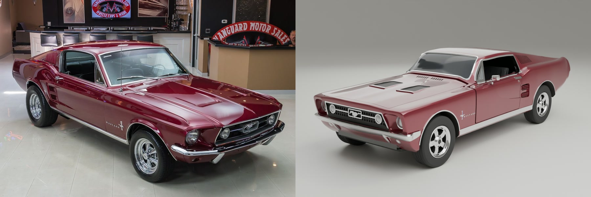

> **100% Code-Generated in Blender Python · 5-Colour Multi-Plate 3D Print · Hidden N25 V8 Drivetrain & Ackermann Steering · Zero-Overlap Verified (`0.0 mm³`)**

Meet **`e-Mustang`** — a **1:20 scale (`226 × 91 × 66 mm`)** 1967 Ford Mustang Fastback engineered entirely from Python code in [`mustang/`](mustang/). Zero polygons were sculpted by hand. Every curve of the fastback roof, V-prow nose, deep-recessed `7"` sealed-beam headlights, 11-slot C-pillar louvers, crowned 5-spoke American Racing Torq-Thrust wheels, opening hood, doors, and trunk lid is generated mathematically and camera-matched against 83 dealer photos and 2 walkaround videos of Vanguard Motor Sales `Stock #2229`.

Beneath the classic burgundy skin sits a hidden **Architecture #1 RC Dynamic Control System**: the blue 289 V8 engine block doubles as a removable scale shroud over an **`N25` brushed gearmotor**, driving a **4-stage `10T:12T` bevel-geared live rear axle**, while a **`1.7g` micro servo** behind the radiator drives **`±15°` front kingpin steering** and a partitioned under-floor conduit routes wiring invisibly to the trunk electronics bay.

---

## 🎬 Watch It Assemble, Steer & Drive

[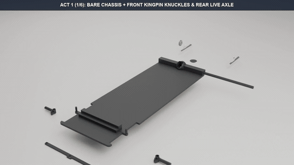](docs/images/rc_simulation.mp4)

*▶️ **Click the animation above** to open the full HD [**4-Act 3D Assembly & Dynamic RC Simulation (`rc_simulation.mp4`, 192 frames @ 24 fps)**](docs/images/rc_simulation.mp4), or watch the [**360° Inside-Out Studio Showcase (`showcase_360.mp4`, 144 frames @ 24 fps)**](docs/images/showcase_360.mp4).*

| Act 1 (`f001–f060`) | Act 2 (`f061–f108`) | Act 3 (`f109–f144`) | Act 4 (`f145–f192`) |
| :--- | :--- | :--- | :--- |
| **6-Wave Fly-In Assembly**: All 65 printed parts + 6 colour-coded RC modules drop into place. | **360° Orbit & Hinges**: Full turntable sweep as `Hood` (`+42°`), `Doors` (`+55°`), and `TrunkLid` (`-40°`) open & close. | **Steering Sweep**: `1.7g` servo shifts `SteeringLink` (`±0.83 mm`) to pivot `Knuckle_L/R` (`+15°` Left / `-15°` Right). | **Dynamic Drive**: Forward S-turn acceleration (`156.7 mm`) with live bevel-axle spin, then reverse back-up (`89.1 mm`). |

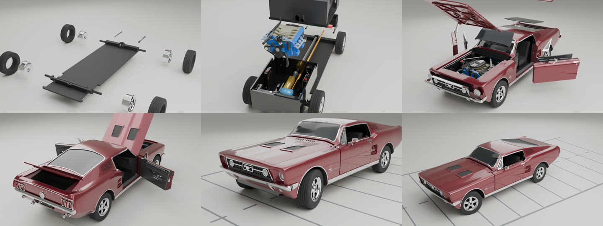

---

## ✨ Why You'll Love Building It

| Engineering Highlight | How It Works |
| :--- | :--- |
| **100% Procedural CAD-Grade Mesh** | Lofted from real-car station tables (`SCALE = 1/20`), ray-cast trim strips, and live `MANIFOLD` booleans. Exports to **47 print-ready STLs**, a **multi-plate Bambu `.3mf`**, and **65 named STEP solids** (`mustang_67_fastback.step`) for Shapr3D. |
| **Hidden 289 V8 Motor Shroud** | The blue 289 V8 block (`engine_block.stl`) features an enlarged underside cavity (`Engine_N25Cavity`), 6 structural mounts, and continuous flat rails (`356.35 mm²` bed contact) that drop directly over an `N25` (`10 × 12 × 31 mm`) gearmotor. |
| **4-Stage Bevel-Geared Rear Live Axle (`3.24 mm` Heavy-Duty)** | `N25` D-shaft $\rightarrow$ `Driveshaft` D-bore coupler $\rightarrow$ `10`-tooth conical bevel pinion $\rightarrow$ `90°` mesh with `12`-tooth `AxleGear` (`1.20 : 1` torque reduction, `+73.8%` spline lock) keyed onto the heavy-duty **`3.24 mm` octagonal `Axle_R`** (`+90.1%` stiffness, `0.088 mm` close-running chassis bearing clearance). |
| **Front Ackermann Kingpin Steering & `12`-Spline Bead-Lock Wheels** | Reinforced `Knuckle_L/R` (`+44.1%` volume, `Ø 3.60 mm` kingpin barrel, inboard wheel stop collar) pivot `±15°` on `Ø 1.90 mm` kingpins (`Chassis_Kingpin_L/R`), linked by `SteeringLink` to a front `1.7g` micro servo. `Rim_*` hubs lock onto the axles with a **`2.621 mm³` (`29.1×`) 8-corner press-fit** and internal `45°` axial stop shoulder, while `Tire_*` interlocks with `Rim_*` via a **mid-barrel bead-lock crown + 12 longitudinal anti-slip splines (`17.51 mm³` torque lock)**. |
| **Partitioned Dual-Tunnel Floor (`Approach A`)** | A solid `1.20 mm` partition wall isolates the central spinning `Driveshaft` tunnel (`Y = -50..+50`) from a dedicated driver-side 5-wire harness conduit (`4.00 × 5.05 mm` print cross-section) running from `BayTub` to `BootTub`. |
| **Snap-Lock Doors & Hinged Panels** | `Door_L/R` swing `+55°` on `1.75 mm` filament pins; `DoorCard_L/R` lock into 6 recessed mortise bays (`166.7 mm³` engagement) while capturing `DoorVent_L/R` inside a sill U-channel. `Hood` (`+42°`) and `TrunkLid` (`-40°`) pivot on printed hinge pegs. |
| **Authentic 1967 Twin-Cowl Cabin & Waterfall Console** | Continuous 33-station lofted twin-cowl dash visor (`Tub_DashBrow`), 5-pod deep-set instrument cluster (`Tub_Gauge0..4`), full-length brushed-aluminum waterfall radio/tambour console (`Tub_Console`), forward-swept chrome T-handle shifter (`Tub_ShifterKnob`), and 3-spoke perforated brushed-chrome steering wheel (`SteeringWheel`). |

| RC System Cutaway (`BayTub` $\rightarrow$ Conduit $\rightarrow$ `BootTub`) | `10T:12T` Rear Bevel Gear Mesh (`Driveshaft` $\rightarrow$ `AxleGear`) |
| :---: | :---: |
| 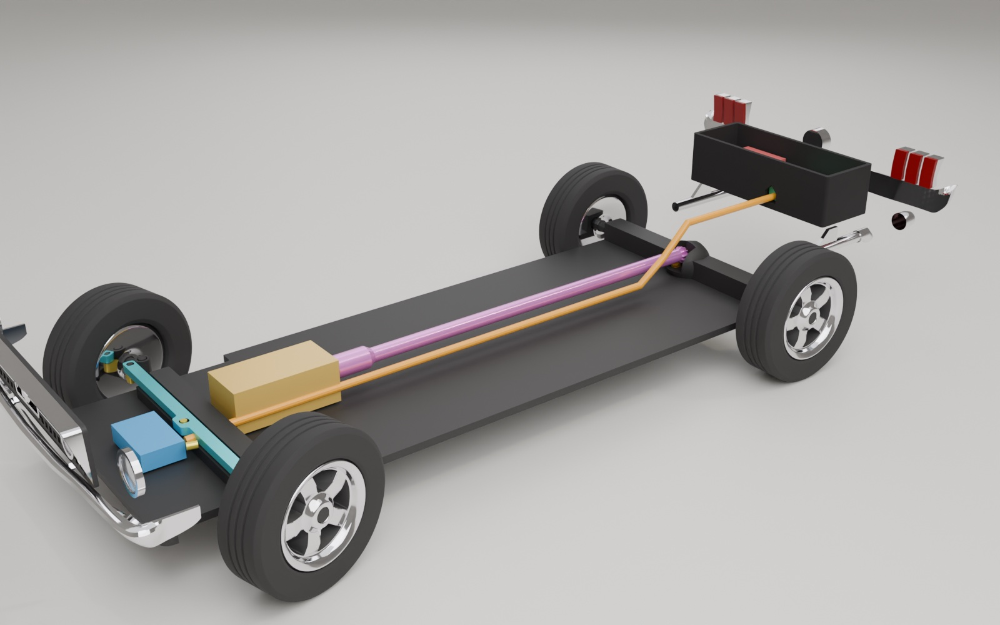 | 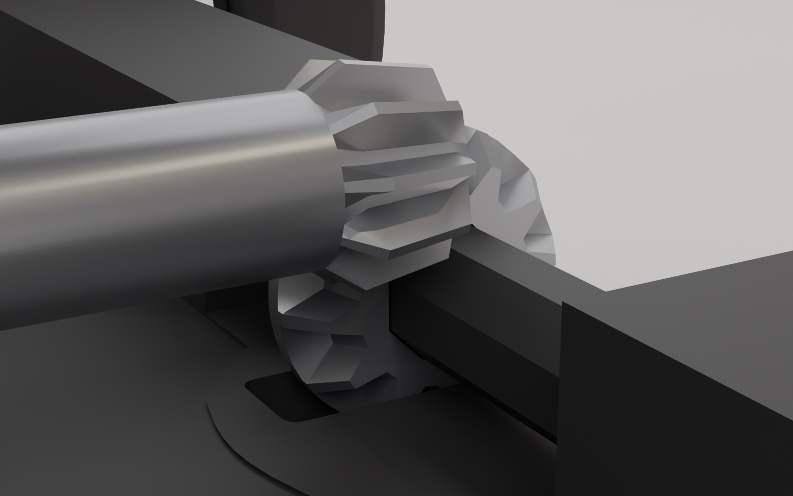 |

---

## 📸 Real Car vs. Procedural Model

Every camera (`Cam_P*`) in the studio scene is calibrated to Vanguard Motor Sales `Stock #2229` reference photography (real car on the left, procedural Blender render on the right):

| Front 3/4 — Passenger Side (`Cam_P1/P21`) | Hood Open — 289 V8 Engine Bay (`Cam_P11`) |
| :---: | :---: |
| 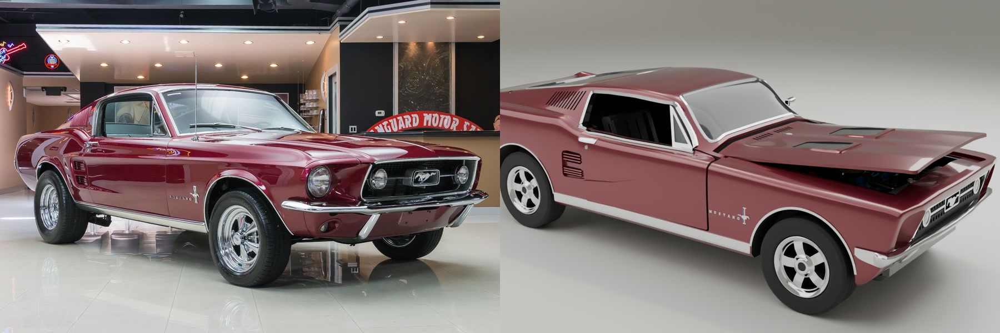 | 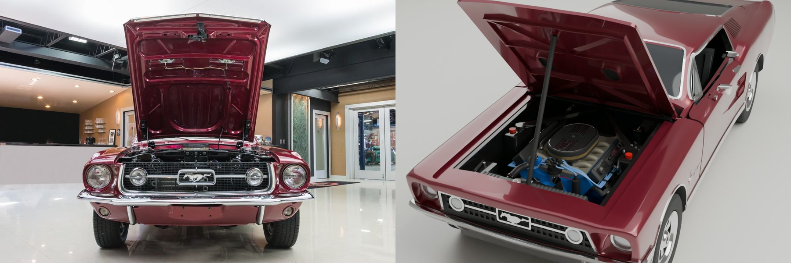 |
| **Top-Down 289 V8 & Cobra Air Cleaner (`Cam_P13`)** | **Passenger Door Open & Cabin Interior (`Cam_P8`)** |
| 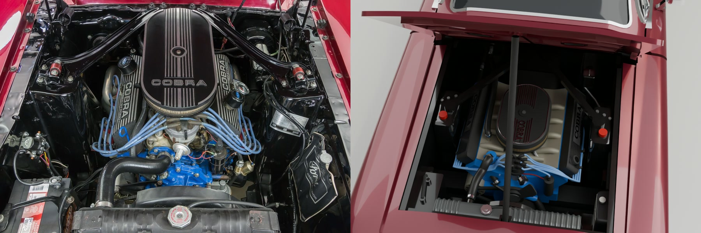 | 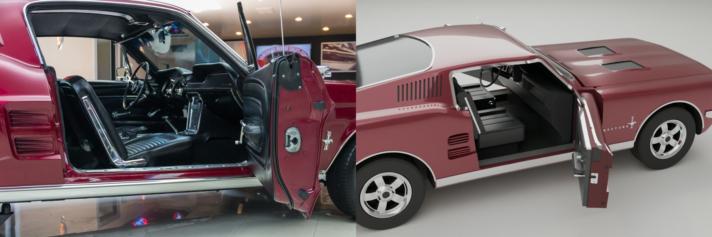 |
| **1967 Twin-Cowl Dash, Waterfall Console & T-Shifter (`Photo 7` vs. Model)** | **Cabin Interior Cutaway Close-Up (`InteriorTub` + `SteeringWheel`)** |
| 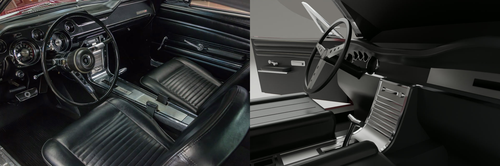 | 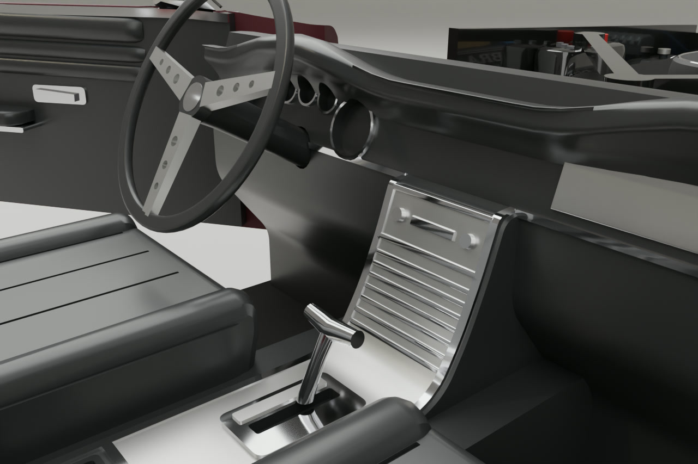 |

---

## 🖨️ Print & Operate in 4 Easy Steps

### 5-Colour Filament Breakdown (`47 STLs` $\rightarrow$ `66 Printed Pieces`)

`mustang/make_project.sh` packs all 66 pieces across **8 auto-arranged plate groups** for a **Bambu Lab X2D** (`0.4 mm` nozzle, `0.12mm High Quality`, Arachne walls, tree supports on `body`, `hood`, `trunk_lid`, `engine_block`, `bumper_rear`):

| Colour | Hex | Pieces | Key Parts |
| :--- | :--- | :---: | :--- |
| 🍷 **Burgundy** | `#6B0F1A` | `5` | `Body`, `Hood`, `TrunkLid`, `Door_L`, `Door_R` |
| ⚫ **Black** | `#1A1A1A` | `25` | `Chassis`, `InteriorTub`, `BayTub`, `BootTub`, `Tire` (`×4`), `Knuckle_L/R`, `SteeringLink`, `Axle_R`, `DoorCard_L/R`, `ValveCover_L/R`, `AirCleaner`, `Grille`, `Brace`, `HoodProp`, `DiffCover`, `SteeringWheel`, `Windshield` & `RearGlass` inlays |
| 🥈 **Silver** | `#C8C8CC` | `29` | `Rim` (`×4`), `Driveshaft`, `AxleGear`, `Bumper_F/R`, `GrilleSurround`, `Corral`, `DoorVent_L/R`, `Headlight` (`×2`), `Fog` (`×2`), `ParkLight` (`×2`), `TaillightBezel` (`×6`), `BackupLight` (`×2`), `Exhaust_L/R`, `GasCap`, `Mirror_L` |
| 🔴 **Red** | `#B01010` | `6` | `TaillightLens` (`×6`) |
| 🔵 **Blue** | `#2B59C3` | `1` | Hollowed 289 V8 `EngineBlock` (`N25` motor shroud) |

### 4-Step Assembly & RC Hookup

1. **Chassis, Steering & Rear Live Axle:** Drop `Knuckle_L/R` onto the front kingpins (`Chassis_Kingpin_L/R`) and clip `SteeringLink` across both steering arms. Slide `Axle_R` through the rear axle bosses with `AxleGear` (`12T`) keyed onto the center octagon, snap `DiffCover` underneath, and press the 4 `Rim_*` + `Tire_*` wheels onto the hubs.
2. **Tubs, Drivetrain & Wiring:** Seat `BayTub` (front) and `BootTub` (rear) onto the chassis.
   - **Proportional Hobby RC (Option A):** Drop a `1.7g` micro servo into `BayTub_ServoBed` (horn engages `SteeringLink_ServoSlot`) and an `N25` gearmotor (`6V 300–500 RPM`) into `BayTub_N25Bed` coupled to `Driveshaft`. Thread the 5 wires through the driver-side floor conduit (`Y = -154..-74`) into `BootTub` to connect a micro 2.4GHz receiver + `5A` brushed ESC (left bay) and `1S/2S` LiPo battery (right bay).
   - **Simple Pocket Keyfob Drive (Option B):** Hook the `N25` motor + `1S 3.7V` LiPo directly to a **433MHz RF Mini H-Bridge Receiver** in `BootTub` for instant 2-button Forward/Reverse pocket-remote driving (zero programming required).
3. **289 V8 Shroud & Interior:** Lower the blue `EngineBlock` (with `ValveCover_L/R` and `AirCleaner`) over the `N25` motor onto `BayTub_EngineGuideL/R`, then drop `InteriorTub` (with `SteeringWheel`) over the dual center tunnels.
4. **Body Shell, Doors, Hood & Trunk:** Seat `Body` (with lamps, grille, corral, and bumpers) onto the chassis bosses. Lock `DoorVent_L/R` and `DoorCard_L/R` (`6` mortise pads) into `Door_L/R`, hinge the doors on `1.75 mm` filament pins, drop `Hood` and `TrunkLid` hinge pegs into their slots, and clip `Brace` across the shock towers.

👉 **Full Bill of Materials, plate-by-plate STL table, and ASCII wiring diagrams:** [**`docs/printing-and-rc-guide.md`**](docs/printing-and-rc-guide.md)

---

## 🚀 Quick Build & CAD Commands

Prerequisites: **Blender 5.1+** (Apple Metal GPU supported), **Bambu Studio**, **ffmpeg**, **python3**, and **[uv](https://docs.astral.sh/uv/)**.

```bash
# 1. Rebuild all 65 parts at 1:20 scale, run zero-overlap print checks, and export 47 STLs + assembled STLs
/Applications/Blender.app/Contents/MacOS/Blender -b --factory-startup --python-expr "
import sys; sys.path.insert(0, 'mustang')
import build, printcheck, export
build.main()
assert printcheck.run()['parts'] == 65
export.run()
export.run_assembled()
"

# 2. Generate the 8-group multi-plate Bambu Studio project (.3mf)
mustang/make_project.sh output/mustang_67_fastback_1-24.3mf

# 3. Export 65 named, colour-coded STEP solids + whole-car assembly for Shapr3D / CAD
uv run mustang/make_step.py
```

---

## 📚 Deep-Dive Documentation (`docs/`)

To keep this README fast and approachable, detailed engineering reports, wiring schematics, and camera calibration tables live in [`docs/`](docs/):

| Guide | What You'll Find Inside |
| :--- | :--- |
| 🧠 [**Design Thinking & Build Verification**](docs/design-thinking-and-verification.md) | How the 1:20 scale upgrade (`K = 1.2`), `Approach A` partitioned wire conduit, 6-pad door interlocks, 4-stage `10T:12T` bevel drivetrain, and 4-Act kinematics were engineered and proven (`0.0 mm³` overlap across all 65 parts and dynamic sweeps). |
| 🛠️ [**Printing, Assembly & RC Wiring Guide**](docs/printing-and-rc-guide.md) | Complete 47-STL / 66-piece manifest, Bambu X2D slicer settings, **Option A (2.4GHz Hobby RC)** & **Option B (433MHz RF Keyfob)** wiring diagrams, and how to import named STEP solids into **Shapr3D**. |
| 🎥 [**Vanguard Stock #2229 Reference Media Index**](docs/reference-media.md) | Complete index of all 83 dealer reference photos, 2 walkaround videos in [`origin_images/`](origin_images/), and `Cam_P*` camera-matching calibration. |
| 📜 [**Changelog (`v1.0.0` $\rightarrow$ `v2.7.0`)**](CHANGELOG.md) | Chronological release history from the initial 1:24 static model to the 1:20 RC dynamic control system, authentic 1967 twin-cowl cabin, and heavy-duty `3.24 mm` axle / `12`-spline wheel assembly. |
| 🤖 [**Architecture & Developer Rules (`AGENTS.md`)**](AGENTS.md) | Coordinate conventions (`+X` rear, `+Y` right), boolean modifier pipeline, `export.HINGED` axes, verification gates, and lockstep documentation rules. |

---

## 🗂️ Repository Layout

| Path | Contents |
| :--- | :--- |
| [`mustang/`](mustang/) | Procedural Blender Python modules (`build`, `body`, `features`, `details`, `bumpers`, `doors`, `engine_bay`, `interior`, `wheels`, `materials`, `printcheck`, `export`, `studio`, `animate`), Bambu CLI scripts (`make_project.sh`, `merge_3mf.py`), STEP exporter (`make_step.py`), `readme_images.sh` |
| [`docs/`](docs/) | Deep-dive engineering guides (`design-thinking-and-verification.md`, `printing-and-rc-guide.md`, `reference-media.md`) and tracked showcase media (`docs/images/`) |
| [`origin_images/`](origin_images/) | 83 reference photos, 2 walkaround videos, and `vanguard_2229_manifest.json` (`Stock #2229`) |
| `output/` | Generated deliverables (git-ignored): `mustang_67_fastback.blend`, `mustang_67_fastback_1-24.3mf`, `mustang_67_fastback.mp4`, `stl/` (`47` STLs), `stl_assembled/`, `step/` (`65` part STEPs), and `mustang_67_fastback.step` |
| `tmp/` | Scratch renders, animation/simulation frame sequences, and JSON verification reports |
