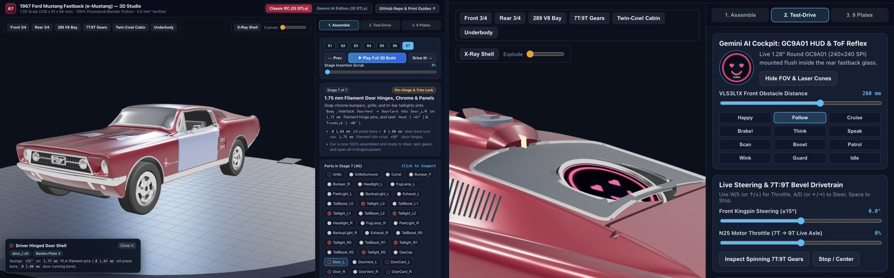
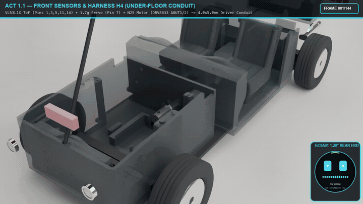

# 1967 Ford Mustang Fastback (`e-Mustang`) — 1:20 Printable RC & Gemini AI Model


> **100% Procedural Blender Python · `1:20` Scale (`226 × 91 × 66 mm`) · 5-Colour 9-Plate 3D Print · Hidden V8 `N25` + `7T:9T` Bevel Live Axle · Optional `Radxa Zero 3W` + Gemini AI Autonomy · `0.0 mm³` Overlap Verified**

<p align="center">
  <a href="https://cc4i.github.io/mustang-67-fastback/"><strong>🕹️ Launch Interactive 3D Assembly &amp; Drive Studio</strong></a> ·
  <a href="docs/printing-and-rc-guide.md"><strong>🖨️ Print &amp; RC Guide</strong></a> ·
  <a href="docs/ai-edition-gemini-robotics-guide.md"><strong>🤖 Gemini AI BOM &amp; Wiring</strong></a> ·
  <a href="docs/ai-edition-software-architecture.md"><strong>🧠 AI Voice &amp; Software (`v3.3.0`)</strong></a> ·
  <a href="docs/images/rc_simulation.mp4"><strong>🎬 Full HD Video</strong></a>
</p>

Meet **`e-Mustang`** — a **1:20 scale** 1967 Ford Mustang Fastback generated entirely from Python math in [`mustang/`](mustang/) (`0` hand-sculpted polygons) and camera-matched against 83 reference photos of Vanguard Motor Sales `Stock #2229`. Beneath the classic burgundy fastback body sits a complete mechanical RC chassis: the Ford-blue **289 V8 block** lifts off to reveal a hidden **`N25` gearmotor**, driving a support-free **`7T:9T` bevel-geared live rear axle**, **`±15°` filament-core front kingpin steering**, and an enclosed under-floor wire conduit — with an optional drop-in **Gemini Robotics ER 2.0 + `Radxa Zero 3W`** autonomous upgrade.

---

## 🕹️ Start Here: Explore & Drive It in 3D (Zero Install)

Before printing a single part, open the **[Interactive 3D Assembly & Drive Studio](https://cc4i.github.io/mustang-67-fastback/)** in your browser to scrub every assembly stage, inspect STL/Bambu plates in X-Ray, and test-drive the steering, `7T:9T` bevel differential, and rear-window AI Emoji HUD live:

[](https://cc4i.github.io/mustang-67-fastback/)

| Interactive Studio Mode | What You Experience in 3D | Direct Launch |
| :--- | :--- | :---: |
| **🔧 Guided 3D Assembly (`7` RC / `8` AI Stages)** | Scrub parts flying along verified `+Z` / `-Z` trajectories; click any 3D mesh for its STL file, Bambu plate, and clearance tip. | [**Open Assembly ↗**](https://cc4i.github.io/mustang-67-fastback/?mode=assemble&stage=1) |
| **🕹️ Live Test-Drive & `7T:9T` Gear X-Ray** | Steer `±15°` (`WASD` / sliders), spin the `N25` $\rightarrow$ `7T` `PinionGear` $\rightarrow$ `9T` `AxleGear` live axle in X-Ray cutaway, and swing open hood, doors, and trunk. | [**Drive in X-Ray ↗**](https://cc4i.github.io/mustang-67-fastback/?mode=drive&xray=1) |
| **🤖 Gemini AI Cockpit & `GC9A01` Emoji HUD** | Toggle the `55`-STL AI Edition (`WaymoPod` + `14` real-BOM 3D boards + `H1`–`H5` harnesses), trigger the `< 120 mm` `VL53L1X` brake reflex, and switch all 12 rear-window emojis. | [**Try AI Cockpit ↗**](https://cc4i.github.io/mustang-67-fastback/?edition=ai&mode=drive) |
| **🖨️ 9-Plate & `2.5h` Rolling-Mule Explorer** | Highlight Bambu Lab X2D `Plates 1–9` in place on the car, or isolate the **`16`-STL / `23`-piece Stage-1 Rolling Mule** to test driving before printing the body shell. | [**Explore Plates ↗**](https://cc4i.github.io/mustang-67-fastback/?mode=plates&mule=1) |

---

## ✨ Key Engineering Highlights

| Highlight | How It Works |
| :--- | :--- |
| **100% Procedural CAD (`0.0 mm³` Overlap)** | Lofted from real-car station tables (`SCALE = 1/20`), ray-cast chrome trim, and live `MANIFOLD` booleans. Exports **53 Classic STLs (`73` pcs)**, **55 AI STLs (`75` pcs)**, **9-plate Bambu `.3mf` projects**, and **67 named STEP solids** for Shapr3D. |
| **Hidden 289 V8 Motor Shroud** | Hollowed Ford-blue `engine_block.stl` drops straight down (`-Z`, `0°` pitch) over a `21 × 11 mm` / `N20` / `N25` motor cradle (`BayTub_N25Bed`, with `0.48 mm` Z-shims for `10 / 9 / 8 mm` motors). |
| **Support-Free `7T:9T` Bevel Live Axle** | Indexed `Ø 6.60 mm` multi-fit `MotorCoupler` (`1.0 mm`, `1.5 mm`, tube, or `3.0 mm` N25 D-bore) $\rightarrow$ bed-flat octagonal `Driveshaft` $\rightarrow$ collared `7T` `PinionGear` $\rightarrow$ `90°` `9T` `AxleGear` on a `3.60 mm` octagonal `Axle_R`. |
| **`1.75 mm` Filament-Core Steering & Hinges** | Raw `1.75 mm` PLA filament snips reinforce the double-shear `Ø 2.60 mm` front kingpins (`> 8×` shear strength, `±15°` `1.7g` servo sweep) and form smooth `+55°` door hinge pins (`Ø 1.84 mm` sill press bore / `Ø 2.00 mm` door bore). |
| **Hand-Slide `6`-Key Wheels & `9`-Boss Lock** | Zero-undercut radial tires slide by hand onto reinforced `1.80 mm`-lip Torq-Thrust rims across 6 axial keys; rolling `Chassis` clicks straight up (`+Z`) onto 9 mortise-and-tenon sub-frame bosses. |
| **Sleek Sub-Surface Gemini AI Upgrade** | Low-profile `WaymoPod` roof scoop (`OV5647` `160°` fisheye + `INMP441` mic), `0.0 mm`-protrusion `GC9A01` `240×240` rear-window Emoji HUD, `VL53L1X` `< 20 ms` front brake laser, and 2-story `Radxa Zero 3W` deck. |

| RC System Cutaway (`BayTub` $\rightarrow$ Floor Conduit $\rightarrow$ `BootTub`) | Rear Bevel Gear Mesh (`7T` `PinionGear` $\rightarrow$ `9T` `AxleGear`) |
| :---: | :---: |
|  |  |

---

## 🧭 Choose Your Build Track

Both tracks share the exact same **1:20 Mustang chassis, steering, wheels, and `7T:9T` bevel drivetrain** — build Classic RC first or jump straight to Autonomous AI:

| Feature | 🏎️ Track A: Classic RC Edition | 🤖 Track B: Autonomous Gemini AI Edition (`v3.5.0`) |
| :--- | :--- | :--- |
| **Printed Parts** | **`53` STLs $\rightarrow$ `73` Pieces** (`67` car parts, `9` Bambu plates) | **`55` STLs $\rightarrow$ `75` Pieces** (`+ waymo_pod.stl` & `gc9a01_bezel.stl`), or **`16` STLs (`23` pcs, `~2.5h`)** Stage-1 Rolling Mule |
| **Drive & Steering** | `N25` / `21×11 mm` motor + `1.7g` micro servo | Same `N25` gearmotor (`DRV8833` H-Bridge) + `1.7g` servo (`PWM14_M0`) |
| **Control Electronics** | **Option A**: `2.4GHz` hobby Rx + `5A` brushed ESC + `1S/2S` LiPo<br>**Option B**: 4-wire `433MHz` keyfob receiver (zero code) | **`Radxa Zero 3W`** (`RK3566` 4GB) + `OV5647` `160°` cam + `VL53L1X` ToF laser + `1.28"` `GC9A01` HUD + `INMP441` mic + `MAX98357A` amp & speaker + `2S` LiPo / `5V 3A` BEC (`14` verified 3D BOM meshes) |
| **Capabilities** | Smooth proportional trigger throttle + wheel steering | Full-duplex **`"Hey Mustang"`** wake-word voice (`AEC3` + barge-in + local `Piper` ONNX TTS), 12 rear-window HUD emojis, 12 maneuvers with `< 20 ms` auto-brake & S-curve obstacle bypass, and `350 mm` person-following |
| **Step-by-Step Guide** | [**`docs/printing-and-rc-guide.md`**](docs/printing-and-rc-guide.md) | [**Hardware BOM & Wiring**](docs/ai-edition-gemini-robotics-guide.md) · [**Software & Early-Test Mule**](docs/ai-edition-software-architecture.md) |

---

## 🛠️ Print & Assemble in 4 Easy Stages

### 1. 5-Colour Filament Palette (`9` Auto-Arranged Bambu Lab X2D Plates)

`mustang/make_project.sh` (Classic RC) and `mustang/make_ai_project.sh` (AI Edition) pack all parts with `0.12mm High Quality` Arachne walls, automatic `outer_only` brims on `28` small parts, and `tree(auto)` build-plate supports on only `5` STLs (`body`, `hood`, `trunk_lid`, `engine_block`, `bumper_rear` — the other `48–50` STLs print **100% support-free**):

| PLA Colour | Hex | Classic / AI Pcs | Key Parts |
| :--- | :---: | :---: | :--- |
| 🍷 **Burgundy** | `#6B0F1A` | `5` / `6` | `Body`, `Hood`, `TrunkLid`, `Door_L`, `Door_R` (+ `WaymoPod` in AI Edition) |
| ⚫ **Black** | `#1A1A1A` | `26` / `26` | `Chassis`, `InteriorTub`, `BayTub`, `BootTub`, `Tire` (`×4`), `Knuckle_L/R`, `SteeringLink`, `Axle_R`, `DiffCover`, `DoorCard_L/R`, `ValveCover_L/R`, `AirCleaner`, `Grille`, `Brace`, `HoodProp`, `SteeringWheel`, `MotorShim_0p5` (`×2`), `Windshield` & `RearGlass` inlays |
| 🥈 **Silver** | `#C8C8CC` | `35` / `36` | `Rim` (`×4`), `Driveshaft`, `PinionGear` (`7T`), `AxleGear` (`9T`), `MotorCoupler` (`×4` kit), `Bumper_F/R`, `GrilleSurround`, `Corral`, `DoorVent_L/R`, lamps, bezels, `Exhaust_L/R`, `GasCap`, `Mirror_L` (+ `GC9A01Bezel` in AI Edition) |
| 🔴 **Red** | `#B01010` | `6` / `6` | `TaillightLens` (`×6`) |
| 🔵 **Blue** | `#2B59C3` | `1` / `1` | Hollowed 289 V8 `EngineBlock` (`N25` motor shroud) |

### 2. 4-Stage Physical Assembly Overview

| Step | Physical Action | Key Parts & Fit Notes | 3D Guide |
| :---: | :--- | :--- | :---: |
| **1. Under-Shell Liners** | Plug `SteeringWheel` into the twin-cowl dash, then push `InteriorTub` and `BayTub` straight up (`+Z`) into `Body`. | Open-bottom `45°` gable tunnels stay clear for drop-in shaft installation. | [**Stage 2 ↗**](https://cc4i.github.io/mustang-67-fastback/?mode=assemble&stage=2) |
| **2. Motor, Servo & Shaft** | Seat `1.7g` servo + `N25` motor (`0–2` Z-shims + matching `MotorCoupler`), thread wires through the driver-side floor conduit, and lift `Driveshaft + PinionGear` (`7T`) into the U-channel. | Plate 6 includes 4 indexed couplers (`0` flutes = `3.0 mm` N25 D-shaft, `1` = `1.0 mm`, `2` = `1.5 mm`, `3` = tube). | [**Stage 3 ↗**](https://cc4i.github.io/mustang-67-fastback/?mode=assemble&stage=3) |
| **3. Rolling Chassis Mate** | Insert `1.75 mm` filament kingpin cores, snap `Knuckle_L/R` + `SteeringLink`, slide `Axle_R` through `AxleGear` (`9T`) + `DiffCover`, hand-slide the 4 tires onto the rims, and push `Chassis` straight up (`+Z`) onto `Body`. | 9 mortise-and-tenon bosses lock `BayTub` & `InteriorTub` while `7T` meshes at `90°` with `9T`. | [**Stage 5 ↗**](https://cc4i.github.io/mustang-67-fastback/?mode=assemble&stage=5) |
| **4. V8 Shroud, Doors & AI** | Drop `EngineBlock` (`-Z`) over the motor and `BootTub` into the trunk, snap chrome trim, hinge `Door_L/R` on `1.75 mm` filament pins, and add `Hood`, `TrunkLid` (+ `WaymoPod` & `GC9A01Bezel` for AI Edition). | `Ø 1.84 mm` sill press bore + `Ø 2.00 mm` door bore create crisp `+55°` filament hinges. | [**Stage 7 ↗**](https://cc4i.github.io/mustang-67-fastback/?mode=assemble&stage=7) |

---

## 🎬 Simulations & Real-Car Photo Matching

| Classic RC 4-Act Assembly & S-Turn Drive (`rc_simulation.mp4`) | Gemini AI 5-Harness (`H1`–`H5`) & Obstacle Bypass (`ai_simulation.mp4`) |
| :---: | :---: |
| [](docs/images/rc_simulation.mp4) | [](docs/images/ai_simulation.mp4) |

Every studio camera (`Cam_P*`) is calibrated to Vanguard Motor Sales `Stock #2229` photography (real car left, procedural Blender render right — full 83-photo index in [`docs/reference-media.md`](docs/reference-media.md)):

| Front 3/4 — Passenger Side (`Cam_P1/P21`) | Hood Open — 289 V8 Engine Bay (`Cam_P11`) |
| :---: | :---: |
|  |  |
| **Passenger Door Open & Cabin (`Cam_P8`)** | **1967 Twin-Cowl Dash & Waterfall Console (`Photo 7`)** |
|  |  |

---

## 🚀 Quick Build, Web Studio & AI Runtime Commands

Prerequisites: **Blender 5.1+** (Apple Metal GPU supported), **Node.js 20+** (for `site/`), **Bambu Studio**, **ffmpeg**, **python3**, and **[uv](https://docs.astral.sh/uv/)**.

```bash
# 1. Interactive 3D Web Studio: refresh Draco GLBs from Blender, build static bundle, or preview locally
make web-assets      # exports site/public/assets/{mustang_rc.glb, mustang_ai_delta.glb, assembly_manifest.json}
make web-preview     # builds & serves the 3D Assembly & Drive Studio at http://127.0.0.1:4173

# 2. Classic RC CAD: rebuild all 67 parts at 1:20 scale, run zero-overlap checks, export 53 STLs + 9-plate .3mf + STEP
/Applications/Blender.app/Contents/MacOS/Blender -b --factory-startup --python-expr "
import sys; sys.path.insert(0, 'mustang')
import build, printcheck, export
build.main(); assert printcheck.run()['parts'] == 67; export.run(); export.run_assembled()
"
mustang/make_project.sh output/mustang_67_fastback_1-24.3mf
uv run mustang/make_step.py

# 3. Independent AI Edition: export 55 STLs (75 pcs) + 3mf, run 40-test pytest suite, Harness Doctor & Live Workbench
/Applications/Blender.app/Contents/MacOS/Blender -b --factory-startup --python-expr "
import sys; sys.path.insert(0, 'mustang')
import ai_edition; ai_edition.build_and_export(save_blend=True)
"
bash mustang/make_ai_project.sh output/ai_edition/mustang_67_ai_edition_x2d.3mf output/ai_edition/mustang_67_ai_edition_prototype_x2d.3mf
make test && make doctor && make self-test
make voice-live      # launches local Mac <-> Gemini Robotics ER 2.0 Voice + HUD Workbench at http://127.0.0.1:8765
```

---

## 📚 Deep-Dive Documentation & Repository Layout

| Guide / Directory | Contents |
| :--- | :--- |
| 🛠️ [**Printing, Assembly & RC Wiring (`docs/printing-and-rc-guide.md`)**](docs/printing-and-rc-guide.md) | Full 53-STL / 73-piece plate manifest, Z-shim & coupler chart, **Option A (2.4GHz ESC)** & **Option B (433MHz Keyfob)** wiring, and Shapr3D STEP import. |
| 🤖 [**Gemini AI Hardware BOM & 40-Pin Wiring (`docs/ai-edition-gemini-robotics-guide.md`)**](docs/ai-edition-gemini-robotics-guide.md) | Sleek Sub-Surface Option B packaging (`WaymoPod`, `GC9A01Bezel`, 2-story `Radxa Zero 3W` deck), 40-pin GPIO table, and complete shopping BOM. |
| 🧠 [**AI Software, Voice Stack & Early-Test Mule (`docs/ai-edition-software-architecture.md`)**](docs/ai-edition-software-architecture.md) | 3-Tier HAL architecture (`software/`), Milestone A `AEC3` + Wake-Word + Barge-In voice stack, `VirtualArena` 2D simulator, and **Stage 1 (`16` STLs) / Stage 2 (`21` STLs)** early-test manifests. |
| 📐 [**Mechatronics Workflow (`docs/build-workflow-and-rules.md`)**](docs/build-workflow-and-rules.md) & [**Verification (`docs/design-thinking-and-verification.md`)**](docs/design-thinking-and-verification.md) | Universal `R1..R10` CAD rules, `G1..G5` pre-print verification gates, tolerance math, and `0.0 mm³` kinematic sweep proofs. |
| 🎥 [**Reference Media (`docs/reference-media.md`)**](docs/reference-media.md) · 📜 [**Changelog (`CHANGELOG.md`)**](CHANGELOG.md) · 🤖 [**Dev Rules (`AGENTS.md`)**](AGENTS.md) | `Stock #2229` photo-to-camera index, release history (`v1.0.0` $\rightarrow$ `v3.6.0`), coordinate conventions, and boolean modifier architecture. |
| [`mustang/`](mustang/) · [`site/`](site/) · [`software/`](software/) · [`docs/`](docs/) · [`origin_images/`](origin_images/) | Procedural Blender CAD + `.glb` web exporter (`mustang/`), Three.js 3D Assembly & Drive Studio (`site/`), standalone `mustang-ai` runtime (`software/`), guides & media (`docs/`), and reference photos (`origin_images/`). |
