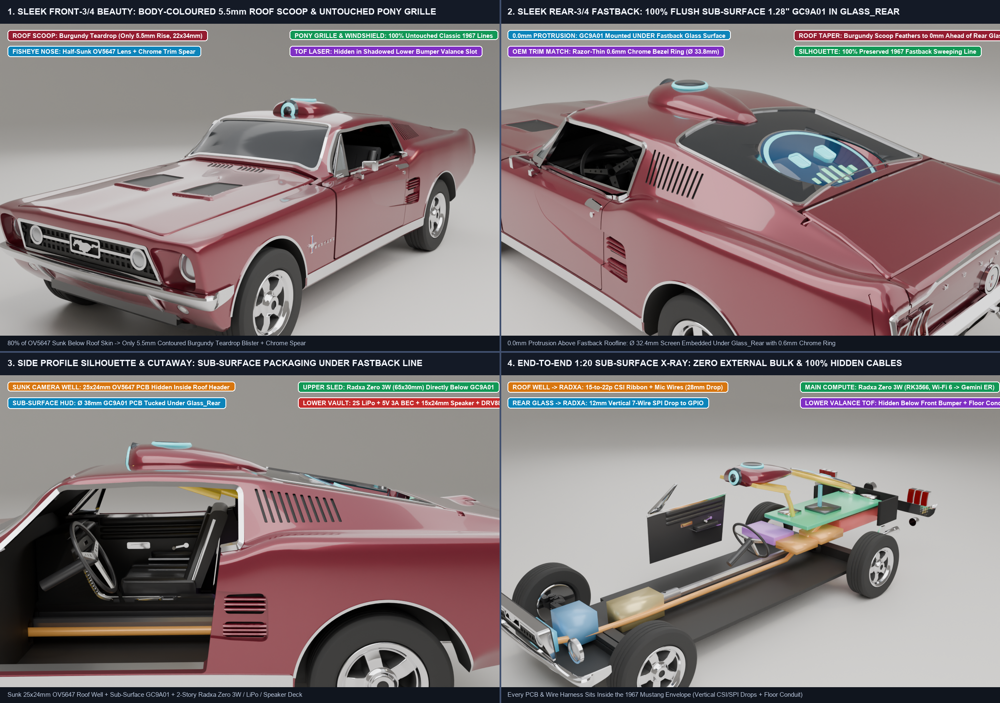
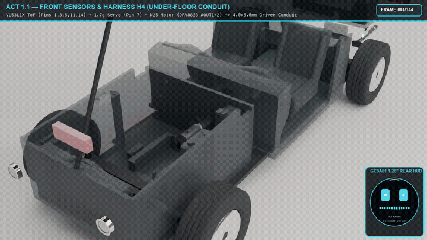
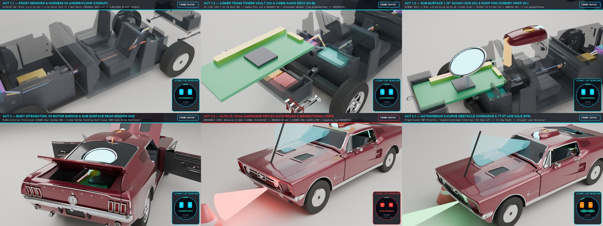

# Gemini Robotics ER 2.0 (`gemini-robotics-er-2-streaming`) + Radxa Zero 3W Mustang Plan, Hardware BOM & Pin-by-Pin Cable Architecture (`v3.0.0` Independent AI Edition)



> **Zero Exterior Fastback Sill / Grille Clutter · `5.5 mm` Shelby Roof Scoop (`waymo_pod.stl`) · `0.0 mm` Flush Sub-Surface `1.28"` Round `GC9A01` Rear Window HUD (`gc9a01_bezel.stl`) · 3-Zone Stepped `Radxa Zero 3W` L-Rail Cradle · `0.0 mm³` Verified Hardware Overlap**

This document captures the complete engineering plan, 3D packaging verification, **Hardware Shopping List / Bill of Materials (BOM)**, and **Pin-by-Pin Cable Architecture (`H1`–`H5`)** for the **Independent AI Edition (`v3.0.0`)** of the 1:20 1967 Ford Mustang Fastback (`e-Mustang`). It builds on top of the classic 1:20 RC Mustang without modifying the baseline deliverables, exporting its Blender scene, `55` STLs (`75` printed pieces), and 9-plate Bambu Lab X2D `.3mf` to `output/ai_edition/`.

---

## 🎬 4-Act Simulated Cable Assembly & Autonomous AI Drive (`144 Frames @ 24 fps`)

[](images/ai_simulation.mp4)

*▶️ **Click the animation above** to open the full HD [**4-Act AI Cable Assembly & Autonomous Drive Simulation (`ai_simulation.mp4`, 144 frames @ 24 fps)**](images/ai_simulation.mp4).*

| Act 1 (`f001–f048`) | Act 2 (`f049–f075`) | Act 3 (`f076–f108`) | Act 4 (`f109–f144`) |
| :--- | :--- | :--- | :--- |
| **5-Harness (`H1`–`H5`) Cable Growth**: Step-by-step X-ray assembly of all 9 AI modules and animated routing of `H4` (under-floor conduit), `H5` (2S LiPo/BEC), `H3` (`MAX98357A` + `1524` speaker + `DRV8833` + `Radxa Zero 3W` L-rail slide-in), `H2` (`GC9A01` HUD `<12 mm` drop), and `H1` (`OV5647` CSI ribbon + `INMP441` mic down `Cut_WaymoChimney`). | **Body Lowering & Sub-Surface HUD Boot-Up**: Burgundy `Body` shell and 289 V8 shroud lower over the wired chassis; `Hood`, `Doors`, and `TrunkLid` open/close; `1.28"` Round `GC9A01` HUD boots up flush inside `Glass_Rear`. | **Live Perception & `< 20 ms` `VL53L1X` Reflex Auto-Brake**: Car cruises with `160°` fisheye FOV cone + green laser rangefinder, detects a road obstacle at `92 mm < 120 mm`, triggers hardware emergency brake, flashes red `ALERT_STOP` HUD, and speaks via `MAX98357A` (`gemini-robotics-er-2-streaming`). | **Autonomous S-Curve Obstacle Avoidance**: `gemini-robotics-er-2-streaming` calls `drive_and_steer(steer=+15.0)` + `LOOK_LEFT`, executing a coupled S-curve lane change around the obstacle and finishing with a `HAPPY` HUD expression. |



---

## 1. Sleek Sub-Surface Exterior Integration ("Show the Beautiful 1967 Mustang First")

To preserve the classic 1967 Mustang Fastback silhouette (`226 × 91 × 66 mm` at `1:20` scale), every external sensor and display element is sunk sub-surface or sculpted into period-correct bodywork:

| Exterior Zone | Design Adjustment | Exterior Protrusion |
| :--- | :--- | :---: |
| **1967 Pony Grille, Headlights & Front Bumper** | **100% Untouched Classic Chrome & Mesh.** The **`VL53L1X` Time-of-Flight (ToF)** obstacle sensor is hidden inside the dark recessed lower valance air slot (`BayTub_ToFSlot` at `X = 9.0..17.0 mm, Z = 18.0..23.5 mm`) underneath the chrome front bumper. | **`0.0 mm`** |
| **Front Windshield, Hood & Side Fastback Profile** | **100% Clean.** Zero windshield camera brackets, zero external wires, and zero pods on the hood, fenders, or C-pillar louvers. | **`0.0 mm`** |
| **Roof Crown (`WaymoPod` $\rightarrow$ `waymo_pod.stl`, Burgundy `#6B0F1A`)** | **Ultra-Low-Profile Integrated Shelby Roof Scoop (`5.5 mm` above roof skin).** `80%` of the **`OV5647` wide-angle / fisheye (`160°–200°`)** camera PCB and M12 lens barrel drops **down inside** a roof socket (`Cut_WaymoSocket` at `X = 123.5..154.5 mm`) and vertical cable chimney (`Cut_WaymoChimney`). Only a sleek `5.5 mm`-tall (`22 × 36 mm`) color-matched `#6B0F1A` Burgundy teardrop aerodynamic fairing crowns the roof, with a `3.3 mm` forward lip overhang and recessed top micro-slots (`WaymoPod_MicCup`) for the **`INMP441` I2S omnidirectional MEMS microphone**. | **`5.5 mm` max** (`22 × 36 mm` footprint) |
| **Rear Fastback Glass (`GC9A01Bezel` $\rightarrow$ `gc9a01_bezel.stl`, Silver `#C8C8CC`)** | **100% Sub-Surface Flush Rear Window HUD (`0.0 mm` exterior protrusion).** The **`1.28"` Round `GC9A01` (`240×240` RGB IPS SPI)** display is mounted **from the inside** of the dark-tinted rear fastback glass (`Glass_Rear`, `+20.5°` slope at `X = 158.0 mm, Z = 54.0 mm`), framed by a thin `1.2 mm` flush chrome bezel ring (`gc9a01_bezel.stl`). When off, it blends into the black glass inlay; when active, animated eyes, voice waveforms, or status text glow straight through the rear window. | **`0.0 mm`** (Flush inside `Glass_Rear`) |

---

## 2. Complete Audited Hardware Shopping List / Bill of Materials (BOM — 20 Items)

Below is the CAD-audited 20-item list of electronic, optical, audio, actuation, power, filtering, and cabling subsystems required to build the **Independent AI Edition (`v3.0.0`–`v3.3.0`)**, matched to the verified boolean pockets in `mustang/ai_edition.py` and the Python drivers in `software/`:

### A. Compute, Vision, Display & Audio Subsystems (AI Layer)

| # | Subsystem | Recommended Part / Model | Form Factor & Specs | Qty | CAD Mounting Bay & Audited Fit Notes |
| :-: | :--- | :--- | :--- | :-: | :--- |
| **1** | **Main AI SBC (`65 × 30 mm` Zero Form Factor)** | **Radxa Zero 3W** (`2GB` or `4GB` LPDDR4, **unpopulated / solderless GPIO header**, `0GB eMMC + MicroSD` or `32GB eMMC`)<br>— *Drop-in `65 × 30 mm` Alternatives (0 CAD changes)*: **`Raspberry Pi Zero 2 W`** (`512MB` + `zram`, 100% pin-for-pin & 22-pin CSI identical), **`Banana Pi BPI-M4 Zero (4GB)`**, or **`Orange Pi Zero 2W (4GB)`** | `65.0 × 30.0 × 5.2 mm` (Wi-Fi + BLE, 22-pin `0.5 mm` MIPI CSI, 40-pin GPIO) | `1` | **3-Zone Stepped L-Rail Cradle** (`Z = 36.0 mm` shelf across `InteriorTub`, `Cut_RadxaBulkheadBridge`, and `BootTub_RadxaShelf_L/R` at `X = 151..216 mm, Y = ±15 mm`). **Mandatory**: Buy the **headerless** version (vertical `8.5 mm` pins exceed the `5.2 mm` clearance under `TrunkLid`). |
| **2** | **Wide-Angle / Fisheye MIPI Camera** | **Raspberry Pi Zero Mini `OV5647 160°` Fisheye Camera Module** (`5MP`, **`8.5 × 8.5 mm` mini sensor head** with integrated **`150 mm` `22-pin 0.5 mm` pitch FPC ribbon**) | Lens barrel `Ø 14.0 mm` on `8.5 × 8.5 mm` head + `11.5 mm` wide 22-pin ribbon | `1` | **`WaymoPod` (`waymo_pod.stl`) + `Cut_WaymoSocket`**. *CAD Audit Fix*: `WaymoPod` outer width is `22.0 mm` (`WaymoPod_LensArch` is `11.0 mm` wide, `WaymoPod_CableChannel` is `12.5 mm` wide); do **not** buy the large `25 × 24 mm` Pi v1 PCB. The `8.5 × 8.5 mm` Pi Zero mini camera fits directly and plugs straight into the 22-pin `0.5 mm` CSI socket. |
| **3** | **Spare MIPI CSI Ribbon Cable** | **`22-Pin (0.5 mm Pitch)` or `15-Pin (1.0 mm) to 22-Pin (0.5 mm)` FPC Flexible Ribbon (`150 mm`)** | `0.3 mm` ultra-flat FPC ribbon (`11.5 mm` width at 22-pin SBC end) | `1` | Spare/adapter ribbon if using a camera head with a detachable connector. Routes down `WaymoPod_CableChannel` $\rightarrow$ `Cut_WaymoChimney` (`X = 142.1..144.8 mm`). |
| **4** | **Rear Fastback HUD Display** | **Waveshare `1.28"` Round `GC9A01` IPS LCD Module (`SKU: WS-19192`)** (`240 × 240` RGB, `3.3V` 4-wire SPI: `VCC, GND, SCL, SDA, RES, DC, CS, BL`) | `Ø 32.4 mm` active screen (`~35.6 × 38.0 × 3.5 mm` module PCB with PH2.0-8P / solder pads) | `1` | **Sub-Surface Rear Window Well (`Cut_RearGlassHUD` + `GC9A01Bezel`)** at `X = 176.5 mm, Z = 56.1 mm`. Sits `< 12 mm` above the 40-pin GPIO header. |
| **5** | **Digital MEMS Microphone** | **`INMP441` Omnidirectional I2S MEMS Microphone Breakout** (`24-bit` digital I2S, `3.3V`: `VDD, GND, SD, WS, SCK, L/R`) | `14.0 × 10.0 × 2.0 mm` circular/mini PCB | `1` | **`WaymoPod_MicCup`** under the top acoustic vent ring of `waymo_pod.stl` (`X = 125.0 mm, Z = 68.1 mm`), isolated from drivetrain gear noise. |
| **6** | **Digital Audio Amplifier** | **Adafruit / Generic `MAX98357A` I2S `3.2W` Class-D Mono Amplifier Breakout** (`3.3V/5V` digital I2S input, filterless speaker output) | `18.0 × 14.0 × 3.0 mm` (trim `3 mm` empty mounting-hole tab to `14.5 × 14.0 mm`) | `1` | **`Tub_AIAmpDrvBay`** (`14.75 × 15.75 × 8.25 mm` **driver-side (`-Y`)** rear seat pocket at `X = 155.0..169.75 mm, Y = -24.5..-8.75 mm`). Stack vertically with `DRV8833` using `Kapton` tape. |
| **7** | **Cabin Micro Speaker** | **`1524` (`15 × 24 × 4 mm`) `8Ω 1W` (or `8Ω 1.5W`) Sealed Rectangular Micro Cavity Speaker** with pre-soldered wire leads | `15.0 × 24.0 × 4.0 mm` rectangular dynamic speaker | `2` | **`Tub_AISpeakerBay`** (`15.25 × 24.50 × 8.25 mm` **passenger-side (`+Y`)** rear seat acoustic enclosure at `X = 154.75..170.0 mm, Y = -2.25..+22.25 mm`), firing upward into the cabin. |
| **8** | **Front Obstacle Reflex Sensor** | **Pololu / Adafruit / GY-530 `VL53L1X` Time-of-Flight (ToF) Laser Distance Sensor Breakout** (`I2C` address `0x29`, up to `400 cm` range, `< 20 ms` ranging) | `18.0 × 13.0 × 3.2 mm` | `1` | **`BayTub_ToFSlot`** (`X = 33.7..36.8 mm, Y = ±9.1 mm, Z = 21.75..30.0 mm`) behind the lower front valance air slot for `< 20 ms` hardware emergency braking (`< 120 mm` stop threshold). |

### B. Drivetrain, Steering & Power Subsystems (Actuation Layer)

| # | Subsystem | Recommended Part / Model | Form Factor & Specs | Qty | CAD Mounting Bay & Audited Fit Notes |
| :-: | :--- | :--- | :--- | :-: | :--- |
| **9** | **Rear Drive Gearmotor** | **`N25` (or `N20` / `21 × 11 mm` Flat-Can) Micro Metal Gearmotor** (`6V`, **`100–150 RPM`** output shaft speed, `Ø 3.0 mm` D-shaft or `Ø 1.0 / 1.5 mm` pin) | `21.0 × 11.0 × 10.0 mm` (also supports `9.0 mm` or `8.0 mm` heights with printed `0.48 mm` `MotorShim_0p5` shims) | `2` | **`BayTub_N25Bed`** (`21.25 × 11.25 × 10.00 mm`) hidden underneath the blue 289 V8 `EngineBlock` shroud; couples via printed `MotorCoupler` to `Driveshaft` (`7T:9T` bevel axle). |
| **10** | **Dual H-Bridge Motor Driver** | **Ultra-Mini Pinless `DRV8833` Dual H-Bridge DC Motor Driver** (`2.7V–10.8V`, `1.5A` continuous / `2A` peak, 2-pin PWM `IN1/IN2` control) | **`10.5 × 13.0 × 3.0 mm`** ultra-mini carrier (fits inside `14.75 × 15.75 mm` pocket) | `2` | **`Tub_AIAmpDrvBay`** (`14.75 × 15.75 × 8.25 mm`, driver `-Y` side), stacked with `Kapton` tape over the `MAX98357A` (`3 mm + 3 mm = 6.0 mm <= 8.25 mm` depth). |
| **11** | **Front Steering Micro Servo** | **`1.7g` Digital Ultra-Micro Servo** (e.g., `AFRC D1302` / `1.7g` `5V` 3-wire PWM) | `13.5 × 6.2 × 16.0 mm` | `2` | **`BayTub_ServoBed`** behind the radiator (`X = 28..42 mm`), driving `SteeringLink` and `Knuckle_L/R` (`±15°` front kingpin steering). |
| **12** | **Main Battery Pack** | **`2 × 1S 3.7V 150–200mAh` `501225` (`25 × 12 × 5 mm`) or `501525` (`25 × 15 × 5 mm`) Micro LiPo Cells Wired in Series (`2S 7.4V`)** | Fits inside the **`15.2 × 26.0 × 6.45 mm`** lower trunk vault (`≤ 25 mm` cell length!) | `1 set` | **`BootTub_AIClearFloor`** (`X = 201.5..216.7 mm, Y = ±13.0 mm, Z = 29.8..36.25 mm`) underneath the upper SBC deck. *(Do not buy `38 mm` cells—they exceed the `26.0 mm` vault).* |
| **13** | **5V Step-Down Regulator (BEC)** | **Fixed `5.0V` Synchronous Buck Regulator: `Pololu D24V22F5` (`5.0V 2.2A`) or Fixed `5.0V Mini560`** | `17.8 × 12.7 × 3.8 mm` (`Pololu D24V22F5`) | `1` | **`BootTub_AIClearFloor`** beside the `2S` LiPo pack. *Audit Fix*: Prefer a **fixed `5.0V`** regulator over a trimpot `Mini360` so vibration cannot drift the `5V` rail. |

### C. Filtering, Charging, Wiring, Connectors & Fasteners

| # | Item | Specification | Qty | Purpose |
| :-: | :--- | :--- | :-: | :--- |
| **14** | **30 AWG & 26 AWG Silicone Wire** | Ultra-flexible multi-color `30 AWG` (`Ø 0.8 mm` OD) signal wire + `26 AWG` (`Ø 1.2 mm` OD) power wire (`6–8 colors`) | `1 box` | Builds the 5 modular cable harnesses (`H1`–`H5`) through `Cut_WaymoChimney` and the `4.00 × 5.05 mm` driver-side floor conduit. |
| **15** | **JST-PH 2.0 Plug & Slide Switch** | `JST-PH 2.0` 2-pin battery pigtails + inline micro slide power switch (`SS12D00G3`, `8 × 4 mm` body) | `1 pack` | Clean battery disconnect inside `TrunkLid` opening. |
| **16** | **1.75 mm PLA Filament + Foam Tape** | Standard `1.75 mm` PLA filament (Burgundy, Black, Silver, Red, Blue) + `0.5 mm` double-sided acrylic foam tape | `1 set` | Secures `Door_L/R` hinges (`Ø 1.84 / 2.00 mm` bores) and cushions the `1524` speaker and `GC9A01` display bezel. |
| **17** | **Motor EMI & Acoustic Filter Cap** | **`0.1 µF` (`104`) `50V` Ceramic Disc Capacitor** | `1 pack` | Soldered across `N25` motor terminals to suppress brushed-motor RF noise and high-frequency PWM whine into the `INMP441` microphone. |
| **18** | **5V Rail Bulk Reservoir Cap** | **`220 µF 10V` Low-ESR Electrolytic or Tantalum Capacitor (`6.3 × 7 mm`)** | `1 pack` | Connected across `Pin 4 (5V)` and `Pin 6 (GND)` to absorb `MAX98357A` speaker and `1.7g` servo current transients without SBC brownouts. |
| **19** | **2S 7.4V LiPo Balance Charger** | **USB `2S 7.4V` Balance Charger (or `ISDT PD60` / `B3 Pro`)** | `1` | Safely recharges the `2S 7.4V` LiPo battery pack outside the car. |
| **20** | **Kapton Tape & Heat-Shrink Kit** | **`10 mm` Polyimide (`Kapton`) Tape + `1.0 / 1.5 / 2.0 mm` Heat-Shrink Assortment** | `1 set` | Insulates the vertically stacked `MAX98357A + DRV8833` boards in `Tub_AIAmpDrvBay` and the `Pin 12` / `Pin 35` I2S Y-splices. |

### D. Drop-In `65.0 × 30.0 mm` SBC Alternatives & Singapore (`SG`) Sourcing Guide

Because our `65.0 × 30.0 mm` L-rail cradle and `Pin 1..40` GPIO header (`I2C`, `SPI`, `I2S`, `PWM`, and `22-pin 0.5 mm` MIPI CSI) follow the **standard Raspberry Pi Zero mechanical and electrical layout**, you can use any of the 4 drop-in boards below when `Radxa Zero 3W` is out of stock (`0` CAD changes):

| Rank | Drop-In `65.0 × 30.0 mm` SBC | SoC & RAM | Camera & GPIO Compatibility | Where to Buy (Ships to Singapore) | Est. Price (`SGD`) |
| :-: | :--- | :--- | :--- | :--- | :---: |
| **1** | **`Raspberry Pi Zero 2 W` (No Header)** | Broadcom `BCM2710A1` Quad-core Cortex-A53 `1GHz`, **`512MB` RAM** (`+512MB zram`), Wi-Fi + BLE | **100% Pin-for-Pin & 22-Pin `0.5 mm` CSI Identical** (`0` CAD or wiring changes; `mustang-ai` uses `~235 MB` total RAM on 64-bit Pi OS Lite Headless) | **In Stock Locally in SG (`1–2` days)**: **Cytron SG** (`sg.cytron.io`), **Element14 SG** (`sg.element14.com`), **RS SG** (`sg.rs-online.com`), **Sim Lim Tower** | **`S$23–S$26`** |
| **2** | **`Banana Pi BPI-M4 Zero (4GB + 32GB eMMC, No Header)`** | Allwinner `H618` Quad-core Cortex-A53, **`4GB` LPDDR4 + `32GB` eMMC**, Wi-Fi 5 + BT | **Onboard MIPI CSI + 40-Pin GPIO** (`0` CAD changes) | **AliExpress (`Sinovoip Official` / `WayPonDEV`)** or **Taobao SG Direct Air (`香蕉派 BPI-M4 Zero 4G`)** (`5–7` days to SG) | **`S$34–S$48`** |
| **3** | **`Orange Pi Zero 2W (4GB, No Header)`** | Allwinner `H618` Quad-core Cortex-A53, **`4GB` LPDDR4**, Wi-Fi 5 + BT 5.0 | **40-Pin GPIO + 2nd USB-C port** (pair with `8×8 mm` `160°` USB UVC camera on `/dev/video0`) | **AliExpress (`Orange Pi Official Store`)**, **Taobao SG Direct Air (`香橙派 Zero 2W 4G`)**, **Shopee SG** (`4–7` days to SG) | **`S$25–S$36`** |
| **4** | **`Radxa Zero 3W` (`2GB/4GB`, No Header)** | Rockchip `RK3566` Quad-core Cortex-A55, **`2GB` or `4GB` LPDDR4**, Wi-Fi 6 + BLE 5.4 | **22-Pin `0.5 mm` MIPI CSI + 40-Pin GPIO** | **Allnet China** (`shop.allnetchina.cn`), **Taobao (`瑞莎官方旗舰店`)**, or **Xianyu (`闲鱼` spot stock)** via Cainiao SG Air | **`S$28–S$58`** |

* **Recommended 3-Cart Singapore Sourcing Split (`~S$147–S$235 SGD` Total Delivered)**:
  1. **Local SG Courier (`Cytron SG` `sg.cytron.io` / `Mouser SG` `sg.mouser.com`, `1–3` days)**: `Raspberry Pi Zero 2 W` (#1), Pi Zero `OV5647 160°` 22-pin camera (#2/#3), Waveshare `1.28" GC9A01` (#4), `MAX98357A` (#6), `VL53L1X` (#8), `6V 100–150 RPM N20/N25` gearmotor (#9), fixed `Pololu D24V22F5 5V` buck (#13), `0.1 µF` + `220 µF` caps (#17/#18).
  2. **Local SG Walk-In / Shopee SG Local (`Sim Lim Tower #03-25 Continental Electronics` / `Rotor Hobby SG`, `1–2` days)**: `2 × 1S 501225` (`25 × 12 × 5 mm`) LiPo cells (#12) + `2S` USB balance charger (#19) — **buy LiPo cells locally in Singapore** to avoid international air-freight `IATA PI965` battery blocks.
  3. **AliExpress Standard Air / Taobao Direct Air to SG (`4–7` days)**: `INMP441` mic (#5), `1524` (`15 × 24 × 4 mm`) `8Ω 1W` speaker (#7), ultra-mini `10.5 × 13 mm` `DRV8833` (#10), `1.7g` `AFRC D1302` digital servo (#11), `30 AWG` silicone wire box (#14), `SS12D00G3` switches (#15), and `Kapton` + heat-shrink kit (#20).

---

## 3. Verified 3D Packaging, Cable Routing & Board Retention

Every subsystem and cable path was verified inside Blender (`mustang/ai_edition.py`) with `0.0 mm³` interference against all `69` car parts (`tmp/ai_edition_build_report.json`):

### 1. Where the Camera & Mic Cables Route (`OV5647` + `INMP441` $\rightarrow$ `Radxa Zero 3W` / `Pi Zero 2 W`)
- **Roof Pod Exit (`WaymoPod_CableChannel`)**: Inside the rear half of `waymo_pod.stl`, a dedicated **`12.5 mm` wide (`±6.25 mm`) × `3.0 mm` tall (`45°` gabled) internal tunnel** (`X = 117.5..142.5 mm`) exits the back of the `8.5 × 8.5 mm` `OV5647` camera head and `INMP441` microphone cup.
- **Vertical Roof Drop (`Cut_WaymoChimney`)**: At the rear edge of the roof socket (`X = 142.1..144.8 mm, Y = -8.5..+8.5 mm`), a **`2.7 mm × 17.0 mm` vertical slot** punches straight through the `Body` roof shell directly in front of the rear fastback glass (`Glass_Rear` starts at `X = 145.6 mm`).
- **Direct Entry to 22-Pin CSI Connector (`_v_csi_ribbon`)**: The `11.5 mm`-wide `22-pin 0.5 mm` MIPI CSI flat flex ribbon (`0.3 mm` thick) and 5-wire `30 AWG` `INMP441` I2S bundle drop straight down `19 mm` from the roof chimney (`Z = 62.5 mm` down to `Z = 41.5 mm`) right onto the front edge of the **`65 × 30 mm` SBC (`X = 151.0 mm`)** behind the rear seat backrest, completely hidden from the side windows and rear HUD window.

### 2. Where the Speaker & Amplifier Sit (`Tub_AISpeakerBay` & `Tub_AIAmpDrvBay`)
- **Passenger-Side (`+Y`) Rear Cabin Deck (`Tub_AISpeakerBay`)**: Molded into the right rear shelf of `InteriorTub` at **`X = 154.75..170.00 mm, Y = -2.25..+22.25 mm, Z = 28.25..36.50 mm`** with an exact **`15.25 × 24.50 × 8.25 mm` internal pocket** (`1.5 mm` walls) that holds the **`15.0 × 24.0 × 4.0 mm` (`1524`) `8Ω 1W` micro speaker** firing upward into the cabin.
- **Driver-Side (`-Y`) Rear Cabin Deck (`Tub_AIAmpDrvBay`)**: Molded on the left rear shelf at **`X = 155.00..169.75 mm, Y = -24.50..-8.75 mm, Z = 28.25..36.50 mm`** (`14.75 × 15.75 × 8.25 mm` internal pocket) right next to the driver-side floor wire conduit (`Y = -7.70..-3.70 mm`) to hold the vertically stacked **`MAX98357A` I2S Class-D amplifier** and **ultra-mini `10.5 × 13.0 mm` `DRV8833` dual H-bridge motor driver**.

### 3. How the `Radxa Zero 3W` (`65.0 × 30.0 × 5.2 mm`) Is Held Horizontally
The `Radxa Zero 3W` sits at **`X = 151.0..216.0 mm, Y = -15.0..+15.0 mm, Z = 36.1..41.3 mm`** (`0.0 mm³` collision with `Body`, `Glass_Rear`, `TrunkLid`, `InteriorTub`, and `BootTub`) and is locked in all 3 axes (`X, Y, Z`) across a **continuous 3-zone stepped `Z = 36.0 mm` L-rail cradle**:
1. **Front Support (`X = 150.5..156.5 mm` in `InteriorTub`)**: Twin vertical support pillars (`Tub_RadxaFrontPillar_L/R` at `Y = ±13.9 mm`, rising from the rear cabin floor to **`Z = 36.0 mm`**) plus a **`2.5 mm` front axial stop lip (`Tub_RadxaFrontStop_L/R`)** at `X = 150.5 mm` that prevents the board from sliding forward under braking.
2. **Mid Bulkhead Bridge (`X = 160.0..179.0 mm` in `Body`)**: `Cut_RadxaBulkheadBridge` cuts the trunk divider wall flat at **`Z = 36.0 mm`** across `Y = -16.8..+16.8 mm`, forming a solid **`19.0 mm`-long center support shelf** directly under the middle of the Radxa PCB.
3. **Rear L-Rail & Backstop (`X = 169.0..217.5 mm` in `BootTub`)**: Full-length load-bearing shelves (`BootTub_RadxaShelf_L/R` at `Z = 34.2..36.0 mm`, `Y = ±13.6..±16.8 mm` giving `1.4 mm` PCB edge bite on both sides), lateral guide walls (`BootTub_RadxaWall_L/R` at `Y = ±15.2..±16.8 mm, Z = 36.0..42.0 mm` leaving a **`30.4 mm` slip-fit channel** for the `30.0 mm` board), and rear axial stop blocks (`BootTub_RadxaStopR_L/R` at `X = 216.2..217.6 mm`).

---

## 4. Complete Cable Architecture & Pin-by-Pin Assembly Schematic (`H1`–`H5`)

All wiring inside the 1:20 Mustang is organized into **5 modular cable harnesses (`H1`–`H5`)** so you can pre-solder and test on the bench before sliding the boards into the car. Every pin number below matches `ai_edition/config.py` (`RadxaPinConfig`).

### A. System-Wide Cable Harness Topology (`H1`–`H5`)

```
                       [ ROOF POD: waymo_pod.stl (X = 123.5..154.5, Z = 61..68 mm) ]
                        ├── OV5647 160° Camera (15-pin 1.0mm CSI)
                        └── INMP441 I2S Mic (VDD, GND, SCK, WS, SD; L/R strapped to GND)
                                       │
                  HARNESS H1 (L=55mm)  │  Drops straight down Cut_WaymoChimney (X = 142.1..144.8 mm)
                  (1x FPC + 5x 30AWG)  ▼
┌─────────────────────────────────────────────────────────────────────────────────────────────────┐
│                UPPER REAR AVIONICS DECK: Radxa Zero 3W (X = 151..216, Z = 36.1..41.3 mm)        │
│                                                                                                 │
│  [22-Pin 0.5mm CSI Socket] ◄── H1-A: 15-to-22-Pin FPC Ribbon (OV5647 Camera)                    │
│                                                                                                 │
│  [40-Pin GPIO Header]                                                                           │
│   ├── Pins 1,9,19,23,24,18,22,16 ◄──► HARNESS H2 (L=35mm, 8x 30AWG, <12mm vertical drop)        │
│   │                                   └──► 1.28" Round GC9A01 HUD (in Cut_RearGlassHUDWell)     │
│   │                                                                                             │
│   ├── Pins 17,20,12*,35*,38      ◄─── H1-B: INMP441 Mic (I2S3_SDI_M0; *Pin 12 & 35 Y-shared)    │
│   │                                                                                             │
│   ├── Pins 2,6,12*,35*,40,37     ───► HARNESS H3-A (L=40mm, 6x 30AWG to Tub_AIAmpDrvBay)        │
│   │                                   └──► MAX98357A I2S Amp ──► H3-B (2x 28AWG across X=148mm) │
│   │                                                              └──► 1524 Speaker (15x24x4mm)  │
│   │                                                                   in Tub_AISpeakerBay       │
│   │                                                                                             │
│   ├── Pins 32,33,36,30           ───► HARNESS H3-C (L=40mm, 4x 30AWG to Tub_AIAmpDrvBay)        │
│   │                                   └──► DRV8833 H-Bridge (AIN1, AIN2, nSLEEP, GND)           │
│   │                                          │                                                  │
│   └── Pins 1,14,3,5,11,7         ───┐        │DRV8833 AOUT1/AOUT2 (2x 28AWG)                    │
└─────────────────────────────────────┼────────┼──────────────────────────────────────────────────┘
                                      │        │   ▲
         HARNESS H4 (L=145mm, 9 wires)│        │   │ HARNESS H5 (L=45mm, 26AWG Power in BootTub_AIClearFloor)
         Routes forward inside the    ▼        ▼   │  2S 7.4V LiPo ──► [Slide Switch] ──┬──► 7.4V VM to DRV8833
         enclosed 4.00 x 5.05 mm     ╔════════════╗│                                    └──► 5V 3A Buck BEC
         driver-side floor conduit   ║  FLOOR     ║│                                          ├──► Radxa Pin 4 (5V) & Pin 6 (GND)
         (Y = -7.8..-3.8 mm)         ║  CONDUIT   ║┘                                          └──► Servo VCC (5V) & GND
                                     ╚══╦═══╦═══╦═╝
              ┌─────────────────────────┘   │   └──────────────────────────┐
              ▼                             ▼                              ▼
 [BayTub_N25Bed (X=50..71mm)]   [BayTub_ServoBed (X=28..42mm)]   [BayTub_ToFSlot (X=9..17mm)]
  H4-A: 2x 28AWG (M+ / M-)       H4-B: 3x 30AWG (5V, GND, SIG)    H4-C: 5x 30AWG (3.3V,GND,SDA,SCL,XSHUT)
  N25 6V 100-150 RPM Motor       1.7g Digital Steering Servo      VL53L1X Front Laser Rangefinder
```

### B. Summary of the 5 Modular Harnesses (`H1`–`H5`)

| Harness ID | From $\rightarrow$ To | Wire Count & Gauge | Cut Length | CAD Routing Channel |
| :--- | :--- | :--- | :---: | :--- |
| **`H1` (`H1-A` + `H1-B`)** | `WaymoPod` (`OV5647` + `INMP441`) $\rightarrow$ `Radxa Zero 3W` | `1×` 15-to-22-pin FPC + `5×` `30 AWG` | **`55 mm`** (use `100 mm` FPC folded once) | Exits `WaymoPod_CableChannel` (`17 × 7 mm`) and drops straight down `Cut_WaymoChimney` (`X = 142.1..144.8 mm, Y = ±8.5 mm`) onto Radxa front edge (`X = 151 mm`). |
| **`H2`** | `1.28"` `GC9A01` Rear Window HUD $\rightarrow$ `Radxa Zero 3W` | `8×` `30 AWG` silicone | **`35 mm`** | Drops straight down `< 12 mm` from `Cut_RearGlassHUDWell` (`X = 158 mm, Z = 54 mm`) onto the Radxa 40-pin header (`Z = 41.3 mm`). |
| **`H3` (`H3-A/B/C`)** | `Radxa Zero 3W` $\rightarrow$ `MAX98357A` + `DRV8833` (`Tub_AIAmpDrvBay`) $\rightarrow$ `1524` Speaker (`Tub_AISpeakerBay`) | `10×` `30 AWG` + `2×` `28 AWG` speaker pair | **`40 mm`** (`55 mm` for speaker pair) | Steps down `8 mm` from the front of the Radxa cradle (`X = 151 mm`) into `Tub_AIAmpDrvBay` (`Y = +3..+19 mm`) and crosses to `Tub_AISpeakerBay` (`Y = -20.5..-5.2 mm`). |
| **`H4` (`H4-A/B/C`)** | Rear Cabin/Trunk (`DRV8833` + `Radxa` + `5V BEC`) $\rightarrow$ Front Engine Bay (`N25` + `Servo` + `VL53L1X`) | `2×` `28 AWG` motor + `7×` `30 AWG` (`9` wires total; `25%` conduit fill) | **`145 mm`** (`175 mm` for `VL53L1X`) | Enters the enclosed **driver-side under-floor conduit (`4.00 × 5.05 mm` at `Y = -7.8..-3.8 mm`)** at `X = 139 mm` and exits into `BayTub` at `X = 48 mm`. |
| **`H5`** | `2S 7.4V LiPo` + `5V 3A BEC` (`BootTub_AIClearFloor`) $\rightarrow$ `Radxa` + `DRV8833` + `Servo` | `6×` `26 AWG` silicone power leads | **`45 mm`** | Rises from the lower trunk floor (`Z = 27.6..35.0 mm`) around the rear/right edge of the Radxa cradle to `Radxa` Pins `4/6` and `DRV8833` `VM/GND`. |

---

### C. Radxa Zero 3W 40-Pin Physical Header Pinout Map (`Pin 1` to `Pin 40`)

Every pin assignment below is 100% collision-free and matches `ai_edition/config.py`:
- **Pin 1** is at the **front-left corner** of the Radxa Zero 3W (`X = 153 mm, Y = -13 mm` when mounted with the USB-C / Micro-HDMI ports facing the rear trunk bumper `+X`).
- Only **2 pins** are intentionally Y-shared (`Pin 12 = I2S3_SCLK_M0` and `Pin 35 = I2S3_LRCK_M0`), because the `INMP441` microphone (`I2S3_SDI_M0` on `Pin 38`) and `MAX98357A` amplifier (`I2S3_SDO_M0` on `Pin 40`) run synchronously on the same `16 kHz` `I2S3_M0` clock bus.

```
                  RADXA ZERO 3W 40-PIN GPIO HEADER (TOP-DOWN VIEW IN CAR)
                        (Front of Car -X is UP; Rear +X is DOWN)
  =======================================================================================
         Connected Subsystem & Signal      [Odd] [Even]     Connected Subsystem & Signal
  ---------------------------------------------------------------------------------------
   GC9A01 VCC + VL53L1X VIN  (3.3V Rail)   [ 1]   [ 2]   5.0V Rail  --> MAX98357A VIN (5V)
   VL53L1X SDA (Blue)        (I2C3_SDA_M0) [ 3]   [ 4]   5.0V Rail  <-- 5V 3A Buck BEC VOUT+
   VL53L1X SCL (Yellow)      (I2C3_SCL_M0) [ 5]   [ 6]   GND        <-- 5V 3A Buck BEC GND & MAX98357A GND
   1.7g Servo SIG (Orange)   (PWM14_M0)    [ 7]   [ 8]   (Unused / UART2_TX)
   GC9A01 GND (Black)        (GND)         [ 9]   [10]   (Unused / UART2_RX)
   VL53L1X XSHUT (White)     (GPIO3_A3)    [11]   [12]   I2S3_SCLK_M0 (Y-Split) --> INMP441 SCK & MAX98357A BCLK
   (Unused)                  (GPIO3_A1)    [13]   [14]   GND        --> VL53L1X GND (Black)
   (Unused)                  (GPIO3_A2)    [15]   [16]   GPIO3_B6 (#110) --> GC9A01 BL (Backlight, Brown)
   INMP441 VDD (Red, 3.3V)   (3.3V Rail)   [17]   [18]   GPIO3_B1 (#105) --> GC9A01 DC (Data/Cmd, Green)
   GC9A01 SDA/MOSI (Blue)    (SPI3_MOSI_M0)[19]   [20]   GND        --> INMP441 GND & L/R (Black)
   (Unused / SPI3_MISO_M0)                 [21]   [22]   GPIO3_B2 (#106) --> GC9A01 RST (Reset, White)
   GC9A01 SCL/SCLK (Yellow)  (SPI3_CLK_M0) [23]   [24]   SPI3_CS0_M0     --> GC9A01 CS (Chip Select, Orange)
   1.7g Servo GND (Black)    (GND)         [25]   [26]   (Unused / SPI3_CS1_M0)
   (Unused / I2C4_SDA)                     [27]   [28]   (Unused / I2C4_SCL)
   (Unused)                                [29]   [30]   GND        --> DRV8833 Logic GND (Black)
   (Unused)                                [31]   [32]   PWM8_M0         --> DRV8833 AIN1 (Motor Fwd PWM, Blue)
   DRV8833 AIN2 (Motor Rev)  (PWM9_M0)     [33]   [34]   GND        --> Spare Shield GND
   INMP441 WS + MAX98357A LR (I2S3_LRCK_M0)[35]   [36]   GPIO3_A4        --> DRV8833 nSLEEP (Enable HIGH, Purple)
   MAX98357A SD_MODE (En)    (GPIO3_B0)    [37]   [38]   I2S3_SDI_M0     <-- INMP441 SD (Mic Data Out, Green)
   (Unused / GND)                          [39]   [40]   I2S3_SDO_M0     --> MAX98357A DIN (Audio Data In, White)
  =======================================================================================
```

---

### D. Exact Part-by-Part Pin-to-Pin Connection Tables

#### 1. `OV5647` `160°` Fisheye Camera (`WaymoPod` $\rightarrow$ `Radxa` 22-Pin MIPI CSI Socket, `Harness H1-A`)

| Camera End (`OV5647` 15-Pin `1.0 mm` Connector) | Cable | Radxa Zero 3W End (`22-Pin 0.5 mm` MIPI CSI Socket) | Contact Orientation & Routing Note |
| :--- | :--- | :--- | :--- |
| **15-Pin `1.0 mm` Pitch FPC Latch** | **`15-to-22-Pin` MIPI CSI Ribbon (`100–150 mm`)** | **22-Pin `0.5 mm` Pitch Flip-Lock CSI Socket** (located at the rear edge of the Radxa Zero 3W PCB) | **Camera end**: silver contacts face **toward the camera PCB** (blue stiffener away from PCB). **Radxa end**: gold contacts face **down toward the Radxa PCB** (black flip-lock tab closes over the top). Feed the narrow `11.5 mm` 22-pin end down through `WaymoPod_CableChannel` $\rightarrow$ `Cut_WaymoChimney` (`X = 143.5 mm`) before seating `waymo_pod.stl`. |

#### 2. `INMP441` I2S Digital MEMS Microphone (`WaymoPod_MicCup` $\rightarrow$ `Radxa` Header, `Harness H1-B`)

*Solder note: On the `INMP441` breakout, bridge the **`L/R`** pad directly to the adjacent **`GND`** pad with a tiny solder bridge so the microphone outputs on the Left I2S channel (`channel 0`), reducing the vertical chimney bundle to **5 wires** (`30 AWG`, `55 mm` long).*

| `INMP441` Pad | Signal Role | Wire Color (`30 AWG`) | Radxa Physical Pin | RK3566 Signal / Ball | Notes |
| :---: | :--- | :---: | :---: | :--- | :--- |
| **`VDD`** | `3.3V` Logic Power | 🔴 Red | **Pin 17** | `VCC_3V3` | Dedicated `3.3V` pin for low-noise mic power |
| **`GND`** | Ground | ⚫ Black | **Pin 20** | `GND` | Also bridge `INMP441` **`L/R`** pad to **`GND`** on the mic PCB |
| **`L/R`** | Left/Right Channel Select | *(Solder jumper)* | *(Tied to `GND` on mic)* | `LOW` = Left Channel | Strapping `L/R` to `GND` selects Left channel (`alsa hw:0,0`) |
| **`SCK`** | I2S Serial Bit Clock (`BCLK`) | 🟡 Yellow | **Pin 12** *(Y-split)* | `I2S3_SCLK_M0` | Y-spliced with `MAX98357A` `BCLK` |
| **`WS`** | I2S Word Select (`LRCLK`) | 🔵 Blue | **Pin 35** *(Y-split)* | `I2S3_LRCK_M0` | Y-spliced with `MAX98357A` `LRCLK` |
| **`SD`** | I2S Serial Data Out (Mic $\rightarrow$ SBC) | 🟢 Green | **Pin 38** | `I2S3_SDI_M0` | Dedicated I2S data input to Radxa |

#### 3. `1.28"` Round `GC9A01` (`240×240` SPI IPS HUD) (`Cut_RearGlassHUDWell` $\rightarrow$ `Radxa` Header, `Harness H2`)

*All 8 wires are `35 mm` long (`30 AWG`) and drop straight down `< 12 mm` from the inside of the rear window (`Z = 54 mm`) onto the Radxa header (`Z = 41.3 mm`). Matches `ai_edition/config.py` (`spi_bus=3, spi_device=0, dc=105, rst=106, bl=110`).*

| `GC9A01` Pin | Signal Role | Wire Color (`30 AWG`) | Radxa Physical Pin | RK3566 Signal (`Linux GPIO #`) | Notes |
| :---: | :--- | :---: | :---: | :--- | :--- |
| **`VCC`** | `3.3V` Logic & LED Power | 🔴 Red | **Pin 1** *(Y-split)* | `VCC_3V3` | Shared with `VL53L1X` `VIN` (`3.3V`) |
| **`GND`** | Ground | ⚫ Black | **Pin 9** | `GND` | Direct ground adjacent to SPI3 pins |
| **`SDA` (`DIN` / `MOSI`)** | SPI3 Master Out Slave In | 🔵 Blue | **Pin 19** | `SPI3_MOSI_M0` | `40 MHz` hardware SPI data |
| **`SCL` (`CLK` / `SCLK`)** | SPI3 Serial Clock | 🟡 Yellow | **Pin 23** | `SPI3_CLK_M0` | `40 MHz` hardware SPI clock |
| **`CS`** | SPI3 Chip Select 0 | 🟠 Orange | **Pin 24** | `SPI3_CS0_M0` | Hardware chip select (`/dev/spidev3.0`) |
| **`DC`** | Data / Command Select | 🟢 Green | **Pin 18** | `GPIO3_B1` (`GPIO 105`) | Matches `gc9a01_dc_pin = 105` in `config.py` |
| **`RES` (`RST`)** | Hardware Reset (Active Low) | ⚪ White | **Pin 22** | `GPIO3_B2` (`GPIO 106`) | Matches `gc9a01_rst_pin = 106` in `config.py` |
| **`BL`** | Backlight PWM / Enable | 🟤 Brown | **Pin 16** | `GPIO3_B6` (`GPIO 110`) | Matches `gc9a01_bl_pin = 110` in `config.py` |

#### 4. `MAX98357A` I2S Class-D Amplifier + `1524` (`15×24×4 mm`) `8Ω 1W` Speaker (`Tub_AIAmpDrvBay` & `Tub_AISpeakerBay`, `Harness H3-A & H3-B`)

| `MAX98357A` Pin | Signal Role | Wire Color | Destination Pin / Terminal | RK3566 Signal / Notes |
| :---: | :--- | :---: | :--- | :--- |
| **`VIN`** | `5.0V` Amplifier Supply | 🔴 Red (`28 AWG`) | **Radxa Pin 2** (or direct `5V BEC +`) | Draws from the `5.0V 3A` BEC rail for full `1W–3.2W` clean audio headroom |
| **`GND`** | Amplifier Power & Signal GND | ⚫ Black (`28 AWG`) | **Radxa Pin 6** (shared with `5V BEC GND`) | Star-grounded to the BEC ground pin |
| **`BCLK`** | I2S Bit Clock | 🟡 Yellow (`30 AWG`) | **Radxa Pin 12** *(Y-split with `INMP441` `SCK`)* | `I2S3_SCLK_M0` |
| **`LRC` (`LRCLK`)** | I2S Left/Right Word Clock | 🔵 Blue (`30 AWG`) | **Radxa Pin 35** *(Y-split with `INMP441` `WS`)* | `I2S3_LRCK_M0` |
| **`DIN`** | I2S Serial Audio Data In | ⚪ White (`30 AWG`) | **Radxa Pin 40** | `I2S3_SDO_M0` (`alsa hw:0,1` playback) |
| **`SD` (`SD_MODE`)** | Amp Shutdown / Channel Mix | 🟣 Purple (`30 AWG`) | **Radxa Pin 37** (or tie to `VIN` via `100 kΩ`) | `GPIO3_B0` (`HIGH` = active) |
| **`GAIN`** | Hardware Gain Select | *(Leave floating)* | *(Unconnected = `9 dB` default gain)* | Or tie to `GND` for `12 dB` boost with the `8Ω 1W` speaker |
| **`SPK+` (`OUT+`)** | Speaker Positive Output | 🔴 Red (`28 AWG`, twisted) | **`1524` Speaker `+` Red Lead** (in `Tub_AISpeakerBay`) | `55 mm` twisted pair crossing from passenger pocket (`Y = +11 mm`) to driver pocket (`Y = -13 mm`) |
| **`SPK-` (`OUT-`)** | Speaker Negative Output | ⚫ Black (`28 AWG`, twisted) | **`1524` Speaker `-` Black Lead** (in `Tub_AISpeakerBay`) | Keep twisted (`3 turns/cm`) to eliminate Class-D EMI |

#### 5. `DRV8833` Dual H-Bridge + `N25` (`6V 100–150 RPM`) Rear Drive Motor (`Tub_AIAmpDrvBay` $\rightarrow$ Conduit $\rightarrow$ `BayTub_N25Bed`, `Harness H3-C & H4-A`)

*Matches `ai_edition/config.py` (`motor_in1_pwm_chip=0` on Pin 32, `motor_in2_pwm_chip=1` on Pin 33, `20 kHz` ultrasonic PWM).*

| `DRV8833` Pin | Signal Role | Wire Color & Gauge | Destination Pin / Terminal | Notes |
| :---: | :--- | :--- | :--- | :--- |
| **`VM` (`VCC`)** | Motor Power Supply (`7.4V`) | 🔴 Red (`26 AWG`) | **`2S 7.4V LiPo +` (after Slide Switch)** (`Harness H5`) | Powered directly from the `2S 7.4V` battery rail so motor stall spikes never touch the `5V` Radxa rail |
| **`GND` (Power)** | Motor Return Ground | ⚫ Black (`26 AWG`) | **`2S 7.4V LiPo -` / `BEC GND`** (`Harness H5`) | Common ground star point in `BootTub_AIClearFloor` |
| **`GND` (Logic)** | PWM Reference Ground | ⚫ Black (`30 AWG`) | **Radxa Pin 30** (`GND`) (`Harness H3-C`) | `40 mm` jumper up to Radxa header |
| **`AIN1` (`IN1`)** | Forward PWM Input (`20 kHz`) | 🔵 Blue (`30 AWG`) | **Radxa Pin 32** (`PWM8_M0`) (`Harness H3-C`) | Matches `motor_in1_pwm_chip = 0` in `config.py` |
| **`AIN2` (`IN2`)** | Reverse PWM Input (`20 kHz`) | 🟢 Green (`30 AWG`) | **Radxa Pin 33** (`PWM9_M0`) (`Harness H3-C`) | Matches `motor_in2_pwm_chip = 1` in `config.py` |
| **`nSLEEP` (`SLP` / `EEP`)** | Driver Enable (Active High) | 🟣 Purple (`30 AWG`) | **Radxa Pin 36** (`GPIO3_A4`) *(or tie to `3.3V`)* | Must be pulled `HIGH` (`3.3V`) to enable the H-bridge outputs (`DRV8833` sleeps if left floating!) |
| **`AOUT1` (`OUT1`)** | Motor Output Positive | 🔴 Red (`28 AWG`, `145 mm`) | **`N25` Motor `+` Terminal** (in `BayTub_N25Bed`) | Routes forward through the driver-side under-floor conduit (`Harness H4-A`). Swap `AOUT1/AOUT2` if forward spins in reverse. |
| **`AOUT2` (`OUT2`)** | Motor Output Negative | ⚫ Black (`28 AWG`, `145 mm`) | **`N25` Motor `-` Terminal** (in `BayTub_N25Bed`) | Routes twisted with `AOUT1` through the driver-side floor conduit (`Harness H4-A`) |

#### 6. `1.7g` Digital Front Steering Servo (`BayTub_ServoBed` $\rightarrow$ Conduit $\rightarrow$ `Radxa` & `5V BEC`, `Harness H4-B`)

*Matches `ai_edition/config.py` (`servo_pwm_chip=2` on Pin 7, `50 Hz`, `1000–2000 µs` for `±15°` kingpin steering).*

| Servo Wire | Signal Role | Wire Color (`30 AWG`, `145 mm`) | Destination Pin / Terminal | Notes |
| :---: | :--- | :---: | :--- | :--- |
| **`VCC` (`+`)** | `5.0V` Servo Power | 🔴 Red | **`5V 3A Buck BEC VOUT+` (`5.0V`)** | Spliced at the `5V BEC` output pad (`Harness H5`) so servo current bypasses the Radxa header traces |
| **`GND` (`-`)** | Servo Ground | ⚫/🟤 Black / Brown | **Radxa Pin 25** (or `5V BEC GND`) | Common ground return |
| **`SIG` (`PWM`)** | `50 Hz` Steering Pulse (`1–2 ms`) | 🟠/🟡 Orange / Yellow | **Radxa Pin 7** (`PWM14_M0`) | Matches `servo_pwm_chip = 2` in `config.py` |

#### 7. `VL53L1X` Front ToF Laser Rangefinder (`BayTub_ToFSlot` $\rightarrow$ Conduit $\rightarrow$ `Radxa` Header, `Harness H4-C`)

*Matches `ai_edition/config.py` (`i2c_bus=3`, address `0x29`, `< 20 ms` hardware emergency brake below `120 mm`).*

| `VL53L1X` Pin | Signal Role | Wire Color (`30 AWG`, `175 mm`) | Radxa Physical Pin | RK3566 Signal | Notes |
| :---: | :--- | :---: | :---: | :--- | :--- |
| **`VIN` (`VCC`)** | `3.3V` Sensor Supply | 🔴 Red | **Radxa Pin 1** *(Y-split with `GC9A01` `VCC`)* | `VCC_3V3` | Routes through the driver-side floor conduit |
| **`GND`** | Sensor Ground | ⚫ Black | **Radxa Pin 14** | `GND` | Dedicated ground pin on header |
| **`SDA`** | I2C3 Data (`400 kHz`) | 🔵 Blue | **Radxa Pin 3** | `I2C3_SDA_M0` | Has onboard pull-up on breakout |
| **`SCL`** | I2C3 Clock (`400 kHz`) | 🟡 Yellow | **Radxa Pin 5** | `I2C3_SCL_M0` | Has onboard pull-up on breakout |
| **`XSHUT`** | Hardware Reset / Enable | ⚪ White | **Radxa Pin 11** *(optional; pulled HIGH on board)* | `GPIO3_A3` | Allows software power-cycling of the laser sensor |

#### 8. Power Subsystem: `2S 7.4V LiPo` + Inline Switch + `5V 3A` Buck BEC (`BootTub_AIClearFloor`, `Harness H5`)

* ⚠️ **CRITICAL CALIBRATION BEFORE CONNECTING RADXA**: If using an adjustable `Mini360` or `MP1584` buck module, connect the `2S 7.4V LiPo` to `IN+ / IN-` first and turn the potentiometer with a multimeter on `OUT+ / OUT-` until it reads **exactly `5.05 V – 5.10 V`** (or use a fixed `5.0V` regulator like the **Pololu `D24V22F5`**) **before** soldering `OUT+` to the Radxa Zero 3W!

| Source Terminal | Wire Color & Gauge | Destination Terminal(s) | Voltage & Role |
| :--- | :--- | :--- | :--- |
| **`2S LiPo +` (`JST-PH 2.0` Red)** | 🔴 Red (`26 AWG`) | **Slide Switch (`SS12D00G3`) Center Pin** | Raw `7.4V–8.4V` battery input |
| **Slide Switch Output Pin** | 🔴 Red (`26 AWG`, Y-split) | 1. **`5V 3A Buck BEC IN+`**<br>2. **`DRV8833` `VM` Pin** (in `Tub_AIAmpDrvBay`) | Master switched `7.4V` rail (powers both the `5V` BEC and the `DRV8833` motor bridge) |
| **`2S LiPo -` (`JST-PH 2.0` Black)** | ⚫ Black (`26 AWG`, star point) | 1. **`5V 3A Buck BEC IN-`**<br>2. **`DRV8833` Power `GND`** | Common battery negative return |
| **`5V 3A Buck BEC OUT+`** | 🔴 Red (`26 AWG`, Y-split) | 1. **Radxa Physical Pin 4 (`5V`)**<br>2. **`1.7g` Servo `VCC` (`Red`)** | Regulated `5.0V 3A` clean supply for Radxa Zero 3W, `MAX98357A` (via Pin 2), and Steering Servo |
| **`5V 3A Buck BEC OUT-`** | ⚫ Black (`26 AWG`, Y-split) | 1. **Radxa Physical Pin 6 (`GND`)**<br>2. **`MAX98357A` `GND`** | Regulated `5.0V` ground reference |

---

### E. Step-by-Step Cable Assembly Sequence (Order of Operations)

1. **Bench-Prewire & Voltage Check (`H5` + `H3` + `H2`)**:
   - Dial your `5V 3A` Buck BEC to `5.05 V` on a multimeter using the `2S 7.4V LiPo`.
   - Pre-solder `H2` (8 wires to `GC9A01`), `H3-A/B/C` (`MAX98357A` + `1524` Speaker + `DRV8833` logic wires), and the two Y-splices (`Pin 12` `I2S3_SCLK_M0` and `Pin 35` `I2S3_LRCK_M0`) onto the `Radxa Zero 3W`.
2. **Thread the Under-Floor Conduit First (`Harness H4` inside `InteriorTub` + `BayTub`)**:
   - Before pushing `InteriorTub` and `BayTub` into `Body`, feed the 9 wires of **`Harness H4`** (`2×` motor `28 AWG`, `3×` servo `30 AWG`, `4–5×` `VL53L1X` `30 AWG`) forward through the driver-side floor conduit (`Y = -7.8..-3.8 mm`) from the rear seat pocket (`X = 139 mm`) out into `BayTub` (`X = 48 mm`).
   - Seat the **`VL53L1X`** into `BayTub_ToFSlot` (`X = 9..17 mm`), the **`1.7g` Servo** into `BayTub_ServoBed` (`X = 28..42 mm`), and the **`N25` Motor** (with its printed `MotorCoupler`) into `BayTub_N25Bed` (`X = 50..71 mm`), then solder/plug `H4-A/B/C`.
3. **Seat Rear Deck Audio & Motor Driver (`Tub_AISpeakerBay` & `Tub_AIAmpDrvBay`)**:
   - Press the **`1524` (`15×24×4 mm`) Speaker** with thin foam tape into the driver-side pocket `Tub_AISpeakerBay` (`Y = -20.5..-5.2 mm`), and seat the **`MAX98357A` + `DRV8833`** into the passenger-side pocket `Tub_AIAmpDrvBay` (`Y = +3..+19 mm`). Push `InteriorTub` and `BayTub` straight up (`+Z`) into `Body`.
4. **Mount the Sub-Surface `1.28"` `GC9A01` Rear Window HUD (`Harness H2`)**:
   - Press `gc9a01_bezel.stl` and the `1.28"` `GC9A01` screen from the underside into `Cut_RearGlassHUDWell` (`X = 158 mm, Z = 54 mm`) inside `Glass_Rear`, leaving the `35 mm` `H2` jumper hanging down `12 mm` above the Radxa bay.
5. **Drop the Roof Pod Cables Down the Chimney (`Harness H1`)**:
   - Mount the **`OV5647` Fisheye Camera** and **`INMP441` Mic** inside `waymo_pod.stl`. Thread the narrow `22-pin` end of the **`15-to-22-pin` MIPI CSI ribbon (`H1-A`)** and the 5-wire **`INMP441` bundle (`H1-B`)** through `WaymoPod_CableChannel` and straight down through `Cut_WaymoChimney` (`X = 142.1..144.8 mm`) into the rear cabin, then seat `waymo_pod.stl` into `Cut_WaymoSocket`.
6. **Install `BootTub`, Lower Power Vault (`H5`), and Slide `Radxa Zero 3W` into the L-Rail Cradle**:
   - Place the **`2S 7.4V LiPo` + `5V 3A BEC` + Slide Switch (`H5`)** into the lower trunk floor (`BootTub_AIClearFloor`, `Z = 27.6..35.0 mm`).
   - Lock the `22-pin` MIPI CSI ribbon (`H1-A`) into the Radxa Zero 3W CSI socket, connect `H1-B` and `H5`, and slide the **`Radxa Zero 3W`** horizontally onto the **`Z = 36.0 mm` 3-zone stepped L-rail cradle** (`Tub_RadxaFrontPillar_L/R` $\rightarrow$ `Cut_RadxaBulkheadBridge` $\rightarrow$ `BootTub_RadxaShelf_L/R`) between the `BootTub_RadxaWall_L/R` side walls and `BootTub_RadxaStopR_L/R` backstops.

---

## 5. Build, Print & Python AI Runtime Commands

```bash
# 1. Build the Independent AI Edition Blender scene (69 parts) and export 55 STLs (75 pieces) to output/ai_edition/
/Applications/Blender.app/Contents/MacOS/Blender -b --factory-startup --python-expr "
import sys; sys.path.insert(0, 'mustang')
import ai_edition; ai_edition.build_and_export(save_blend=True)
"

# 2. Pack the 9-plate Bambu Lab X2D project (output/ai_edition/mustang_67_ai_edition_x2d.3mf)
bash mustang/make_ai_project.sh output/ai_edition/mustang_67_ai_edition_x2d.3mf

# 3. Run the standalone software/ pytest suite and Cable Harness Doctor (H1..H5)
cd software && uv run pytest -v
cd software && uv run mustang-ai doctor --harness all --mode sim
cd software && uv run mustang-ai --self-test

# 4. Render the 144-frame 4-Act AI Cable Assembly & Autonomous Drive simulation (`mustang/ai_animate.py` -> `output/ai_edition/mustang_67_ai_simulation.mp4`)
/Applications/Blender.app/Contents/MacOS/Blender -b --factory-startup output/ai_edition/mustang_67_ai_edition.blend --python mustang/ai_animate.py

# 5. Run live on Radxa Zero 3W with Gemini Robotics ER 2.0 bidirectional audio/video streaming + autonomous driving
export GEMINI_API_KEY="your-api-key"
cd software && uv run mustang-ai --mode radxa
```

👉 **Complete `v3.2.0` 3-Tier Software Architecture, Protocol-Driven HAL, 2D `VirtualArena` Simulator & Minimal Early-Test Print Manifest (`16` STLs / `23` pieces for Stage 1):** [**`docs/ai-edition-software-architecture.md`**](ai-edition-software-architecture.md)
