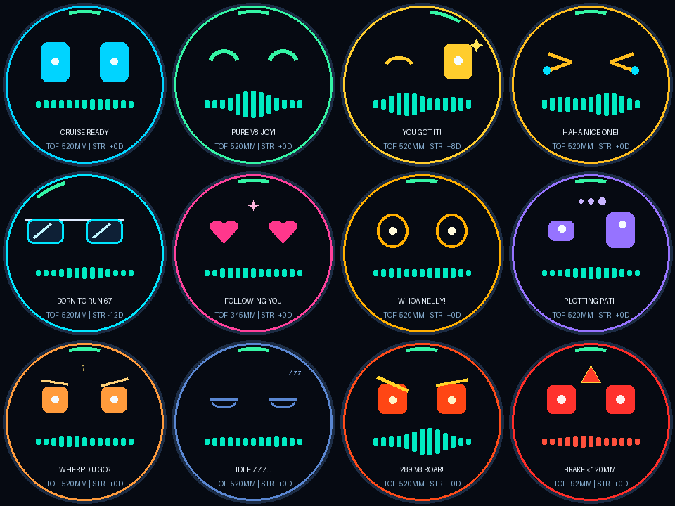
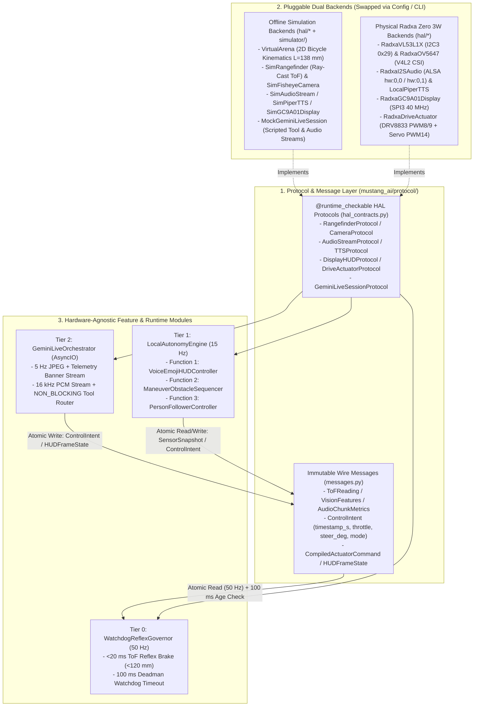
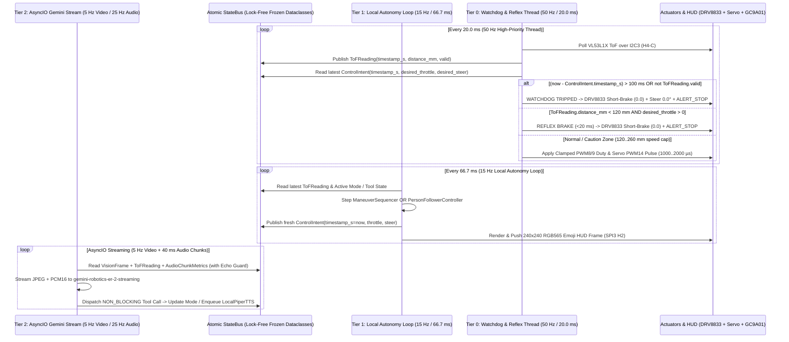
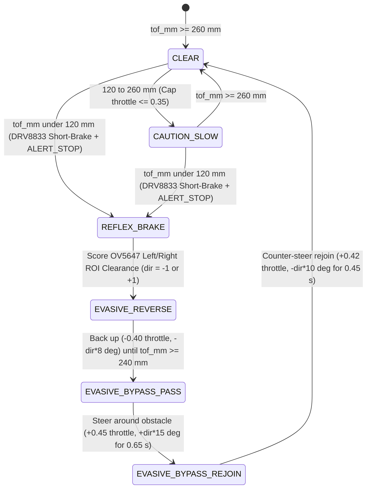

# 1:20 1967 Ford Mustang Fastback AI Edition (`v3.2.0`) — Software Architecture, Protocol Contracts & Pre-Hardware Verification Specification

> **Purpose:** Complete pre-implementation software design, module decomposition, `@runtime_checkable typing.Protocol` Hardware Abstraction Layer (HAL) contracts, inter-tier concurrency/watchdog rules, and 3-layer offline verification architecture for the standalone **`software/`** package. Designed so **100% of features, state machines, and failure modes are deterministically tested offline before connecting physical Radxa Zero 3W hardware**, while keeping the software completely decoupled from the 3D Blender CAD model (`mustang/`).



---

## 0. Locked Architectural & Design Decisions (`v3.2.0` Grill Alignment)

| Design Dimension | Locked Engineering Decision | Target Module / Contract |
| :--- | :--- | :--- |
| **1. Standalone Software Folder (`software/`)** | **100% Decoupled Top-Level `software/` Project (`pyproject.toml` + `src/mustang_ai/` + `tests/`)**: Completely separated from `mustang/` (the 3D Blender CAD scripts) and eliminating the naming collision with `mustang/ai_edition.py`. Contains zero `bpy` imports and deploys directly to `/opt/mustang/software/` on the Radxa Zero 3W. | `software/pyproject.toml`, `software/src/mustang_ai/` |
| **2. Hybrid Voice Architecture (`Function 1`)** | **Cloud Multimodal Audio-In (Zero Local STT) + Local `Piper ONNX` TTS (`~25 MB` RAM, `< 45 ms`)**: `gemini-robotics-er-2-streaming` natively accepts `[VIDEO, AUDIO, TEXT]` inputs (raw `16 kHz` PCM from `INMP441` streams directly to Gemini with **zero local STT model**), and outputs `TEXT` + Tool Calls (`response_modalities=["TEXT"]`). `LocalPiperTTS` synthesizes `spoken_text` locally into `16 kHz` PCM for the `MAX98357A` speaker, guarded by **Half-Duplex Auto-Mute + High-Threshold Barge-In (`RMS >= 0.55`)**. | `mustang_ai/hal/tts_piper.py`, `mustang_ai/features/voice_emoji_hud.py` |
| **3. Fun Emoji Rear Window HUD (`Function 1`)** | **12 Expressive Procedural Emojis (`240×240` RGB565)**: `CRUISE`, `HAPPY`, `WINK`, `LAUGH`, `COOL_SHADES`, `HEART_EYES`, `SURPRISED`, `THINKING`, `CONFUSED`, `SLEEPY`, `ANGRY_REV`, and `ALERT_STOP`, with steering-coupled pupil gaze and 13-bar live voice equalizer. | `mustang_ai/features/voice_emoji_hud.py`, `mustang_ai/hal/display_gc9a01.py` |
| **4. Predefined Action Macros (`Function 2`)** | **All 7 Core Tricks**: `circle_left`, `circle_right`, `figure_eight`, `slalom`, `spin_wiggle`, `u_turn_3pt`, and `patrol` executed at `15 Hz` via non-blocking Gemini tool calls. | `mustang_ai/features/maneuver_obstacle.py` |
| **5. Automatic Obstacle Avoidance (`Function 2`)** | **Auto Reverse + S-Curve Bypass**: Instant `< 20 ms` hardware short-brake at `VL53L1X < 120 mm` $\rightarrow$ optical left/right clearance score on `OV5647` lower ROIs $\rightarrow$ reverse `~150 mm` (`-0.40` throttle until `d >= 240 mm`) $\rightarrow$ `±15°` S-curve pass + counter-steer rejoin $\rightarrow$ resume interrupted maneuver. | `mustang_ai/features/maneuver_obstacle.py` |
| **6. Follow People with Camera (`Function 3`)** | **Full-Body / Legs & Torso Primary + Hand/Face Fallback (`350 mm` Standoff)**: Equidistant fisheye horizontal bearing PD steering ($\theta_x = \operatorname{degrees}((u - c_x)/f_x)$, $K_p = 0.42, K_d = 0.08$) coupled with 4-zone `VL53L1X` longitudinal standoff (`> 450 mm` approach, `220..450 mm` hold with `HEART_EYES`, `120..220 mm` gentle `-0.32` reverse, `< 120 mm` reflex brake). | `mustang_ai/features/person_follower.py` |
| **7. Runtime Concurrency & Watchdog Safety** | **Single-Process `asyncio` + High-Priority `50 Hz` Reflex Thread + `100 ms` Deadman Watchdog**: Tiers exchange immutable `@dataclass(frozen=True, slots=True)` messages (`SensorSnapshot`, `ControlIntent`, `CompiledActuatorCommand`, `HUDFrameState`) over an atomic `StateBus`. If `ControlIntent` is older than `100 ms` (Wi-Fi drop, camera stall, or loop hang), the `50 Hz` thread forces `DRV8833` short-brake (`throttle = 0.0`) and displays `ALERT_STOP`. | `mustang_ai/protocol/messages.py`, `mustang_ai/runtime/state_bus.py`, `mustang_ai/runtime/watchdog_reflex.py` |
| **8. Pre-Hardware 3-Layer Verification Suite** | **100% Testable Offline Before Hooking Up Hardware**: (1) `@runtime_checkable Protocol` HAL contract tests (`Sim*` vs. `Radxa*`), (2) Deterministic **2D Virtual Arena Simulator** ($L = 138\text{ mm}$ bicycle kinematics, ray-cast synthetic ToF, synthetic `OV5647` fisheye renderer, scripted `MockGeminiLiveSession`), and (3) Interactive Hardware Bring-Up CLI (`mustang-ai doctor --harness H1..H5`). | `software/tests/`, `mustang_ai/simulator/virtual_arena.py`, `mustang_ai/cli/doctor.py` |

---

## 1. Standalone `software/` Directory Tree & Packaging Boundary

To guarantee clean separation between **3D CAD / Printing (`mustang/`)** and **Embedded Autonomous Software (`software/`)**, all runtime, protocol, simulation, and test code resides in the top-level `software/` directory with its own `pyproject.toml`:

```text
mustang-67-fastback/
├── mustang/                                # 3D Blender CAD, STL/3MF Export & Animation ONLY (Requires bpy)
│   ├── body.py, chassis, interior, ...
│   ├── ai_edition.py                       # 3D CAD geometry for WaymoPod, GC9A01Bezel & Radxa Sled (55 STLs)
│   └── ai_animate.py                       # Blender 3D showcase animation renderer
│
└── software/                               # Standalone Python Software Package (ZERO Blender / bpy dependencies)
    ├── pyproject.toml                      # Independent package (`mustang-ai`), dependencies, pytest & ruff config
    ├── README.md                           # Quickstart for offline simulation, pytest, and Radxa deployment
    ├── src/
    │   └── mustang_ai/
    │       ├── __init__.py
    │       ├── config.py                   # Frozen dataclasses: RadxaPinConfig, CameraConfig, PiperTTSConfig, SafetyConfig
    │       │
    │       ├── protocol/                   # Formal Interfaces & Immutable Wire Contracts
    │       │   ├── __init__.py
    │       │   ├── hal_contracts.py        # @runtime_checkable Protocol classes for all 7 hardware/cloud boundaries
    │       │   └── messages.py             # Frozen dataclasses: SensorSnapshot, ControlIntent, CompiledActuatorCommand, HUDFrameState
    │       │
    │       ├── hal/                        # Hardware Abstraction Layer Implementations (Sim vs. Physical Radxa)
    │       │   ├── __init__.py
    │       │   ├── rangefinder_vl53l1x.py  # SimRangefinder & RadxaVL53L1X (I2C3 0x29 @ 50 Hz)
    │       │   ├── camera_ov5647.py        # SimFisheyeCamera & RadxaOV5647 (V4L2 /dev/video0 @ 15 Hz + ROI/Bearing math)
    │       │   ├── audio_i2s.py            # SimAudioStream & RadxaI2SAudio (ALSA hw:0,0 Mic + hw:0,1 MAX98357A Speaker)
    │       │   ├── tts_piper.py            # SimPiperTTS & LocalPiperTTS (piper-tts ONNX ~25 MB, <45 ms synthesis)
    │       │   ├── display_gc9a01.py       # SimGC9A01Display & RadxaGC9A01Display (SPI3 /dev/spidev3.0 @ 40 MHz, 240x240 RGB565)
    │       │   └── drive_actuators.py      # SimDriveActuator & RadxaDriveActuator (DRV8833 PWM8/9 + 1.7g Servo PWM14)
    │       │
    │       ├── features/                   # Core Functional Modules (Pure Protocol Consumers — Zero Direct Hardware I/O)
    │       │   ├── __init__.py
    │       │   ├── voice_emoji_hud.py      # Function 1: 12-Emoji Compositor, Half-Duplex Echo Guard & >=0.55 RMS Barge-In
    │       │   ├── maneuver_obstacle.py    # Function 2: 7 Predefined Tricks + Left/Right ROI Scorer + Auto-Reverse & S-Curve Bypass
    │       │   └── person_follower.py      # Function 3: Equidistant Fisheye Bearing PD Steer + 4-Zone 350 mm Laser Standoff
    │       │
    │       ├── runtime/                    # Concurrency, Safety Watchdog & Cloud Streaming Orchestration
    │       │   ├── __init__.py
    │       │   ├── state_bus.py            # Lock-free atomic state exchange between 50 Hz, 15 Hz, and AsyncIO tiers
    │       │   ├── watchdog_reflex.py      # Tier 0: 50 Hz ToF Reflex Governor + 100 ms Deadman Watchdog
    │       │   ├── local_autonomy_loop.py  # Tier 1: 15 Hz Sequencer, Follower, TTS Queue & GC9A01 HUD Frame Dispatcher
    │       │   └── gemini_live_stream.py   # Tier 2: gemini-robotics-er-2-streaming WebSocket Client & NON_BLOCKING Tool Router
    │       │
    │       ├── simulator/                  # Pre-Hardware 2D Virtual Arena & Mock Gemini Session
    │       │   ├── __init__.py
    │       │   ├── virtual_arena.py        # 1:20 Mustang Bicycle Kinematics (L=138 mm) + Ray-Cast ToF + Synthetic Fisheye Frame Generator
    │       │   └── mock_gemini_session.py  # Deterministic scripted tool-call & audio/video stream harness for offline E2E tests
    │       │
    │       ├── voice/                      # Milestone A (v3.3.0): Laptop & Radxa Full-Duplex Voice Stack
    │       │   ├── __init__.py
    │       │   ├── audio_engine.py         # 16 kHz 10 ms full-duplex stream, 70% volume cap, instant flush & motor noise injector
    │       │   ├── frontend.py             # WebRTC AEC3 + NS + HPF + AGC (livekit APM) + 4-tap NLMS & throttle thresholds
    │       │   ├── keywords.py             # Open-vocab KWS over keywords.txt, hot-reload & <3-syllable risk warning
    │       │   ├── vad.py                  # Streaming 10 ms VAD with 550 ms hangover -> 16 kHz WAV utterance segments
    │       │   ├── tts_stream.py           # Sentence-streamed Piper ONNX TTS with <=25-word cap (D13)
    │       │   ├── live_session.py         # Persistent per-conversation Gemini Live session + set_wake_word tool & D10 offline mode
    │       │   ├── conversation.py         # IDLE / LISTENING / THINKING / SPEAKING / FOLLOW_UP / STOP state machine (D1..D15)
    │       │   └── metrics.py              # S1..S7 telemetry ledger (ERLE dB, TTFA, barge-in latency, stop latency)
    │       │
    │       └── cli/                        # Command-Line Entry Points
    │           ├── __init__.py
    │           ├── run_agent.py            # `mustang-ai [live|voice-live|repl|simulate|voice-e2e|--self-test]`
    │           ├── voice_live.py           # `mustang-ai voice-live [--verify-only]` Milestone A voice stack runner
    │           └── doctor.py               # `mustang-ai doctor [--harness H1|H2|H3|H4|H5|all]` hardware bring-up diagnostics
    │
    └── tests/                              # Offline Pytest Verification Suite (40 tests, runs with Zero Hardware)
        ├── conftest.py                     # Shared fixtures: VirtualArena, StateBus, MockHALRig
        ├── test_protocol_contracts.py      # Verifies isinstance(backend, Protocol) across all Sim* and Radxa* classes
        ├── test_watchdog_and_safety.py     # Verifies <20 ms ToF short-brake (<120 mm) & 100 ms Deadman Watchdog timeout
        ├── test_fn1_voice_emoji_hud.py     # Verifies all 12 emojis, LocalPiperTTS synthesis, half-duplex mute & >=0.55 RMS barge-in
        ├── test_fn2_maneuver_obstacle.py   # Verifies all 7 tricks, optical ROI clearance, ~150 mm reverse & S-curve obstacle bypass
        ├── test_fn3_person_follower.py     # Verifies fisheye bearing math, PD steering clamp & 4-zone 350 mm standoff transitions
        ├── test_milestone_a_voice_pipeline.py # Verifies S1..S7, D1..D15 & R1 (AEC3 ERLE, motor noise, wake/stop barge-in, 8s follow-up)
        └── test_virtual_arena_e2e.py       # Closed-loop 2D kinematics + scripted Gemini Live tool-call multi-turn scenarios
```

---

## 2. Formal Protocol Contracts & Immutable Message Architecture (`mustang_ai/protocol/`)

Every feature module (`voice_emoji_hud.py`, `maneuver_obstacle.py`, `person_follower.py`) and runtime loop (`watchdog_reflex.py`, `local_autonomy_loop.py`, `gemini_live_stream.py`) depends **exclusively** on `@runtime_checkable typing.Protocol` interfaces and frozen dataclasses. No feature module ever imports `spidev`, `smbus2`, `alsaaudio`, or `/sys/class/pwm` directly.



### 2.1 Immutable Inter-Tier Wire Messages (`mustang_ai/protocol/messages.py`)

All state passed across threads/coroutines uses `@dataclass(frozen=True, slots=True)` with monotonic timestamps (`time.monotonic()`) so readers never see torn state and staleness is measured to microsecond precision:

| Message Dataclass | Producer $\rightarrow$ Consumer | Fields & Invariants |
| :--- | :--- | :--- |
| `ToFReading` | `RangefinderProtocol` $\rightarrow$ `Tier 0 (50 Hz)` & `StateBus` | `timestamp_s: float`, `distance_mm: int` (`10..4000`), `valid: bool`, `zone: Literal["EMERGENCY_STOP", "PERSONAL_SPACE", "CAUTION_SLOW", "STANDOFF_HOLD", "CLEAR"]` |
| `VisionFrameMetrics` | `CameraProtocol` $\rightarrow$ `Tier 1 (15 Hz)` & `Tier 2 (5 Hz)` | `timestamp_s: float`, `frame_seq: int`, `rgb_bytes: bytes`, `left_clearance_score: float`, `right_clearance_score: float`, `preferred_bypass_dir: Literal[-1, 1]`, `person_detected: bool`, `person_bearing_deg: float` (`-80°..+80°`), `person_box_2d: tuple[int, int, int, int] \| None` |
| `AudioChunkMetrics` | `AudioStreamProtocol` $\rightarrow$ `Tier 1` & `Tier 2` | `timestamp_s: float`, `pcm16_bytes: bytes` (`640` samples / `40 ms` @ `16 kHz`), `rms_level: float` (`0.0..1.0`), `muted_by_echo_guard: bool`, `barge_in_triggered: bool` (`rms_level >= 0.55` while speaker active) |
| `ControlIntent` | `Tier 1 (15 Hz)` $\rightarrow$ `Tier 0 (50 Hz)` via `StateBus` | `timestamp_s: float` (**checked by `100 ms` Deadman Watchdog**), `source_mode: Literal["IDLE", "MANUAL_TOOL", "MANEUVER", "EVASIVE_BYPASS", "FOLLOW_PERSON"]`, `desired_throttle: float` (`-1.0..+1.0`), `desired_steering_deg: float` (`-15.0°..+15.0°`), `active_maneuver: str` |
| `CompiledActuatorCommand` | `Tier 0 (50 Hz)` $\rightarrow$ `DriveActuatorProtocol` | `timestamp_s: float`, `applied_throttle: float` (`-1.0..+1.0`), `applied_steering_deg: float` (`-15.0°..+15.0°`), `motor_in1_duty: float`, `motor_in2_duty: float`, `servo_pulse_us: int` (`1000..2000`), `emergency_brake: bool`, `watchdog_tripped: bool`, `override_reason: str` |
| `HUDFrameState` | `Tier 1 / Tier 0` $\rightarrow$ `DisplayHUDProtocol` | `timestamp_s: float`, `emoji: str` (`ALLOWED_EMOJIS`), `caption: str` (`<= 16` chars), `tof_mm: int`, `steering_deg: float`, `voice_rms: float`, `alert_override: bool` |

### 2.2 The 7 Formal `@runtime_checkable Protocol` Contracts (`mustang_ai/protocol/hal_contracts.py`)

| Protocol Name | Harness & Physical Bus | Required Protocol Methods & Signatures | Contract Invariants Tested in `test_protocol_contracts.py` |
| :--- | :--- | :--- | :--- |
| `RangefinderProtocol` | **`H4-C`** (`VL53L1X` on `I2C3` `0x29`) | • `read_tof() -> ToFReading`<br>• `close() -> None` | Must return in `< 5 ms` (`50 Hz` budget = `20 ms`). On I2C bus error or timeout, returns `ToFReading(distance_mm=0, valid=False, zone="EMERGENCY_STOP")` (fail-closed). |
| `CameraProtocol` | **`H1-A`** (`OV5647` `160°` Fisheye on `MIPI CSI-2`) | • `capture_frame() -> bytes`<br>• `extract_vision_metrics(rgb_bytes: bytes, target_box_2d: tuple[int, int, int, int] \| None, target_mode: str) -> VisionFrameMetrics`<br>• `encode_telemetry_jpeg(rgb_bytes: bytes, tof_mm: int, steer_deg: float, emoji: str, mode: str) -> bytes` | `capture_frame()` returns `640×480×3` RGB bytes (`921,600 B`). `extract_vision_metrics()` computes equidistant fisheye bearing $\theta_x = \operatorname{degrees}((u - 320)/215)$ and lower-ROI left/right clearance scores. |
| `AudioStreamProtocol` | **`H1-B`** (`INMP441` Mic) + **`H3-A/B`** (`MAX98357A` Amp on `I2S3_M0`) | • `read_mic_chunk() -> AudioChunkMetrics`<br>• `play_pcm16_async(pcm16_bytes: bytes) -> None`<br>• `stop_playback() -> None`<br>• `is_playing() -> bool` | Enforces half-duplex echo guard: when `is_playing() == True` and `raw_rms < 0.55`, returns zeroed PCM (`muted_by_echo_guard=True`). When `raw_rms >= 0.55`, calls `stop_playback()` and sets `barge_in_triggered=True`. |
| `TTSProtocol` | Local CPU on `Radxa Zero 3W` (`RK3566`) | • `synthesize_to_pcm16(text: str) -> bytes` | Converts UTF-8 `spoken_text` into `16 kHz` 16-bit mono PCM bytes in `< 45 ms` (`piper-tts` ONNX with deterministic harmonic waveform fallback when binary is absent). |
| `DisplayHUDProtocol` | **`H2`** (`1.28"` Round `GC9A01` on `SPI3` `40 MHz`) | • `render_and_push(state: HUDFrameState) -> int`<br>• `last_rgb_image() -> Image.Image` | Renders `240×240` circular frame for all 12 core emojis + status ring + steering gaze + 13-bar voice equalizer, converts to `115,200 B` big-endian `RGB565`, and pushes over SPI. |
| `DriveActuatorProtocol` | **`H3-C / H4-A`** (`DRV8833` N25 Motor) + **`H4-B`** (`1.7g` Servo) | • `apply_command(cmd: CompiledActuatorCommand) -> None`<br>• `emergency_coast_all() -> None` | Maps `emergency_brake=True` to `DRV8833` `IN1=1.0, IN2=1.0` (active electromagnetic short-brake) and clamps steering strictly to `[-15.0°, +15.0°]` (`1000..2000 µs`). |
| `GeminiLiveSessionProtocol` | **`H5` / Wi-Fi 6** (`gemini-robotics-er-2-streaming`) | • `send_video_jpeg(jpeg_bytes: bytes) -> None`<br>• `send_audio_pcm16(pcm16_bytes: bytes) -> None`<br>• `receive_events() -> AsyncIterator[GeminiStreamEvent]`<br>• `send_tool_response(call_id: str, result: dict) -> None` | Abstracts the `google-genai` Live API WebSocket so `MockGeminiLiveSession` can inject deterministic tool calls (`speak_with_emoji`, `execute_maneuver`, `set_follow_person_mode`, `emergency_stop`) in offline tests. |

---

## 3. Concurrency, Timing & `100 ms` Deadman Watchdog Protocol (`mustang_ai/runtime/`)

### 3.1 Three-Tier Execution & Atomic `StateBus` Topology



### 3.2 Mandatory Fault-Injection & Fail-Safe Matrix (Verified in `test_watchdog_and_safety.py`)

| Fault / Failure Scenario | Detection Mechanism & Threshold | Automatic Fail-Safe Action |
| :--- | :--- | :--- |
| **1. Tier 1 (`15 Hz`) Hang or Camera V4L2 Freeze** | `ReflexThread` checks `now - control_intent.timestamp_s > 0.100` (`100 ms` Deadman Watchdog). | Forces `DRV8833` short-brake (`IN1=1, IN2=1`), centers servo (`1500 µs`), sets `watchdog_tripped=True`, and displays `ALERT_STOP` (`"WATCHDOG BRAKE"`). Automatically recovers once a fresh `ControlIntent` (`age <= 100 ms`) arrives. |
| **2. `VL53L1X` I2C3 Bus Glitch or Disconnected Cable (`H4-C`)** | `read_tof()` catches `OSError` / invalid range (`<= 0` or `> 4000 mm`) and returns `valid=False`. | Treated identically to `< 120 mm` obstacle for forward motion: blocks all positive `throttle > 0.0` (`override_reason="TOF_SENSOR_FAULT"`), allowing only `0.0` or reverse recovery. |
| **3. Sudden Front Obstacle (`< 120 mm`) During Any Trick or Follow Mode** | `ToFReading.distance_mm < 120` detected in `50 Hz` loop (`< 20 ms` latency). | Immediate hardware short-brake in Tier 0; Tier 1 transitions `ManeuverSequencer` into `EVASIVE_REVERSE` (`-0.40` throttle until `d >= 240 mm`) $\rightarrow$ `EVASIVE_BYPASS_PASS` (`±15°` toward clearer optical ROI) $\rightarrow$ `EVASIVE_BYPASS_REJOIN`. |
| **4. Wi-Fi Disconnect / Cloud WebSocket Drop** | `gemini_live_stream.py` catches WebSocket disconnect/timeout. | Local `50 Hz` and `15 Hz` loops continue running safely; if no autonomous trick is active, transitions to `IDLE` (`throttle=0.0`, `CONFUSED` emoji `"WIFI RETRY..."`) while background exponential backoff reconnects. |
| **5. User Shouts `"Stop!"` During Loud Speaker Playback** | `AudioStreamProtocol.read_mic_chunk()` detects `raw_rms >= 0.55` while `is_playing() == True`. | Immediately terminates `LocalPiperTTS` / `MAX98357A` playback, unmutes the mic chunk for Gemini, and triggers `emergency_stop("VOICE BARGE-IN")`. |
| **6. Person Walks Out of `160°` Camera Frame During `FOLLOW_PERSON`** | `VisionFrameMetrics.person_detected == False` for `> 1.5 s` (`22` frames at `15 Hz`). | Halts forward motion (`throttle = 0.0`), holds last known steering gaze angle, and displays `CONFUSED` (`"WHERE'D U GO?"`) until person re-enters frame. |

---

## 4. Feature-by-Feature Engineering Breakdown (`mustang_ai/features/`)

### 4.1 Feature Module 1: `voice_emoji_hud.py` (`VoiceEmojiHUDController`)
- **Inputs**: `AudioChunkMetrics` (from `AudioStreamProtocol`), tool call `speak_with_emoji(emoji, hud_message, spoken_text)`, current `ToFReading`, and `CompiledActuatorCommand`.
- **Processing**:
  1. Validates `emoji` against `ALLOWED_EMOJIS` (fallback to `CRUISE`) and truncates `hud_message` to `16` uppercase characters.
  2. When `spoken_text` is non-empty, invokes `TTSProtocol.synthesize_to_pcm16(spoken_text)` (`LocalPiperTTS`, `< 45 ms`) and dispatches non-blocking audio playback to `AudioStreamProtocol.play_pcm16_async()`.
  3. Computes real-time playback/mic RMS energy (`0.0..1.0`) to animate the 13-bar bottom voice equalizer on the `240×240` `GC9A01` display while shifting pupil horizontal offset proportional to `applied_steering_deg` (`-15°..+15°`).
  4. If `ToFReading.distance_mm < 120` or `watchdog_tripped == True`, overrides the HUD to `ALERT_STOP` (`"BRAKE <N>MM"` or `"WATCHDOG BRAKE"`).
- **Outputs**: `HUDFrameState` pushed to `DisplayHUDProtocol.render_and_push()` at `15 Hz`, plus `barge_in_triggered` flag to `StateBus`.

### 4.2 Feature Module 2: `maneuver_obstacle.py` (`ManeuverObstacleSequencer`)
- **Inputs**: Tool call `execute_maneuver(maneuver_name, speed_scale)`, `ToFReading` (`50 Hz`), and `VisionFrameMetrics` (`left_clearance_score`, `right_clearance_score`, `preferred_bypass_dir`).
- **Processing**:
  1. Maintains the 7-trick step library (`circle_left`, `circle_right`, `figure_eight`, `slalom`, `spin_wiggle`, `u_turn_3pt`, `patrol`) with elapsed timer freezing whenever an obstacle avoidance state is active.
  2. Executes the 5-state obstacle avoidance machine:
     - `CLEAR` (`tof_mm >= 260 mm`): Runs active maneuver step at requested `throttle * speed_scale`.
     - `CAUTION_SLOW` (`120 mm <= tof_mm < 260 mm`): Clamps forward `throttle <= 0.35`.
     - `EVASIVE_REVERSE` (triggered when `tof_mm < 120 mm` during forward motion): Latches `preferred_bypass_dir` (`-1` left or `+1` right from `OV5647` lower-ROI optical clearance) and reverses at `throttle = -0.40, steer = -bypass_dir * 8.0°` (`SURPRISED`, `"BACKING UP..."`) until `tof_mm >= 240 mm` (`~150 mm` physical back-up) or `1.2 s` max.
     - `EVASIVE_BYPASS_PASS`: Drives forward (`throttle = +0.45, steer = +bypass_dir * 15.0°`, `THINKING`, `"BYPASS LEFT/RIGHT"`) for `0.65 s`.
     - `EVASIVE_BYPASS_REJOIN`: Counter-steers (`throttle = +0.42, steer = -bypass_dir * 10.0°`, `HAPPY`, `"PATH CLEAR!"`) for `0.45 s`, then resumes the paused maneuver step.
- **Outputs**: `ControlIntent` (`desired_throttle`, `desired_steering_deg`, `source_mode`) and HUD emoji/caption update.



### 4.3 Feature Module 3: `person_follower.py` (`PersonFollowerController`)
- **Inputs**: Tool call `set_follow_person_mode(enabled, target_mode, target_box_2d, standoff_mm)`, `VisionFrameMetrics` (`person_detected`, `person_bearing_deg`), and `ToFReading` (`distance_mm`).
- **Processing**:
  1. **Equidistant Fisheye Bearing Extraction**: From either Gemini's `[ymin, xmin, ymax, xmax]` (`0..1000`) bounding box or local silhouette tracker (`target_mode="body_legs_torso"` primary, `"hand_or_face"` fallback), computes horizontal bearing $\theta_x = \operatorname{degrees}((u_{\text{px}} - 320.0) / 215.0)$.
  2. **PD Steering Law (`15 Hz`)**: Computes $\delta_{\text{steer}} = \operatorname{clamp}(0.42 \cdot \theta_x + 0.08 \cdot \dot{\theta}_x, -15.0^\circ, +15.0^\circ)$.
  3. **4-Zone Longitudinal Standoff Controller**:
     - `tof_mm > 450 mm` (`APPROACHING`): $u_{\text{thr}} = \operatorname{clamp}(0.28 + 0.00055 \cdot (d_{\text{tof}} - 350), 0.28, 0.65)$, `HEART_EYES` (`"FOLLOWING YOU"`).
     - `220 mm <= tof_mm <= 450 mm` (`STANDOFF_HOLD` around `350 mm`): $u_{\text{thr}} = 0.0$ while continuing to steer toward person, `HEART_EYES` (`"LOCKED 350MM"`).
     - `120 mm <= tof_mm < 220 mm` (`PERSONAL_SPACE_BACKUP`): $u_{\text{thr}} = -0.32$, `WINK` (`"SPACE BACKUP"`).
     - `tof_mm < 120 mm` (`EMERGENCY_STOP`): $u_{\text{thr}} = 0.0$ + short-brake, `ALERT_STOP` (`"TOO CLOSE!"`).
- **Outputs**: `ControlIntent` and HUD state (`HEART_EYES` / `WINK` / `CONFUSED` / `ALERT_STOP`).

---

## 5. Three-Layer Pre-Hardware Verification & Bring-Up Protocol

Before connecting any physical cables to the `Radxa Zero 3W`, the entire software stack must pass **Layers 1 and 2** offline (`0` hardware required), and then execute **Layer 3** one harness at a time during physical bench bring-up:

### Layer 1: Protocol Contract & Unit Fault-Injection Suite (`software/tests/`)
| Test Module | What It Verifies Offline (Zero Hardware) | Pass Criteria |
| :--- | :--- | :--- |
| `test_protocol_contracts.py` | Checks `isinstance(sim_obj, Protocol)` and `isinstance(radxa_obj, Protocol)` across all 7 HAL interfaces (`RangefinderProtocol`, `CameraProtocol`, `AudioStreamProtocol`, `TTSProtocol`, `DisplayHUDProtocol`, `DriveActuatorProtocol`, `GeminiLiveSessionProtocol`). | `14/14` backend classes satisfy `@runtime_checkable` protocol signatures. |
| `test_watchdog_and_safety.py` | Simulates (a) `ToF < 120 mm` reflex brake, (b) `ToF` I2C read failure (`valid=False`), and (c) Tier 1 stall (`ControlIntent` age `> 100 ms`). | Short-brake engages within `1` tick (`20 ms`); Deadman Watchdog trips at `> 100 ms` and auto-recovers on fresh intent. |
| `test_fn1_voice_emoji_hud.py` | Renders all 12 core emojis to `240×240` `RGB565` (`115,200 B`), synthesizes speech via `LocalPiperTTS`, verifies half-duplex mic mute during playback, and injects a `0.72` RMS shout to verify barge-in cancellation. | All 12 emoji frames non-blank & distinct; PCM16 output `> 16,000 B`; barge-in cancels playback in `1` chunk (`40 ms`). |
| `test_fn2_maneuver_obstacle.py` | Steps all 7 tricks (`circle_left` .. `patrol`), injects a `95 mm` obstacle mid-circle with asymmetric optical clutter (`right_clear > left_clear`), and verifies `EVASIVE_REVERSE` $\rightarrow$ `EVASIVE_BYPASS_PASS` $\rightarrow$ `EVASIVE_BYPASS_REJOIN` $\rightarrow$ trick resumption. | All 7 tricks match steering/throttle profiles; obstacle recovery backs up until `d >= 240 mm` and steers `+15°` toward clearer side. |
| `test_fn3_person_follower.py` | Sweeps target pixel `u_px` across `0..640 px` and `ToF` across `680 mm -> 350 mm -> 175 mm -> 90 mm`, plus `> 1.5 s` target loss. | Steering tracks bearing within `[-15°, +15°]`; standoff holds `0.0` throttle at `350 mm`, reverses `-0.32` at `175 mm`, brakes at `90 mm`, and shows `CONFUSED` on target loss. |

### Layer 2: Closed-Loop 2D Virtual Arena Simulator (`mustang_ai/simulator/virtual_arena.py` & `test_virtual_arena_e2e.py`)
Models the physical `1:20` Mustang inside a 2D coordinate arena ($x, y, \psi$ in millimetres, wheelbase $L = 138.0\text{ mm}$):
$$\dot{x} = v \cos\psi, \quad \dot{y} = v \sin\psi, \quad \dot{\psi} = \frac{v}{L} \tan\delta_{\text{steer}}, \quad v = v_{\max} \cdot u_{\text{applied\_throttle}}$$
1. **Ray-Cast Synthetic `VL53L1X` ToF**: Casts a forward cone from the front valance (`+113 mm` ahead of car center) against virtual box obstacles and a virtual walking person to compute exact physical `distance_mm`.
2. **Synthetic `OV5647` `160°` Fisheye Renderer**: Projects 3D arena obstacles and the walking person into `640×480` RGB frames using the equidistant fisheye projection $u = c_x + f_x \cdot \theta_x$, so `extract_vision_metrics()` runs its real pixel-level ROI and bearing algorithms during simulation.
3. **Closed-Loop Multi-Turn Scenario (`test_virtual_arena_e2e.py`)**:
   - **Scenario A**: `MockGeminiLiveSession` emits `speak_with_emoji("COOL_SHADES", "LET'S ROLL!", "Starting figure eight")` + `execute_maneuver("figure_eight")`; virtual obstacle placed at `(x=600 mm, y=0 mm)` triggers real ray-cast ToF `< 120 mm`, reverses the simulated car in 2D space until ray-cast ToF reaches `240 mm`, bypasses the box on the clearer right side, and completes the figure-eight with `0` obstacle collisions (`min_clearance_mm >= 85 mm`).
   - **Scenario B**: Virtual person walks a curved path from `(800 mm, 150 mm)` to `(1400 mm, -200 mm)` and then steps back toward the car; `PersonFollowerController` steers the simulated Mustang along the trajectory, settles at `350 ± 35 mm` standoff, and backs up when the person steps closer than `220 mm`.

### Layer 3: Interactive Hardware Bring-Up Diagnostic CLI (`mustang-ai doctor`)
Once offline tests pass, connect one physical harness at a time on the bench (with wheels off the table) and run:
```bash
# Run offline pytest verification suite first (on Mac/Linux or Radxa, zero hardware needed)
cd software && uv run pytest -v

# Step-by-step physical harness bring-up on Radxa Zero 3W before full driving:
uv run mustang-ai doctor --harness H4   # Verify I2C3 VL53L1X (0x29) live distance + Servo center (1500 us) + N25 10% pulse
uv run mustang-ai doctor --harness H2   # Flash 12-emoji test pattern onto 1.28-inch Round GC9A01 SPI3 HUD
uv run mustang-ai doctor --harness H1   # Capture 1 frame from OV5647 (/dev/video0) + record 2s INMP441 mic RMS
uv run mustang-ai doctor --harness H3   # Synthesize Piper TTS test phrase & play through MAX98357A I2S speaker
uv run mustang-ai doctor --harness all  # Full 5-harness pre-flight sign-off
```

---

## 6. Minimal Early-Test 3D Print Manifest (Skip `34` Cosmetic STLs / `47` Pieces)

Out of the full `55` STLs (`75` printed pieces in `output/ai_edition/stl/`), **`34` STLs (`47` pieces) are purely cosmetic bodywork, trim, lamps, and V8 dress-up parts** (`hood`, `trunk_lid`, `door_l/r`, `door_card_l/r`, `vent_window_l/r`, `engine_block`, `valve_cover_l/r`, `air_cleaner`, `brace`, `hood_prop`, `grille`, `grille_surround`, `corral_emblem`, `fog_lamp_x2`, `headlight_x2`, `park_light_x2`, `taillight_lens_l/r_x3`, `taillight_bezel_l/r_x3`, `gas_cap`, `bumper_front`, `bumper_rear`, `exhaust_x2`, `backup_light_x2`, `mirror`, `steering_wheel`, plus 3 unused coupler variants).

To start early hardware and functional testing as fast as possible, print in **two progressive functional stages**:

### Stage 1: Minimal "Open-Top Rolling Chassis & Avionics Mule" (`16` STLs / `23` Pieces — Zero Body Shell Needed)
> **What You Can Test Immediately**: 100% of `Radxa Zero 3W` board retention (`Z = 36.0 mm` L-rails), 2S LiPo + 5V BEC fit, `1524` speaker + `MAX98357A` + `DRV8833` pockets, under-floor wire conduit (`H4`), `VL53L1X` front laser `< 20 ms` emergency brake, `N25` `7T:9T` bevel drivetrain, `±15°` servo steering, all 7 driving maneuvers (`circle_left` .. `patrol`), and `LocalPiperTTS` voice synthesis (`waymo_pod.stl` and `gc9a01_bezel.stl` can also be printed in `16 min` and temporarily taped to the mule before printing `body.stl`).

| Subsystem Group | Required STL Files (`output/ai_edition/stl/`) | STL Count | Piece Qty | Bambu X2D Plate Group | Functional Purpose |
| :--- | :--- | :-: | :-: | :--- | :--- |
| **1. Core Tubs, Conduit & Radxa Cradle** | `chassis.stl`, `bay_tub.stl`, `interior_tub.stl`, `boot_tub.stl` | `4` | `4` | Plate 4 (`2_black`) | Holds `VL53L1X` (`BayTub_ToFSlot`), `1.7g` Servo (`BayTub_ServoBed`), `N25` motor (`BayTub_N25Bed`), `4.0 × 5.05 mm` wire conduit, `1524` speaker (`Tub_AISpeakerBay`), `MAX98357A` + `DRV8833` (`Tub_AIAmpDrvBay`), 2S LiPo + 5V BEC (`BootTub_AIClearFloor`), and the `Radxa Zero 3W` L-rail shelves. |
| **2. Rear Bevel Drivetrain (`7:9`)** | `axle.stl`, `diff_cover.stl`, `driveshaft.stl`, `pinion_gear.stl`, `axle_gear.stl`, `motor_coupler_n25.stl`, `motor_shim_x2.stl` | `7` | `8` | Plates 4, 5, 6 (`2_black`, `3_silver`, `3_silver_small`) | Couples the `N25` gearmotor shaft through the horizontal `Driveshaft` (`7T` `PinionGear` $\rightarrow$ `9T` `AxleGear`) to the octagonal rear `Axle_R` (`15` STLs / `21` pcs total if `motor_shim_x2.stl` is omitted for a `10 mm` tall motor). |
| **3. Front Steering & Rolling Wheels** | `knuckle_l.stl`, `knuckle_r.stl`, `steering_link.stl`, `rim_x4.stl`, `tire_x4.stl` | `5` | `11` | Plates 4 & 5 (`2_black`, `3_silver`) | Provides `±15°` kingpin steering and rolling traction for floor testing. |
| **Stage 1 Subtotal** | **`16` STLs (`15` without shims)** | **`16`** | **`23` (`21` w/o shims)** | **Single Black Plate + 7 Silver Parts (`~2.5 hrs` total print)** | **100% Rolling Drivetrain, Steering, ToF Reflex & Audio Mule** |

### Stage 2: Full Optical Geometry & Sub-Surface HUD Upgrade (`+5` STLs / `+5` Pieces = `21` STLs / `28` Pieces Total)
> **What It Unlocks**: Locks the **`OV5647` `160°` Fisheye Camera + `INMP441` Mic** at the exact roof elevation (`Z = 64.5 mm`) and mounts the **`1.28"` Round `GC9A01` Rear Window HUD** flush inside `Glass_Rear` (`X = 158.0 mm, Z = 54.0 mm`) for final calibration of **Function 1 (Rear Window Emoji HUD)**, **Function 2 (Optical Left/Right ROI Obstacle Bypass)**, and **Function 3 (Fisheye Bearing Person-Following)**.

| Subsystem Group | Additional STL Files (`output/ai_edition/stl/`) | STL Count | Piece Qty | Bambu X2D Plate Group | Functional Purpose |
| :--- | :--- | :-: | :-: | :--- | :--- |
| **4. Roof Camera Pod & HUD Bezel** *(Can also be printed during Stage 1 in `~16 min`)* | `waymo_pod.stl`, `gc9a01_bezel.stl` | `2` | `2` | Plate 3 (`1_doors`) & Plate 6 (`3_silver_small`) | Houses `OV5647` fisheye camera + `INMP441` MEMS mic (`H1`) and retains the `1.28"` Round `GC9A01` SPI display (`H2`). |
| **5. Main Shell & Tinted Glass Inlays** | `body.stl`, `windshield.stl`, `rear_glass.stl` | `3` | `3` *(1 assembled print)* | Plate 1 (`1_body`) | Provides `Cut_WaymoSocket`, `Cut_WaymoChimney` (`2.7 × 17.0 mm` cable drop), `Cut_RadxaBulkheadBridge` (`Z = 36.0 mm` center support), and `Cut_RearGlassHUD` window aperture. |
| **Stage 1 + Stage 2 Total** | **`21` STLs (out of `55`)** | **`21`** | **`28` pcs (out of `75`)** | **Skips `34` Cosmetic STLs (`47` pieces saved)** | **100% Complete Functional AI Mustang (All 3 Major Functions)** |

