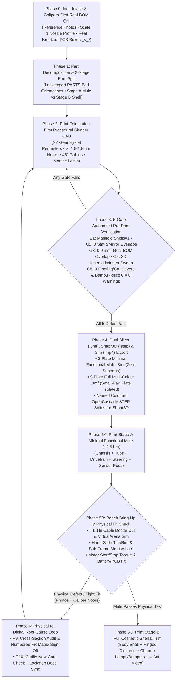

# Universal 3D Mechatronics & Printable Product Build Workflow (`R1..R10` & `G1..G5`)

> **Quick Links**: [Back to Main README](../README.md) | [Agent Skill (`.claude/skills/procedural-3d-mechatronics/SKILL.md`)](../.claude/skills/procedural-3d-mechatronics/SKILL.md) | [Design Thinking & Verification](design-thinking-and-verification.md) | [Printing & RC Guide](printing-and-rc-guide.md) | [AI Edition Guide](ai-edition-gemini-robotics-guide.md)

This document defines the **portable, project-agnostic Standard Operating Process, Repository Template Layout, 10 Engineering Rules (`R1..R10`), and 5 Pre-Print Verification Gates (`G1..G5`)** distilled from the `1:20` 1967 Ford Mustang Fastback (`e-Mustang` & `e-Mustang AI Edition`).

For any future creative 3D-printable, RC, or AI-embodied build, the user provides only the **initial Idea**, and the engineering workflow proceeds deterministically through **Phases 0 to 6**.

---

## 1. End-to-End Closed-Loop Workflow Diagram

---

## 2. Seven-Phase Standard Operating Process (`Phase 0` to `Phase 6`)

| Phase | Standard Process Stage | User Input / Trigger | Agent Automated Actions & Enforced Rules (`R1..R10` / `G1..G5`) | Stage Output Deliverables |
| :--- | :--- | :--- | :--- | :--- |
| **Phase 0** | **Idea Intake & Real-BOM Grill** | User provides raw idea + reference photos + target hardware list. | Grill user on scale, printer/nozzle profile, moving DoFs, and **Calipers-First Real-BOM envelopes (`R1`, `_v_*` including PCB carriers, headers, lenses, ribbons, LiPo & BEC)**. | Locked Spec, Station Table & `_v_*` BOM Envelope Table. |
| **Phase 1** | **Part Decomposition & 2-Stage Print Split** | Approved Phase 0 Spec. | Split model into `Body`, `Sub-Frames/Tubs`, `Chassis`, `Drivetrain/Linkages`, and `Trim`; lock `export.PARTS` bed orientations; define **Stage A Minimal Functional Mule** vs **Stage B Full Cosmetic Shell (`R2`)**. | Part Manifest, Colour Map & 2-Stage Plate Plan. |
| **Phase 2** | **Print-Orientation-First Procedural Blender CAD** | Part Manifest & Station Tables. | Author parametric Python CAD (`cad/*.py`): `XY`-plane gear teeth/eyelets (`R2`), `>= 1.5-1.8 mm` lip/collar necks & `>= 3.4 mm` octagonal shafts (`R3`), `0` radial snap undercuts + axial keys (`R4`), `45°` gable roofs (`R5`), mortise-and-tenon sub-frame locks + double-shear kingpins (`R6`), open-bottom U-channels + partitioned wire conduits (`R7`). | Procedural Blender Python modules (`cad/*.py`). |
| **Phase 3** | **5-Gate Pre-Print Verification Loop** | Built Blender Scene. | Run headless verification until all 5 gates pass: **`G1` Manifold/Shells=1**, **`G2` `0.0 mm³` Static/Mirror Overlaps**, **`G3` `0.0 mm³` Real-BOM `_v_*` Overlap**, **`G4` `0.0 mm³` Kinematic & `+Z/-Z` Insertion Sweeps**, **`G5` `0` Floating/Cantilevers & `0` Slicer Warnings**. | Machine-verified JSON report (`tmp/build_report.json`). |
| **Phase 4** | **Dual Slicer (`.3mf`), Shapr3D (`.step`) & Sim Export** | Green `G1..G5` Gates. | Export print & assembled STLs; build **3-Plate Minimal Mule `.3mf`** + **Full Multi-Colour `.3mf`** with isolated small-part plate & outer brims (`R8`); convert to named, coloured OpenCascade **`.step` solids** for Shapr3D; render 4-Act assembly `.mp4`. | `output/*.3mf` (Mule + Full), `output/*.step`, `output/stl/`, `.mp4`. |
| **Phase 5** | **Mule Print, Bench Bring-Up & Assembly Guide** | Exported Mule `.3mf` & Software HAL. | Generate step-by-step `+Z/-Z` assembly & pin-by-pin harness guide (`H1..Hn`); run offline `VirtualArena` sim + bench `doctor --harness all`; user prints & assembles Stage A Mule (`~2.5 hrs`) before Stage B shell. | `docs/printing-and-assembly-guide.md`, `docs/ai-hardware-guide.md`. |
| **Phase 6** | **Physical-to-Digital Root-Cause Feedback Loop** | User photos / fit & strength feedback from physical print. | **`R9` (Audit-Before-Action)**: Measure exact failure cross-section in print mm and output numbered Fix Matrix for sign-off; apply CAD fix; **`R10` (Gate Ratchet & Lockstep Docs)**: add regression check to `printcheck.py`, rebuild `.3mf`/`.step`, and sync `README.md`, `AGENTS.md`, `CHANGELOG.md`, and `docs/*.md`. | Next `[vX.Y.Z]` release with ratcheted gates & synced docs. |

---

## 3. Ten Golden Engineering Rules (`R1..R10`)

1. **`R1` - Calipers-First Real-BOM Envelope Rule**:
   - Never size internal pockets from bare IC or display glass dimensions (`14 × 14 mm` or `Ø 32.4 mm`).
   - Model every electronic and mechanical component as an explicit 3D virtual bounding box (`_v_*`) using its **full breakout PCB + solder header + lens barrel + ribbon/wire-bend clearance**, and assert `0.000 mm³` overlap against all printed parts (`Gate G3`).
2. **`R2` - Mandatory 2-Stage Print Split (`Mule-Before-Shell`)**:
   - Always generate a **Stage A Minimal Functional Mule `.3mf`** (`2-3` zero-support plates containing only the chassis, inner tubs, drivetrain, steering linkage, wheels, and sensor pods) alongside the **Stage B Full Multi-Colour `.3mf`**.
   - Physical drivetrain, steering, sub-frame registration, and electronics fit must be validated on the `< 3 hr` Stage A Mule before committing to a `15+ hr` cosmetic body print.
3. **`R3` - Print-Orientation & XY Perimeter Load Rule (`0.4 mm` Nozzle Standards)**:
   - Declare every part's bed orientation in `export.PARTS` before writing geometry.
   - Place all gear teeth, spline sockets, crush bores, and steering clevis eyelets in the **`XY` bed plane** so continuous Arachne perimeter loops resist hoop and shear stress.
   - Enforce minimum structural cross-sections:
     - **Rim lip necks, motor couplers & gear collars**: `>= 1.50-1.80 mm` (`4` continuous perimeter walls).
     - **Steering clevis eyelet walls**: `>= 1.00-1.20 mm` (`2-3` perimeter walls) around `>= Ø 1.50 mm` pins.
     - **Octagonal drive axles & wheel stubs**: `>= 3.40 mm` across flats (`8`-lobe octagonal hub socket bore on rims so reversible AI start/stop torque pushes against flat faces instead of wedging corners).
     - **Steering tie-rod beams**: `>= 3.40 × 2.10 mm` rectangular/filleted bar.
     - **Bevel gears**: Solid tooth-root cores on pinions (stop internal socket ahead of teeth) and stress-relieved circular front bores under crown-gear tooth valleys.
4. **`R4` - Zero Radial Undercut & Calibrated Fit Clearances**:
   - Never use closed radial snap-fit undercuts on rigid PLA/PETG rims or housings (`0` radial undercut).
   - Use **`0.20-0.22 mm`/side radial clearance**, a `45°` lead-in chamfer, and **open-ended axial drive keys** for hand-slide tire/rim assembly.
   - Use **`0.07-0.08 mm`/side clearance** for close-running bearings (`Chassis_BossR`, `Knuckle_Bore`) and octagonal spline sockets (`MotorCoupler`, `PinionGear`, `AxleGear`).
5. **`R5` - `45°` Self-Supporting Internal Cavities**:
   - Every horizontal tunnel, wire conduit, and bottom mortise socket on support-free parts must terminate in a **`45°` gable roof or `<= 30°` conical bevel** (`nz > -0.95`) with zero horizontal steps `> 0.20 mm` above `Z = 0` (`floating == []`, `cantilevers == []`).
6. **`R6` - Positive Sub-Frame Mortise-and-Tenon Interlocks & Double-Shear Pivots**:
   - Never butt-glue flat tubs onto a flat chassis. Lock every inner sub-frame (`BayTub`, `InteriorTub`, `DoorCard`) in `X`, `Y`, and `Z` using **`45°` gable-roofed mortise-and-tenon bosses** and recessed solid servo/motor cradle floors on `Chassis`.
   - Capture steering kingpins and high-load pivots at both bottom and top (**double shear**).
7. **`R7` - Open-Bottom U-Channels & Partitioned Wire Conduits**:
   - Use open-bottom `45°` gable U-channels for driveshafts and linkages so sub-assemblies push straight together (`+Z` or `-Z`) without blind threading, separated by a solid `>= 1.0 mm` wall from enclosed wire conduits.
8. **`R8` - Small-Part Plate Isolation & Outer-Only Brims**:
   - Isolate miniature gears, couplers, and trims onto a dedicated low-Z plate (`max_z <= 10.5 mm`) with `brim_type: outer_only` (`3-5 mm`), `20-25 mm/s` small-perimeter speeds, and `reduce_crossing_wall: 1`.
9. **`R9` - Audit-Before-Action Physical Feedback Protocol**:
   - When the user reports physical print defects or uploads photos, first measure the exact failure cross-section in print mm (`wall thickness`, `radial gap`, `shear area`, `pocket L × W × H`) and present a **numbered Root-Cause & Fix Matrix** for user approval before editing CAD code.
10. **`R10` - Gate Ratchet & Lockstep Documentation Sync**:
    - Every physical fix must add a permanent geometric check to `printcheck.py` / `verify_virtual_hardware()`, regenerate STLs / `.3mf` / `.step`, and update `README.md`, `AGENTS.md`, `CHANGELOG.md`, and `docs/*.md` in the same turn.
