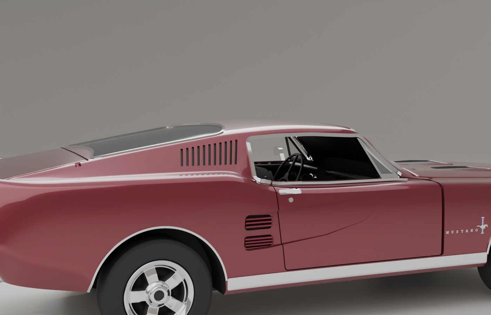
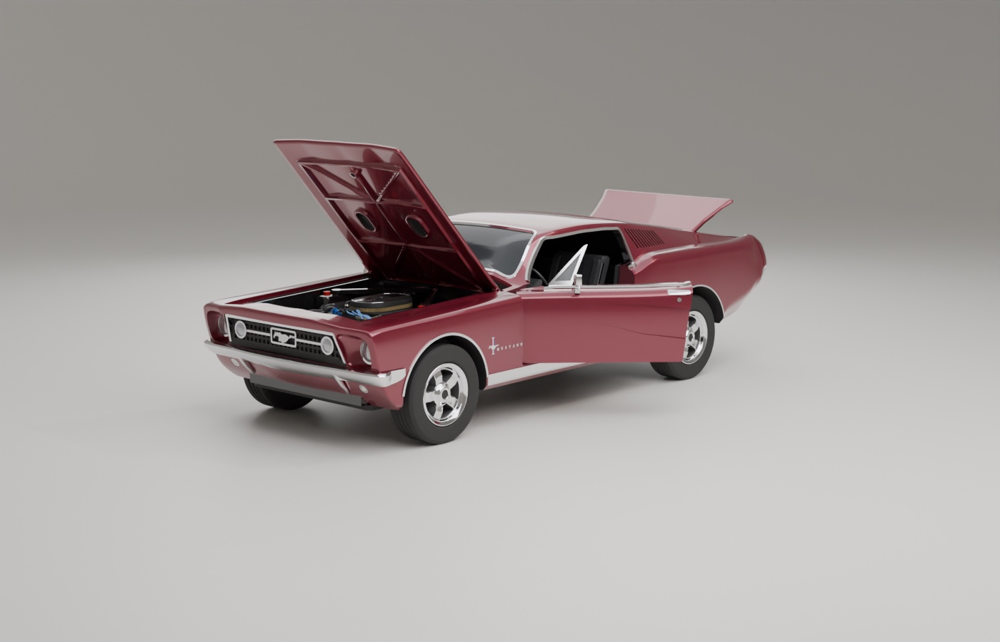
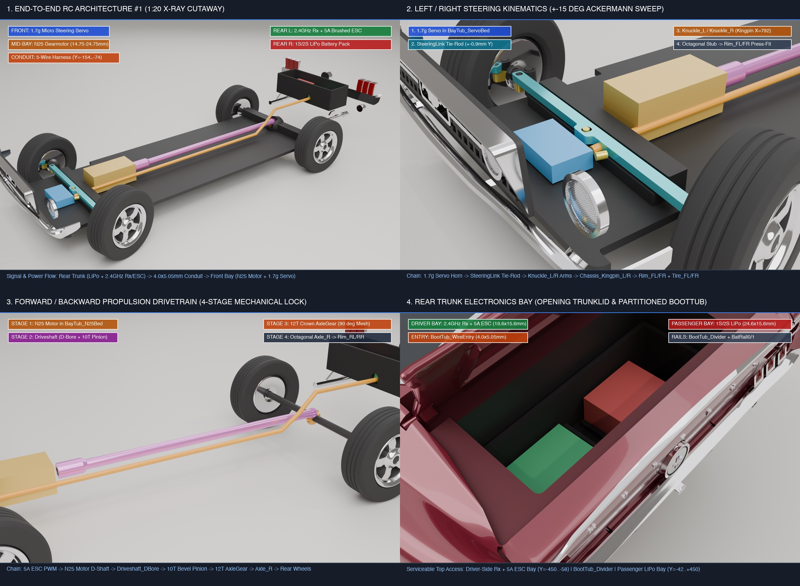
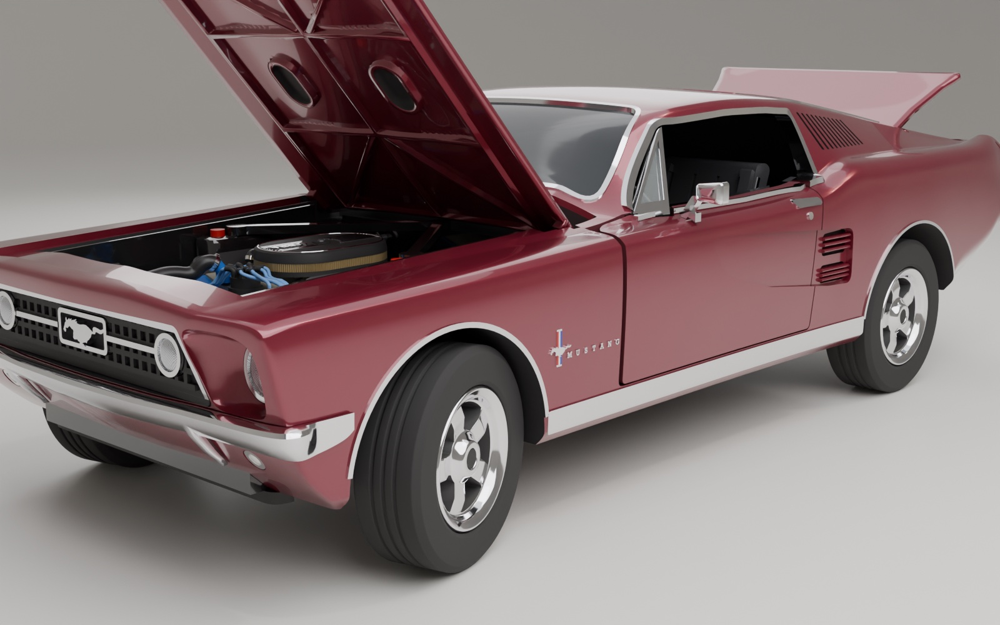
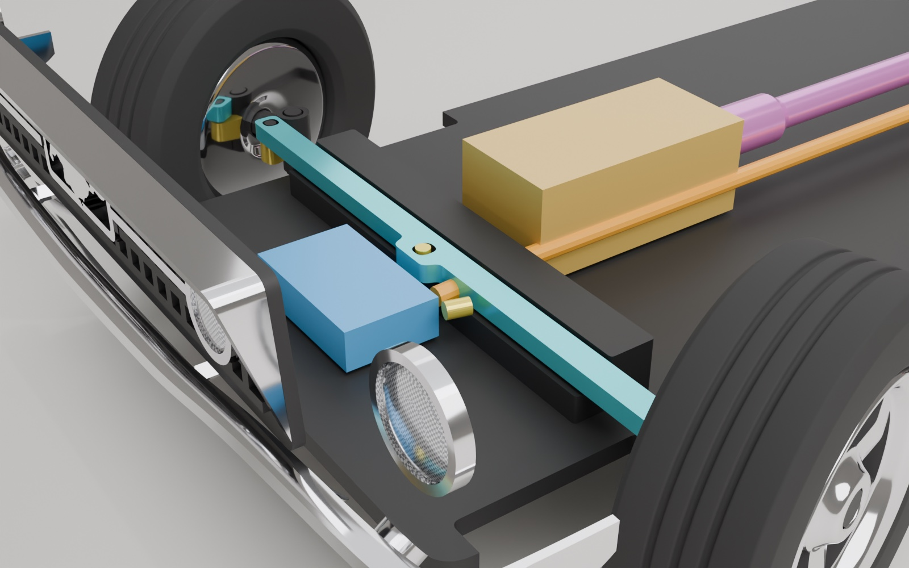
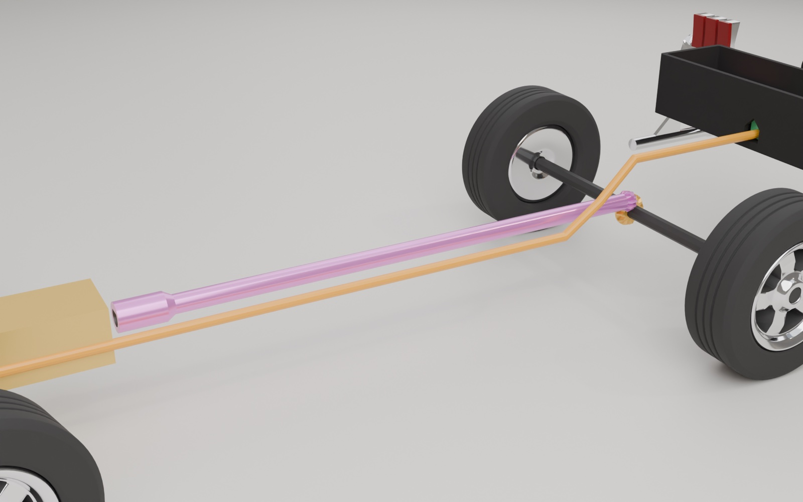
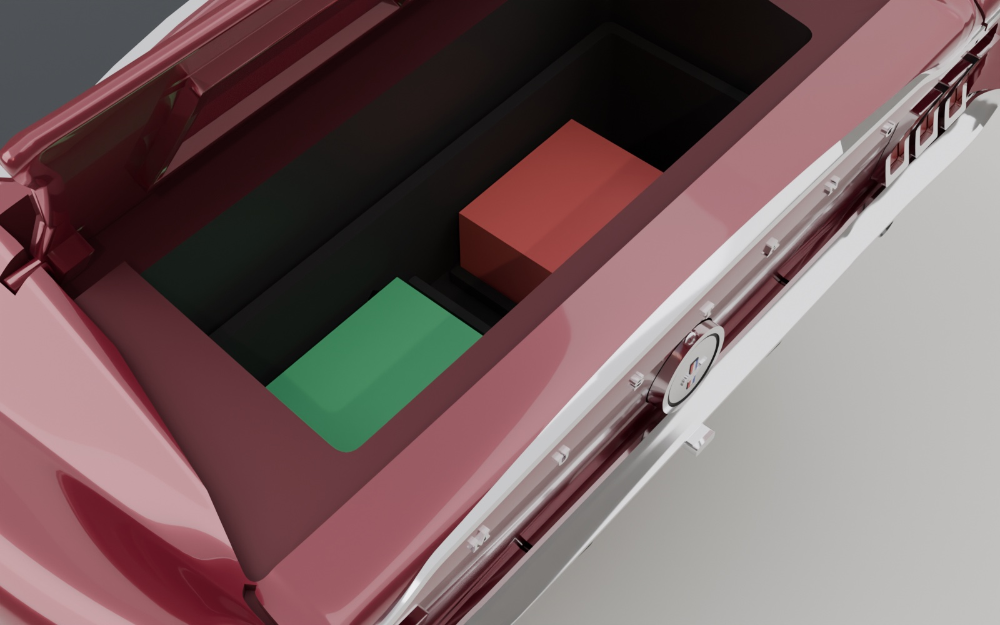
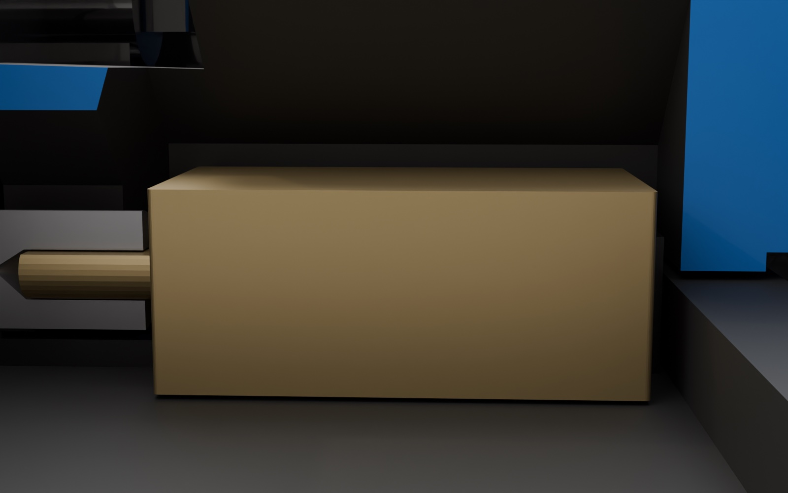
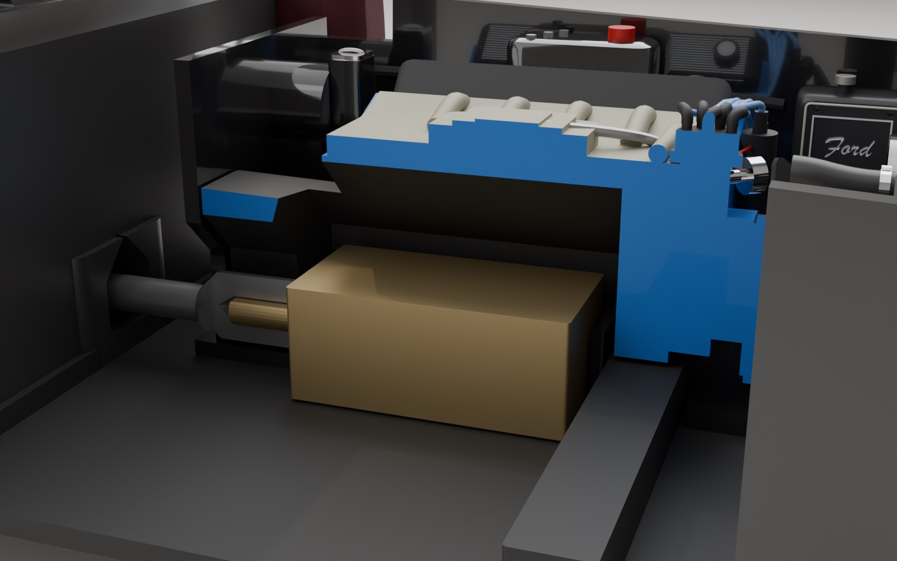

# Engineering Design Thinking & Build Verification Dossier (`1:20 e-Mustang`)

> ** Quick Links**: [Back to Main README](../README.md) | [Printing, CAD & RC Wiring Guide](printing-and-rc-guide.md) | [Reference Photo & Camera Index](reference-media.md) | [Changelog (`v1.0.0` → `v2.7.0`)](../CHANGELOG.md)

This dossier documents the engineering design thinking, root-cause diagnostics, mechanical trade-offs, and quantitative verification proofs behind the **1:20 scale (`SCALE = 1/20`) procedural 1967 Ford Mustang Fastback (`e-Mustang`)**.

---

## 1. Why Scale from `1:24` to `1:20` (`K = 1.2`) & Photo-vs-Code Alignment

An initial audit of the `1:24` baseline against the 83 dealer reference photos (`origin_images/`, Vanguard Motor Sales `Stock #2229`) and a `0.4 mm` FDM nozzle (`0.12 mm` layer height) surfaced four structural bottlenecks:

1. **Sub-Nozzle Feature Fragility at `1:24`**: Thin rails (such as `0.50 mm` taillight bezel walls, `0.80 mm` vent window frames, and `1.08 mm` hood hinge pegs) sat at the single-extrusion limit. Scaling up by **`K = 1.20` (`SCALE = 1/20`, `226 × 91 × 66 mm`)** increases linear wall thickness by `+20%` and internal packaging volume by **`+72.8%`** while still fitting comfortably on a single `256 × 256 mm` Bambu build plate.
2. **Solid Rear Body Block (`X = 3415..4520`)**: Behind the rear seat (`CAB_X1 = 3415.0`), the rear `46 mm` of the `1:24` body was solid plastic with only a cosmetic `0.35 mm` decklid scribe line. We extended the cabin hollow under the fastback backlight to form the authentic **fold-down rear sport deck (`Tub_CargoShelf`)** with 5 chrome runner strips, carved out the rear trunk cavity (`Cut_Boot`), added the partitioned **`BootTub`** liner, and separated the hinged **`TrunkLid`** (`-40°` opening around `X = 3985.0, Z = 1094.0`).
3. **9 Geometric Photo-Alignment Upgrades**:
   - **V-Prow Nose Rake & Deep `7"` Headlight Buckets (`body.py`, `details.py`, `materials.py`)**: Added `v_prow` and `fender_setback` in `body.rake(x, z, y)` and carved `5.4 mm` deep body-coloured fender headlight buckets (`headlight_bucket_cutter`) with wrapped `GrilleSurround_Skin` and fluted `SealedBeam` lenses.
   - **Full-Chrome Side Window Perimeter (`details.py`, `doors.py`, `materials.py`)**: Mapped `Cut_WindowOpen` to `Chrome`, added `DoorBeltTrim_L/R` along the door sills, and extended `drip_rail` around the rear quarter window pillar and sill.
   - **Rear Quarter Tuck, `11`-Slot Louvers & `1.35 mm` Side Scoops (`body.py`, `details.py`)**: Softened `QUARTER_TUCK_SLOPE` to `0.72` (`QUARTER_TUCK = 3760.0`), upgraded C-pillar sail panels from `9` to `11` slots, deepened door side coves to `1.35 mm`, and added recessed hood turn-signal indicator scallops.
   - **Crowned 5-Spoke Torq-Thrust Rims, Counterbore Hubs & `12`-Spline Bead-Lock Tires (`wheels.py`)**: Sculpted arched 3D American Racing Torq-Thrust spokes with filleted windows inside deep-dish chrome lips, thickened the rear hub boss (`Ø 7.56 mm`) with a `2.621 mm³` (`29.1×`) 8-corner press-fit bore and `45°` internal axial stop shoulder, and interlocked `Tire_*` onto `Rim_*` via a mid-barrel bead-lock crown + 12 longitudinal anti-slip splines (`17.505 mm³` torque lock).
   - **Authentic 1967 Twin-Cowl Cabin, Waterfall Console, T-Shifter & 3-Spoke Perforated Wheel (`interior.py`, `materials.py`)**: Replaced the segmented boxy dash blocks and flat console brick with a continuous 33-station lofted twin-cowl visor (`Tub_DashBrow`), 5-pod deep-set instrument cluster (`Tub_Gauge0..4`), full-length brushed-aluminum waterfall radio/tambour console (`Tub_Console`), forward-swept automatic T-handle shifter (`Tub_ShifterKnob`), and 3-spoke perforated brushed-chrome steering wheel (`SteeringWheel`, photos `(7)`, `(63)`).

| Side Window Chrome Surround Close-Up | All Closures Open (`Hood`, `Doors`, `TrunkLid`) |
| :---: | :---: |
|  |  |
| **1967 Twin-Cowl Dash, Waterfall Console & T-Shifter (`Photo 7` vs. Model)** | **Cabin Interior Cutaway Close-Up (`InteriorTub` + `SteeringWheel`)** |
|  |  |

---

## 2. Architecture #1 — Full `1:20` RC Dynamic Control System

| Full RC System X-Ray Cutaway | Front Wheel `+15°` Steered Stance |
| :---: | :---: |
|  |  |

| Left/Right Kingpin Steering Close-Up (`±15°`) | Forward/Backward 4-Stage Bevel Drivetrain | Open Trunk `BootTub` (`Rx/ESC` + `LiPo`) |
| :---: | :---: | :---: |
|  |  |  |

### End-to-End Motion & Power Chain (`1:20` Print Millimetres)

| Motion Axis | Stage | Driving Component | Driven Component | Mechanical Interface & Print Dimensions (`1:20`) | Static Overlap (`mm³`) | Positive Interlock / Sweep Proof |
| :--- | :--- | :--- | :--- | :--- | :--- | :--- |
| **Power & Radio** | **Stage 0: Rear Trunk Bay (`BootTub`)** | `1S/2S LiPo Battery` (`Right Bay`, `Y = +0.50..+21.50 mm`) + `2.4GHz Rx + 5A Brushed ESC` (`Left Bay`, `Y = -21.50..-2.00 mm`) | `5`-Wire Harness (`2` motor + `3` servo leads) inside `4.00 × 5.05 mm` conduit (`Y = -7.70..-3.70 mm`) | Partitioned `BootTub` (`boot_tub.stl`, `3,050.7 mm³`) divided by `BootTub_Divider` + `BootTub_BatRail0/1` feeds the 5-wire bundle through `BootTub_WireEntry` → `Cut_WireTunnel` → `Tub_WireTunnel` → `Cut_FirewallWireWeb` → `BayTub_WireTunnel` | `0.000 mm³` | `4.00 × 5.05 mm` continuous conduit clears `Driveshaft` by a `1.20 mm` solid partition wall |
| **Forward / Reverse** | **Stage 1: Motor Cradle (`BayTub` + `EngineBlock`)** | `N25 Brushed Gearmotor` (`10 × 12 × 24 mm` body, reversible PWM from `5A ESC`) | `BayTub_N25*` Cradle (`X = 43.80..70.20 mm`) + `Engine_N25Cavity` (`Y = ±8.10 mm`) | Snap-fit `12.60 × 24.80 mm` motor pocket on `BayTub` floor beneath the hollowed V8 `EngineBlock`; `BayTub_N25WireFront/Rear` route the 2 motor leads into the driver-side wire chute | `0.000 mm³` | Rectangular gearbox housing captured by `7.00 mm` tall `BayTub_N25WallL/R` against counter-rotation |
| **Forward / Reverse** | **Stage 2: D-Shaft Coupler (`Driveshaft`)** | `N25` `Ø3.00 mm` Output D-Shaft (`2.50 mm` across flat) | `Driveshaft` Front Sleeve (`Driveshaft_DBore`, `Ø5.20 mm` OD, `3.20 mm` D-bore) | Matching flat top wall locks rotation between the N25 D-shaft and the `105.50 mm` prop shaft inside `Tub_ShaftTunnel` | `0.000 mm³` | **`1.278 mm³`** rotational D-flat interference at `45°` |
| **Forward / Reverse** | **Stage 3: 90° Bevel Gear Mesh (`AxleGear`)** | `Driveshaft` Rear `10-Tooth` Bevel Pinion (`X = 172.65..174.85 mm, r_tip = 2.60 mm`) | `AxleGear` `12-Tooth` Crown Bevel Gear (`X = 176.75 mm, r_tip = 3.40 mm`, `32.16 mm³`) | `90°` conical bevel gear mesh (`1.20 : 1` reduction) housed inside `Chassis_Diff` (`Cut_ChassisAxlePinion` + `Cut_ChassisAxleGear`) | `0.014 mm³` | **`0.019–0.066 mm³`** tooth flank engagement per half-pitch rotation |
| **Forward / Reverse** | **Stage 4: Heavy-Duty Live Rear Axle (`Axle_R`) & `12`-Spline Wheels** | `AxleGear` Octagonal Spline Bore (`3.32 mm` across flats + extended hub collar) | `Axle_R` (`3.24 mm` flats / `3.507 mm` corners, `8.70 mm²` area, `+90.1%` stiffness) → `Rim_RL/RR` + `Tire_RL/RR` | `Axle_R` runs inside close-clearance `Ø3.684 mm` `Chassis_BossR` bearings (`0.088 mm` radial gap, `61.20 mm` span) and locks into `Rim_RL/RR` (`Ø3.276 mm` bore + `45°` counterbore stop) and `12`-spline bead-lock `Tire_RL/RR` | `0.000 mm³` | **`0.278 mm³`** `AxleGear` spline lock + **`2.621 mm³` (`29.1×`)** hub press-fit + **`17.505 mm³`** `12`-spline tire torque lock |
| **Left / Right Steer** | **Stage 1: Front Micro Servo (`BayTub_Servo*`)** | `1.7g` Micro Digital Servo (`13.5 × 6.2 × 16.0 mm`, CH1 PWM) | Servo Horn Pin (`X = 36.40 mm, Y = 0.0 mm`) inside `SteeringLink_ServoSlot` | Seated in `BayTub_ServoBed` (`X = 24.30..36.50 mm, Y = -9.10..+9.10 mm`) behind the radiator; horn drops through `BayTub_ServoHornSlot` into `SteeringLink` | `0.000 mm³` | `±0.83 mm` lateral horn throw drives `±15°` front wheel steering |
| **Left / Right Steer** | **Stage 2: Transverse Tie-Rod (`SteeringLink`)** | `SteeringLink` (`62.40 mm` bar sliding on `Chassis_SteeringShelf`) | `Knuckle_L_Pin` & `Knuckle_R_Pin` (`Ø1.20 mm` pins at `X = 36.40 mm, \|Y\| = 29.80 mm`) | Clevis slots convert `±Y` tie-rod translation into synchronized rotation of both knuckle arms | `0.000 mm³` | **`0.214 mm³` × 2** positive pin-to-clevis lock (`+0.35 mm` Y shift) |
| **Left / Right Steer** | **Stage 3: Reinforced Kingpin Knuckles (`Knuckle_L/R`)** | `Knuckle_L/R` (`163.70 mm³`, `+44.1%` vol) pivoting on `Chassis_Kingpin_L/R` (`Ø1.90 mm` at `X = 39.60 mm, \|Y\| = 29.80 mm`) | Front Wheels `Rim_FL/FR` + `Tire_FL/FR` on `3.24 mm` octagonal stubs with inboard `Knuckle_HubCollar` | `Ø2.05 mm` bore inside `Ø3.60 mm` barrel (`0.075 mm` radial gap, `0.775 mm` wall) rotates on `Ø1.90 mm` kingpin post; `Rim_FL/FR` lock onto `3.24 mm` stub against `Knuckle_HubCollar` (`r = 2.40 mm`) | `0.000 mm³` (`-15°..+15°`) | **`1.069 mm³`** kingpin radial retention + **`2.621 mm³` (`29.1×`)** front hub press-fit + **`3.344 mm³`** axial stop |

---

## 3. 289 V8 Engine Stand Stability & N25 Clearance Proof

| N25 Motor Macro Clearance Under V8 Shroud | Engine Bay Wide Cutaway | Rear 90° Bevel Gear Mesh Close-Up |
| :---: | :---: | :---: |
|  |  |  |

In the original static V8 design, the engine rested on a single pair of narrow stands (`3.50 mm` fore-aft span, `26.25 mm²` floor contact), placing the V8's center of mass (`CoM X = 50.42 mm`) behind the rear support edge so the block tipped backward when hollowed out for the N25 motor. We re-engineered the V8 underside with **3 pairs of gusseted stands (`Engine_MountF`, `Engine_MountR`, `Engine_BellhousingMount`)**, **continuous bottom cradle rails (`Engine_CradleRail`, `Engine_BellhousingRail`)**, and **interlocking bay guides (`BayTub_EngineGuideL/R`)**:

| Stability Metric / Feature | Previous Design (`1` Stand Pair) | Upgraded Design (`3` Gusseted Stand Pairs + Cradle Rails) | Engineering Improvement |
| :--- | :--- | :--- | :--- |
| **Floor Support Fore–Aft Span (`X`)** | `3.50 mm` (`X = 46.00..49.50 mm`) | **`35.70 mm`** (`X = 43.30..79.00 mm`) | **`10.2×` longer longitudinal base** from front cylinder bank to rear bellhousing |
| **Center of Mass (`CoM`) Pitch Stability** | `CoM X = 50.42 mm` (**outside** support base; tips backward) | **`CoM X = 52.38 mm`**, `Y = 0.26 mm`, `Z = 28.99 mm` (**centered** inside `[43.30, 79.00] mm`) | **Zero pitching moment** (`+9.08 mm` front margin, `+26.62 mm` rear margin) |
| **Floor Contact Surface Area (`Z = 16.50 mm`)** | `26.25 mm²` (`8` vertices) | **`356.35 mm²`** (`Y = -15.40..+15.40 mm`) | **`13.6×` larger flat bed contact area** |
| **Positive Lock on `BayTub`** | Flat pads on flat floor (`0` lateral/fore-aft guides) | `BayTub_EngineGuideL/R` + inner `BayTub_N25WallL/R` | **4-way mechanical capture**: `53.203 mm³` lateral lock & `97.731 mm³` fore-aft lock |

---

## 4. Approach A: Partitioned Motor-to-Battery Floor Wire Conduit

To prevent the 5-wire RC harness (2 motor power leads + 3 steering servo leads) from rubbing against the high-RPM `Driveshaft`, the floor pan implements **Approach A** — a continuous, enclosed driver-side conduit (`Y = -7.70..-3.70 mm` print, `4.00 × 5.05 mm` clear interior cross-section) physically isolated from the central driveshaft tunnel (`Y = -2.50..+2.50 mm`) by a solid **`1.20 mm` partition wall**:

| Zone (`X` in `1:20` Print mm / Real mm) | Part & Boolean Feature | Conduit Cross-Section (`W × H` Print mm) | Mechanical Isolation & Routing Geometry | 3D Wire Gauge Overlap |
| :--- | :--- | :--- | :--- | :--- |
| **Zone 1: Front Servo & N25 Solder Relief (`X = 24.30..44.25 mm`)** | `BayTub` (`BayTub_N25WireFront/Rear`) + `Engine_N25Cavity` | `10.85 × 5.25 mm` | Relieves upper wall ahead of N25 solder tabs and feeds servo + motor leads into the driver-side chute | **`0.000 mm³`** |
| **Zone 2: Engine Bay Partitioned Chute (`X = 44.25..82.75 mm`)** | `BayTub` (`BayTub_WirePartition`, `BayTub_WireOuterWall`, `BayTub_WireTunnel`) | **`4.00 × 5.05 mm`** (`45°` self-supporting gable roof) | Solid vertical partition wall isolates the wire chute from the `Ø5.20 mm` `Driveshaft` D-coupler | **`0.000 mm³`** |
| **Zone 3: Firewall Bulkhead Web (`X = 80.00..84.00 mm`)** | `Body` (`Cut_FirewallWireWeb`, `Cut_DiffShaftWeb`) | **`4.00 × 5.05 mm`** | Dedicated driver-side bore through the body firewall web separated by a solid pillar from `Cut_DiffShaftWeb` | **`0.000 mm³`** |
| **Zone 4: Cabin Floor & Sport-Deck Ramp (`X = 80.75..171.25 mm`)** | `InteriorTub` (`Tub_Tunnel`, `Tub_WireTunnel`, `Tub_ShaftTunnel`) | **`4.00 × 5.05 mm`** | `1.20 mm` solid vertical partition wall along the entire cabin floor, ramping smoothly up `Tub_CargoShelf` | **`0.000 mm³`** |
| **Zone 5: Rear Bulkhead & `BootTub` Entry (`X = 170.00..202.50 mm`)** | `Body` (`Cut_WireTunnel`) + `BootTub` (`BootTub_WireEntry`) | **`4.00 × 5.05 mm`** | Passes `5.90 mm` above the rear differential tunnel and opens flush into the left Receiver/ESC bay of `BootTub` | **`0.000 mm³`** |

---

## 5. Mechanical `DoorVent` & `DoorCard` Interlocks (`mustang/doors.py`)

Rather than relying on flat butt-gluing for the inner door cards and chrome quarter-vent windows, `mustang/doors.py` builds self-locating mechanical interlocks into all three parts:

| Sub-Assembly | Root Cause in Naive Geometry | Mechanical Interlock Engineered in `mustang/doors.py` | Static Overlap (`mm³`) | Displacement Interlock Proof |
| :--- | :--- | :--- | :--- | :--- |
| **`DoorVent_L/R` ↔ `Door_L/R` + `DoorCard_L/R`** | Vent window foot sat flush on the sill with zero tenon, allowing it to tip inboard or outboard during assembly. | Extended a `7.09 × 1.25 × 1.20 mm` (`TENON_DEPTH = 24.0` real mm) bottom mounting tenon captured inside a shared U-channel mortise (`Door_VentSlot` + `DoorCard_VentSlot`) between the outer door sill wall and inner `DoorCardTrim` lip. | **`0.000 mm³`** | Outboard `-Y` (`0.55 mm`): **`0.034 mm³`** Inboard `+Y` (`0.55 mm`): **`0.458 mm³`** |
| **`DoorCard_L/R` ↔ `Door_L/R`** | Flat butt plane at `\|Y\| = 34.80 mm` (`696.0` real mm) had zero shear or pull-out registration. | Cut a `3×2` grid of **6 `45°`-chamfered mortise bays (`Door_CardBay0..5`)** into the door's inner face and added **6 mating chamfered tenon pads (`DoorCard_Pad0..5`)** on the back of `DoorCard`, all coplanar on `Z_print = 0`. | **`0.000 mm³`** | Outboard `-Y` (`0.25 mm`): **`166.719 mm³`** Fore/Aft `±X` (`0.45 mm`): **`5.900 mm³`** Vertical `±Z` (`0.45 mm`): **`8.621 mm³`** |

---

## 6. Print-Readiness, CAD Solid & Kinematic Verification Matrix

Every build is verified programmatically in Blender (`printcheck.run()`, `export.run()`, kinematic sweep scripts) and OpenCascade (`make_step.py`):

| Verification Gate | Target Requirement | Measured Result (`v2.5.0` Build) | Status |
| :--- | :--- | :--- | :--- |
| **Scene Part Count (`printcheck.run()`)** | `65` mesh objects across `Body`, `Wheels`, `Parts` (`+1` `HoodProp` in `Accessories`) | `65` scene parts (`47` STL files making `66` printed pieces incl. `2` glass inlays) | **PASS** |
| **Mesh Manifold & Shell Integrity (`problems`)** | `{}` (`0` non-manifold edges/verts, `0` boundary edges, `body.shells == 1`) | `{}` across all `65` scene objects (`Body`: `1` shell, `210,092.9 mm³`) | **PASS** |
| **Body Clearance (`overlaps_with_body`)** | `{}` (`<= 0.001 mm³` with `Body`) | `{}` (`0.000 mm³` across all `64` parts) | **PASS** |
| **L/R Mirror Symmetry (`mirror_mismatches`)** | `{}` (`<= 0.05 mm` bounding-box delta) | `{}` across all left/right pairs (incl. `Knuckle_L` ↔ `Knuckle_R`) | **PASS** |
| **Inter-Part Clearance (`part_overlaps`)** | `{}` (`<= 0.02 mm³` excluding `Axle\|Rim` & `Knuckle\|Rim` press-fits) | `{}` across all part pairs | **PASS** |
| **Kinematic Closure & Steering Sweeps** | `0.000 mm³` across `Hood` (`0°..42°`), `TrunkLid` (`0°..-40°`), `Doors` (`0°..55°`), & `Knuckles` (`-15°..+15°`) | **`0.000 mm³`** (`{}`) across all opening and steering angles | **PASS** |
| **RC Electronics Envelope Clearance** | `0.000 mm³` collision for `1.7g Servo`, `N25 Motor`, `2.4GHz Rx + 5A ESC`, `1S/2S LiPo`, & `5-Wire Gauge` | **`0.000 mm³`** against all surrounding printed parts | **PASS** |
| **Exported STL Manifold Check (`export.run()`)** | `0` non-manifold edges across all `47` STLs | **`0` non-manifold edges** on all `47` STLs in `output/stl/` | **PASS** |
| **Shapr3D STEP Solid Export (`make_step.py`)** | `65` named, coloured B-Rep solids in `output/step/*.step` + `output/mustang_67_fastback.step` | All `65` parts closed (`closed: true`) and exported with exact Blender object names and sRGB colours | **PASS** |

---

## 7. 4-Act 3D Assembly & Dynamic RC Simulation Choreography (`192 Frames @ 24 fps`)

* **Full-Resolution 4-Act RC Simulation MP4 (`1280×720`)**: [`docs/images/rc_simulation.mp4`](images/rc_simulation.mp4)
* **Full-Resolution 360° Inside-Out Showcase MP4 (`1280×720`)**: [`docs/images/showcase_360.mp4`](images/showcase_360.mp4)

| Act | Frame Range (`Time @ 24 fps`) | Simulation Stage | Animated Subsystems & Kinematic Coupling |
| :--- | :--- | :--- | :--- |
| **Act 1 (Wave 1)** | `Frames 1–14` (`0.0s–0.6s`) | **Chassis Foundation, Steering Linkage & Live Rear Axle** | Bare `SC_Chassis` rests on the studio floor; `SC_Knuckle_L/R` drop onto `Chassis_Kingpin_L/R`, `SC_SteeringLink` slides onto the knuckle pins, and `SC_AxleGear` + `SC_Axle_R` + `SC_DiffCover` + `SC_Exhaust_L/R` seat into the rear differential housing. |
| **Act 1 (Wave 2)** | `Frames 11–24` (`0.5s–1.0s`) | **5-Spoke Torq-Thrust Rims & Tires Press-Fit** | `SC_Rim_FL/FR/RL/RR` followed by `SC_Tire_FL/FR/RL/RR` press-fit onto `Knuckle_L/R`'s front octagonal hubs and `Axle_R`'s rear ends. |
| **Act 1 (Wave 3)** | `Frames 22–36` (`0.9s–1.5s`) | **Front `BayTub`, Rear `BootTub`, `Driveshaft` & RC Electronics** | `SC_BayTub` and `SC_BootTub` seat onto the chassis, followed by `RC_MicroServo` + `RC_ServoHorn`, `RC_N25Motor`, `SC_Driveshaft`, `RC_WireHarness` (inside the driver-side `4.0 × 5.05 mm` conduit), `RC_ReceiverESC`, and `RC_LiPoBattery`. |
| **Act 1 (Wave 4)** | `Frames 34–48` (`1.4s–2.0s`) | **Hollowed 289 V8 Engine Shroud & Cabin Interior Tub** | Hollowed `SC_EngineBlock` drops over `RC_N25Motor` onto `BayTub_EngineGuideL/R`, `SC_ValveCover_L/R`, `SC_AirCleaner`, and `SC_Brace` lock onto the V8, and `SC_InteriorTub` + `SC_SteeringWheel` drop over the twin center tunnels. |
| **Act 1 (Wave 5)** | `Frames 46–60` (`1.9s–2.5s`) | **Fastback Body Shell, Glass, Grille, Lights & Bumpers** | `SC_Body`, `SC_Glass_Windshield`, and `SC_Glass_Rear` descend from above while front and rear lamps, grille, corral, bumpers, and gas cap fly in along `±X`. |
| **Act 1 (Wave 6)** | `Frames 54–72` (`2.3s–3.0s`) | **Hinged Closures (`Doors` + `Cards` + `Vents`, `Hood`, `TrunkLid`)** | `SC_DoorCard_L/R`, `SC_DoorVent_L/R`, and `SC_Mirror_L` interlock into `SC_Door_L/R`; doors (`45° → 0°`), hood (`38° → 0°`), and trunk lid (`-40° → 0°`) swing closed. |
| **Act 2** | `Frames 73–116` (`3.0s–4.8s`) | **360° Turntable Orbit & Open/Close Bay Inspection** | Camera orbits `360°` while `SC_Hood` (`42°`), `SC_Door_L/R` (`55°`), and `SC_TrunkLid` (`-40°`) open (`Frames 78–104`) to reveal the V8 bay, cabin sport deck, and rear boot electronics bay, then close flush. |
| **Act 3** | `Frames 117–144` (`4.8s–6.0s`) | **Front Wheel Left / Right RC Steering Sweep (`+15° / -15°`)** | `RC_ServoHorn` pivots `±27°` → `SC_SteeringLink` translates `±0.83 mm` in `Y` → `SC_Knuckle_L/R` steer **Full Left (`+15°`, Frame 124)**, **Full Right (`-15°`, Frame 134)**, and return to `0°`. |
| **Act 4A** | `Frames 145–171` (`6.0s–7.1s`) | **Dynamic Forward Drive & Steered Left-Right S-Turn Cornering** | Car accelerates forward (`ΔX = -156.72 mm`), steering Left (`+15°`) into Corner 1 (`ΔY = -17.74 mm`) and counter-steering Right (`-15°`) into Corner 2 while all 4 wheels roll (`9.84 rad`) and `SC_Driveshaft` spins at `1.20×` (`11.81 rad`). |
| **Act 4B** | `Frames 172–192` (`7.1s–8.0s`) | **Reverse Backing Up (`N25` Polarity Reversed)** | Car stops at Frame 171, applies reverse steering (`-8° → +6° → 0°`), and backs up `89.08 mm` with all 4 wheels and `SC_Driveshaft` rotating in reverse (`-5.55 rad`). |
