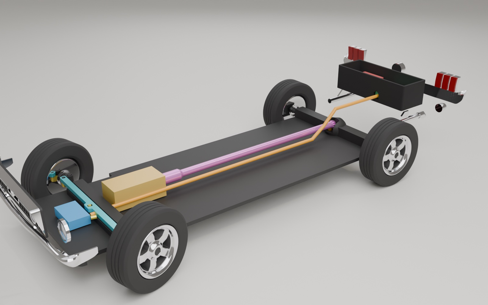
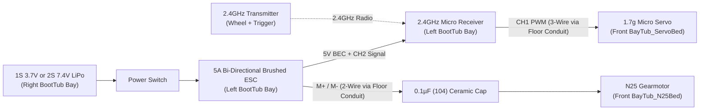

# 3D Printing, Assembly, CAD (Shapr3D) & RC Electronics Guide

> **Quick Links**: [Back to Main README](../README.md) | [Engineering Design Thinking & Verification](design-thinking-and-verification.md) | [Reference Photo & Camera Index](reference-media.md) | [Changelog](../CHANGELOG.md)

---

## 1. Bambu Studio Print Profile & 5-Colour Filament Palette

[`mustang/make_project.sh`](../mustang/make_project.sh) generates the multi-plate Bambu Studio project (`output/mustang_67_fastback_1-24.3mf`) with pre-configured object orientations, Arachne wall generation, and support overrides:

* **Target Printer & Nozzle**: Bambu Lab X2D (`256 × 256 × 256 mm` bed), `0.4 mm` nozzle.
* **Layer Profile**: `0.12mm High Quality`, Bambu PLA Basic, `wall_generator: arachne`, `reduce_crossing_wall: 1`, and `initial_layer_speed: 25 mm/s` across the project so fine chrome trim, louvers, and gear teeth adhere reliably and avoid travel collisions.
* **Small-Part Outer-Only Brims & Gentle Wall Speeds**: [`mustang/merge_3mf.py`](../mustang/merge_3mf.py) applies `brim_type: outer_only` (`3–5 mm` width, `0.08–0.10 mm` peel gap) and gentle `25–30 mm/s` outer-wall / `20 mm/s` small-perimeter speeds to all `28` miniature and slender STLs, and isolates the `25` miniature chrome pieces, flat-printed bevel gears, and multi-fit motor couplers onto a dedicated low-height plate (`3_silver_small`, `10.04 mm` max Z).
* **Tree Supports (`tree(auto)`, build plate only)**: Enabled automatically on `body.stl`, `hood.stl`, `trunk_lid.stl`, `engine_block.stl`, and `bumper_rear.stl` via [`mustang/merge_3mf.py`](../mustang/merge_3mf.py). All other `48` STLs print support-free (with `driveshaft.stl` oriented horizontally flat on `Z = 0` at `3.62 mm` height, and `pinion_gear.stl` / `axle_gear.stl` printed flat in the `XY` plane).

### Complete 53-STL / 73-Piece Colour & 9-Plate Breakdown

| Plate Group | PLA Colour | Hex | STL Files Included (`output/stl/`) | Pieces |
| :--- | :--- | :---: | :--- | :---: |
| **`1_body` (Plate 1)** | **Burgundy** (+ **Black** Inlays) | `#6B0F1A` / `#1A1A1A` | `body.stl` + multi-colour inlays `windshield.stl` & `rear_glass.stl` | `3` |
| **`1_hood` (Plate 2)** | **Burgundy** | `#6B0F1A` | `hood.stl`, `trunk_lid.stl` | `2` |
| **`1_doors` (Plate 3)** | **Burgundy** | `#6B0F1A` | `door_l.stl`, `door_r.stl` | `2` |
| **`2_black` (Plate 4)** | **Black** | `#1A1A1A` | `chassis.stl`, `tire_x4.stl`, `grille.stl`, `diff_cover.stl`, `axle.stl`, `knuckle_r.stl`, `knuckle_l.stl`, `steering_link.stl`, `interior_tub.stl`, `steering_wheel.stl`, `door_card_r.stl`, `door_card_l.stl`, `bay_tub.stl`, `valve_cover_r.stl`, `valve_cover_l.stl`, `air_cleaner.stl`, `brace.stl`, `hood_prop.stl`, `boot_tub.stl`, `motor_shim_x2.stl` | `24` |
| **`3_silver` (Plate 5)** | **Silver / Chrome** | `#C8C8CC` | `rim_x4.stl`, `bumper_front.stl`, `grille_surround.stl`, `exhaust_x2.stl`, `driveshaft.stl` | `9` |
| **`3_silver_small` (Plate 6)** | **Silver / Chrome** | `#C8C8CC` | `corral_emblem.stl`, `fog_lamp_x2.stl`, `headlight_x2.stl`, `park_light_x2.stl`, `taillight_bezel_r_x3.stl`, `taillight_bezel_l_x3.stl`, `gas_cap.stl`, `backup_light_x2.stl`, `mirror.stl`, `vent_window_r.stl`, `vent_window_l.stl`, `pinion_gear.stl`, `axle_gear.stl`, `motor_coupler_1p0.stl`, `motor_coupler_1p5.stl`, `motor_coupler_tube.stl`, `motor_coupler_n25.stl` | `25` |
| **`3_bumper` (Plate 7)** | **Silver / Chrome** | `#C8C8CC` | `bumper_rear.stl` | `1` |
| **`4_red` (Plate 8)** | **Red** | `#B01010` | `taillight_lens_r_x3.stl`, `taillight_lens_l_x3.stl` | `6` |
| **`5_blue` (Plate 9)** | **Ford Engine Blue** | `#2B59C3` | `engine_block.stl` (hollowed underside motor shroud with 6-point mounts) | `1` |
| **Total** | **5 PLA Colours (`9` Plates)** | — | **53 STL Files (`51` parts + `2` glass inlays)** | **73** |

---

## 2. Step-by-Step Physical & RC Assembly



1. **Step 1 — Front Kingpin Steering & Rear Bevel Live Axle (`Chassis`)**:
   - Press the 4 tires (`tire_x4.stl`) over the 4 chrome 5-spoke rims (`rim_x4.stl`) from the inboard side so each rim's flared outer lip seats flush in the tire bead pocket.
   - Drop `Knuckle_L` and `Knuckle_R` onto the vertical front kingpin posts (`Chassis_Kingpin_L/R`) and snap `SteeringLink` onto both knuckle steering pins across `Chassis_SteeringShelf`.
   - Hold `AxleGear` (`9`-tooth flat-printed crown bevel gear) inside the rear differential cavity (`Cut_ChassisAxleGear`), slide the octagonal `Axle_R` shaft through the rear chassis bosses and through `AxleGear`'s octagonal bore, press `PinionGear` (`7`-tooth flat-printed bevel pinion) onto the rear octagonal spline tenon of `Driveshaft` (`driveshaft.stl`), snap `DiffCover` underneath, and press the 4 wheel assemblies onto the front knuckle stubs and rear axle ends.
2. **Step 2 — Front `BayTub`, Rear `BootTub`, Multi-Fit Motor Coupler & RC Electronics**:
   - Seat `BayTub` (front engine liner) and `BootTub` (rear trunk liner) onto the chassis.
   - **Front Steering Servo**: Seat a `1.7g` micro servo (`13.5 × 6.2 × 16.0 mm`) into `BayTub_ServoBed` behind the radiator so its horn pin drops through `BayTub_ServoHornSlot` directly into the center slot (`SteeringLink_ServoSlot`) of `SteeringLink`.
   - **Multi-Fit Motor Coupler & Z-Shims (`BayTub_N25Bed`, `21.25 × 11.25 mm`)**: Select the coupler matching your motor shaft using the external V-notches (`1` flute = `motor_coupler_1p0.stl` for `Ø 1.0 mm` smooth pin; `2` flutes = `motor_coupler_1p5.stl` for `Ø 1.5 mm` smooth pin; `3` flutes = `motor_coupler_tube.stl` for a `2.0–2.4 mm` OD silicone sleeve collet; `0` flutes = `motor_coupler_n25.stl` for a `Ø 3.0 mm` N25 D-shaft). Press the coupler onto the motor shaft (adding a tiny drop of CA glue or an `M2` set-screw through the side diamond lock port), engage the front spline tenon of `Driveshaft` so `PinionGear` (`7T`) meshes with `AxleGear` (`9T`), and seat the `21 × 11 mm` motor into `BayTub_N25Bed` over `0`, `1`, or `2` `motor_shim_x2.stl` (`0.48 mm`) shims for `10.0 mm`, `9.0 mm`, or `8.0 mm` flat motor heights.
   - **Floor Wire Conduit & Trunk Bay**: Route the 2 motor leads from either the front solder-tab window (`BayTub_N25WireFront` + `BayTub_N25WireSideL`) or rear exit (`BayTub_N25WireRear`) alongside the 3-wire servo lead through the enclosed driver-side floor wire conduit (`Y = -7.80..-3.80 mm` through the firewall, `Y = -7.70..-3.70 mm` under the cabin floor) into `BootTub`. Place the Receiver + 5A Brushed ESC into the left bay of `BootTub` and the 1S/2S LiPo battery into the right bay between `BootTub_BatRail0/1`.
3. **Step 3 — 289 V8 Engine Shroud & Cabin Interior**:
   - Glue `ValveCover_L`, `ValveCover_R`, and `AirCleaner` onto the blue `EngineBlock`. Lower `EngineBlock` over the `N25` motor; its 6 structural mounts and bottom cradle rails lock between `BayTub_EngineGuideL/R` with zero motor interference.
   - Plug `SteeringWheel` into the dashboard and slide `InteriorTub` over the dual center floor tunnels.
4. **Step 4 — Body Shell, Interlocking Doors, Hood & Trunk Lid**:
   - Peel off the single-layer `outer_only` brims from the miniature chrome trims (`3_silver_small`), taillight lenses (`4_red`), and exhaust pipes (`exhaust_x2.stl`), then install the grille, 7-layer stepped grille surround, corral emblem, headlights, fog lights, park lights, taillights, backup lights, gas cap, and front/rear bumpers onto `Body`.
   - **Door Mechanical Interlocks**: Seat the bottom tenon of `DoorVent_L/R` into `Door_VentSlot` and press the contoured `45°` rear boss and upper mirror-tongue keyway (`DoorCard_MirrorKey`) on the back of `DoorCard_L/R` into the matching mortise bay (`Door_CardBay`) on the inner face of `Door_L/R`. This locks both the door card and the chrome vent window into the door.
   - Hinge `Door_L` and `Door_R` on short lengths of `1.75 mm` filament, seat the `Body` onto the chassis bosses, drop the `Hood` and `TrunkLid` hinge pegs into their body slots, and clip `Brace` across the shock towers.

---

## 3. RC Remote Controller Options & Electrical Wiring Diagrams

### Option A: Proportional Hobby RC (`2.4GHz Receiver + 5A Micro Brushed ESC + 1.7g Servo`)
Best for smooth variable-speed throttle, crawling, and proportional left/right front steering.



### Option B: Ultra-Simple 4-Wire Keyfob Controller (`433MHz RF Mini H-Bridge`)
Best for push-button **Forward / Stop / Reverse** operation of the `N25` motor with zero programming and no separate ESC:

```text
  [433MHz Keyfob Remote]
     ( ▲ ) Forward
     ( ■ ) Stop
     ( ▼ ) Reverse
       │
       ⋮  433.92 MHz RF Signal
       ▼
  ┌────┴───────────────────────────────────┐
  │  ANT (17.3 cm helical wire, leave free)│
  │                                        │
  │   433MHz RF Mini H-Bridge Receiver     │
  │   (3.3V - 12V DC, 1.5A - 2A Peak)      │
  │                                        │
  │    VIN+      GND       M+        M-    │
  └─────┼─────────┼─────────┼─────────┼────┘
        │         │         │         │
   [SW1]│ (Switch)│         │         │
        │         │         ├────┬────┤
       (+)       (-)        │   ─┴─   │
  ┌─────┴─────────┴─────┐   │   ─┬─   │ 0.1µF (104) Ceramic Cap
  │  DC Battery Pack    │   │    │    │ (RF brush-noise filter)
  │  • 1S LiPo (3.7V)   │   │  ┌─┴─┐  │
  │  • 3x AAA  (4.5V)   │   └──┤ + ├─┐│
  │  • 4x AAA  (6.0V)   │      │N25│ ││
  └─────────────────────┘      │Mtr│ ││
                               └─┬─┘ ││
                                 └───┴┘
```

| Board Pad | Connected Component | Wire Convention | Electrical Notes |
| :--- | :--- | :--- | :--- |
| **`VIN+` / `V+`** | Battery Positive (`+`) via Switch `SW1` | Red | `3.3V – 12V DC` input (match N25 voltage rating, typically `3.7V–6V` at `100–300 RPM`) |
| **`GND` / `V-`** | Battery Negative (`-`) | Black | Common ground reference |
| **`M+` / `OUT1`** | N25 Motor Terminal 1 | Yellow / White | Swap `M+` and `M-` if Forward/Reverse direction is inverted |
| **`M-` / `OUT2`** | N25 Motor Terminal 2 | Blue / Green | Solder a `0.1µF (104)` ceramic capacitor across motor tabs to suppress brush RF noise |

---

## 4. CAD Editing in Shapr3D (`.step` Solids vs `.stl` Meshes)

Because binary `.stl` files (`output/stl_assembled/_mustang_assembled_all_parts.stl`) contain only unnamed triangle soup, importing an STL into **Shapr3D** labels every body as a generic reference *"Meshed Object"* that cannot be boolean-edited or measured.

Use [`mustang/make_step.py`](../mustang/make_step.py) to generate closed OpenCascade B-Rep **STEP solids** with exact Blender object names and sRGB print colours:

```bash
uv run mustang/make_step.py
```

| CAD Workflow in Shapr3D | File(s) to Import | Object Names & Advantages |
| :--- | :--- | :--- |
| **Fast Subsystem Editing (Recommended)** | Individual files from `output/step/*.step` (e.g. `chassis.step`, `baytub.step`, `boottub.step`, `axle_r.step`, `axlegear.step`, `piniongear.step`, `motorcoupler.step`, `driveshaft.step`) | Loads in `< 2 seconds`; parts land in their exact assembled car coordinates as editable CAD solids named `Chassis`, `BayTub`, `BootTub`, `Axle_R`, `AxleGear`, `PinionGear`, `MotorCoupler`, `Driveshaft`. |
| **Full 67-Part Car Assembly** | `output/mustang_67_fastback.step` | Single assembly containing all `67` named, coloured B-Rep solids under the root `mustang_67_fastback` tree. |
